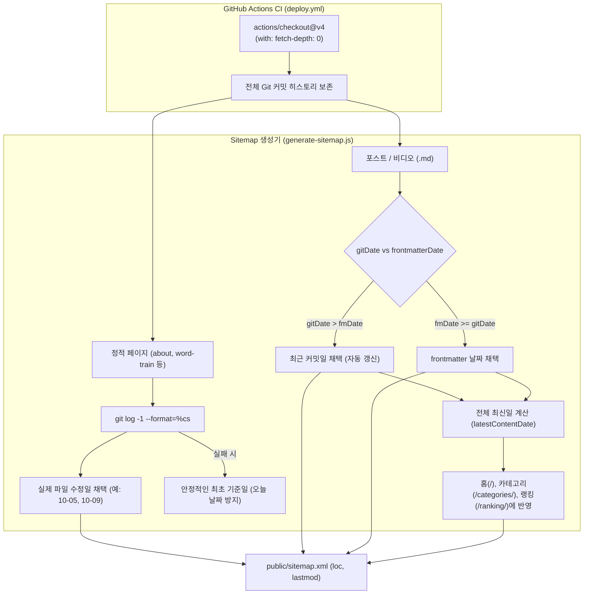

# Sitemap.xml `<lastmod>` 자동화 및 Git 히스토리 보존 아키텍처

이 문서는 `sitemap.xml`의 `<lastmod>` 날짜가 GitHub Actions 배포 시 일괄 "오늘 날짜"로 오염되던 현상을 해결한 배경, 기술적 원인, 아키텍처 설계 결정 사항 및 유지보수 규칙을 기록합니다.

---

## 1. 배경 및 문제 상황 (Background & Symptoms)

* GitHub Pages에 배포된 라이브 `sitemap.xml`을 확인했을 때, 실제 내용 변경이 없는 정적 페이지(`/about/`, `/word-train/`, `/cart/` 등)를 포함한 다수의 코어 URL의 `<lastmod>`가 배포 실행일(오늘 날짜)로 찍히는 현상이 발생했습니다.
* 반면 최근 내용 및 레이아웃을 보강한 마크다운 포스트는 frontmatter의 과거 작성일로 고정되어 재크롤링 신호가 검색엔진에 전달되지 못했습니다.

---

## 2. Googlebot 동작 원리와 영향 (Googlebot Behavior & Impact)

* **Google Search Central 공식 문서 (Build and submit a sitemap)**:
  > *"Google uses the `<lastmod>` value if it's consistently and verifiably ... accurate."*
* **실제 영향**:
  - Google은 `<lastmod>` 값이 지속적이고 검증 가능하게 정확할 때만 이를 크롤링 신호로 활용합니다.
  - 실제 콘텐츠 변경이 없음에도 배포할 때마다 날짜를 일괄 갱신하면, Googlebot은 해당 사이트맵의 `<lastmod>` 신호를 신뢰하지 않고 **사용하지 않습니다(ignored)**.
  - 결과적으로 실제 본문이 수정된 글의 변경 사항이 크롤러에 제때 감지되지 못해 재색인이 지연되거나 누락되는 원인이 됩니다.
  - 또한 Google 공식 문서에 따르면 `<priority>`와 `<changefreq>` 값은 Googlebot에 의해 완전히 무시됩니다(*"Google ignores `<priority>` and `<changefreq>` values"*). 따라서 사이트맵은 정확한 `<loc>`과 검증 가능한 `<lastmod>` 중심으로 단순하고 명확하게 유지해야 합니다.

---

## 3. 근본 원인 분석 (Root Causes)

### 원인 ① GitHub Actions의 Shallow Clone (`fetch-depth: 1`)
* `.github/workflows/deploy.yml`의 `actions/checkout@v4` 기본 동작은 최신 커밋 1개만 내려받는 **Shallow clone(fetch-depth 1)**입니다.
* GitHub Actions 러너에서 `git log -1 --format="%cs" -- "pages/about.jsx"` 실행 시, 해당 파일이 직전 커밋에 포함되지 않았으면 Git 히스토리가 비어있어 빈 문자열을 반환합니다.
* 그 결과 `files/gen/generate-sitemap.js`의 `getGitLastMod()` 함수가 fallback 값(`latestContentDate`, 즉 오늘 날짜)을 채택하여 모든 정적 페이지가 배포 당일 날짜로 오염되었습니다.

### 원인 ② 마크다운 글의 Git 커밋일 미반영
* `generate-sitemap.js`의 `getContentEntries()`는 마크다운 파일의 frontmatter(`data.updated || data.lastmod || data.date`)만 읽었습니다.
* 글 본문을 수정하고 커밋하더라도, frontmatter 날짜를 수동으로 타이핑하여 수정하지 않으면 영원히 과거 날짜로 고정되었습니다.

---

## 4. 아키텍처 해결 설계 (Architecture Solution)

### 원칙: "Git 커밋 히스토리를 사이트맵의 단일 진실 원천(Single Source of Truth)으로 삼는다"



---

## 5. 상세 구현 내역

### 1) `.github/workflows/deploy.yml`
```yaml
      # 1. 소스 체크아웃 (전체 히스토리 보존하여 정확한 git log lastmod 추출)
      - name: Checkout code
        uses: actions/checkout@v4
        with:
          fetch-depth: 0
```

### 2) `files/gen/generate-sitemap.js`
1. **포스트/비디오 동적 감지**:
   ```javascript
   const frontmatterDate = normalizeDateStr(data.updated || data.lastmod || data.date, file);
   const relFilePath = path.join(relDir, file);
   const gitDate = getGitLastMod(relFilePath, frontmatterDate);
   const lastmod = gitDate > frontmatterDate ? gitDate : frontmatterDate;
   ```
2. **정적 페이지 안전한 Fallback 지정 & 무의미한 태그 제거**:
   ```javascript
   const corePages = [
     { loc: `${siteUrl}/`, lastmod: latestContentDate },
     { loc: `${siteUrl}/categories/`, lastmod: latestContentDate },
     { loc: `${siteUrl}/ranking/`, lastmod: latestContentDate },
     { loc: `${siteUrl}/cart/`, lastmod: getGitLastMod('pages/cart/index.jsx', '2026-09-18') },
     { loc: `${siteUrl}/word-train/`, lastmod: getGitLastMod('pages/word-train.jsx', '2026-10-09') },
     { loc: `${siteUrl}/about/`, lastmod: getGitLastMod('pages/about.jsx', '2026-10-05') },
     { loc: `${siteUrl}/privacy/`, lastmod: getGitLastMod('pages/privacy.jsx', '2026-09-01') },
   ];
   ```

---

## 6. 검증 및 유지보수 수칙 (Guardrails)

1. **Shallow Clone 탐지 가드레일 (`files/gen/verify-seo.js`)**:
   - CI에서 누군가 `fetch-depth`를 지우거나 얕은 복제가 발생할 경우 빌드를 즉시 중단시킵니다:
     ```javascript
     const historyCount = Number(execSync('git rev-list --count HEAD', { stdio: ['ignore', 'pipe', 'ignore'] }).toString().trim());
     if (historyCount < 50) {
       errors.push(`[Git 히스토리 부족] 커밋 ${historyCount}개만 존재(shallow clone 의심). CI checkout 시 fetch-depth: 0 설정이 누락되어 sitemap lastmod가 오염될 수 있습니다.`);
     }
     ```
2. **Lastmod 단일 날짜 오염 방지 가드레일**:
   - 사이트맵 내 URL이 10개 이상인데 모든 `lastmod`가 단일 날짜로 통일될 경우 빌드를 차단합니다.
3. **신규 정적 페이지 추가 시**:
   - `pages/`에 새로운 정적 라우트를 추가할 경우, `generate-sitemap.js`의 `corePages` 목록에 등록하고 fallback 날짜로 오늘 날짜가 아닌 안정적인 초기 커밋 날짜를 전달합니다.
