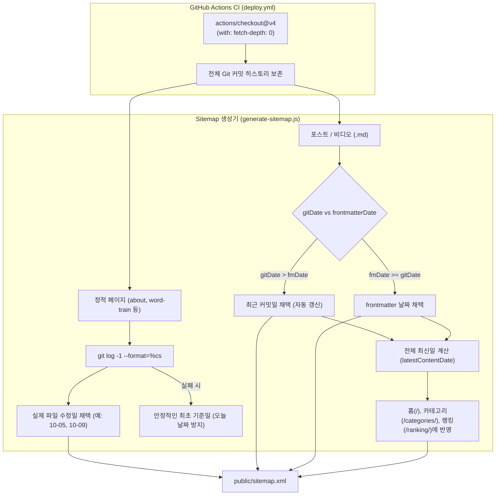

# Sitemap.xml `<lastmod>` 자동화 및 Git 히스토리 보존 아키텍처

이 문서는 `sitemap.xml`의 `<lastmod>` 날짜가 GitHub Actions 배포 시 일괄 "오늘 날짜"로 오염되던 현상을 해결한 배경, 기술적 원인, 아키텍처 설계 결정 사항 및 유지보수 규칙을 기록합니다.

---

## 1. 배경 및 문제 상황 (Background & Symptoms)

### 1) 관측된 문제 현상
* GitHub Pages에 배포된 `sitemap.xml`을 열어보았을 때, 실제 내용이 변경되지 않은 정적 페이지(`/about/`, `/word-train/`, `/cart/` 등)를 포함한 사이트맵 내 거의 모든 URL의 `<lastmod>`가 배포 실행일(오늘 날짜)로 찍히는 현상이 발생했습니다.
* 반면 최근 수정된 마크다운 포스트(예: 레이아웃 개선이 반영된 Gemini 글 등)는 frontmatter의 과거 작성일(`2026-10-14`)로 고정되어 재크롤링 신호가 검색엔진에 전달되지 않았습니다.

### 2) Googlebot의 페널티 (Untrustworthy Lastmod)
* **Google Search Central 공식 가이드라인**:
  Googlebot은 대규모 사이트를 효율적으로 크롤링하기 위해 사이트맵의 `<lastmod>` 태그를 신뢰하고 우선순위 지표로 사용합니다.
* **불신(Ignored) 페널티**:
  그러나 실제 콘텐츠 수정 없이 배포 시마다 모든 URL의 `<lastmod>`를 "오늘"로 일괄 갱신하는 사이트맵을 감지하면, Googlebot 알고리즘은 이를 **"조작되거나 신뢰할 수 없는 날짜(Untrustworthy / Spammy lastmod)"**로 분류하고 **해당 도메인의 `<lastmod>` 신호를 영구적으로 무시**합니다.
* **직결되는 피해**:
  - 실제로 내용이 대폭 보강된 글이 재색인되지 못함.
  - 불필요한 변경 없는 페이지에 크롤러가 헛걸음하면서 한정된 크롤링 예산(Crawl Budget)이 낭비되어 신규 포스트의 색인이 지연·누락됨.

---

## 3. 근본 원인 분석 (Root Causes)

### 원인 ① GitHub Actions의 Shallow Clone (`fetch-depth: 1`)
* `.github/workflows/deploy.yml`에서 소스 코드를 가져올 때 `actions/checkout@v4`를 옵션 없이 사용했습니다.
* `actions/checkout`의 기본 동작은 커밋 딱 1개만 가져오는 **Shallow clone(fetch-depth 1)**입니다.
* GitHub Actions 러너에서 `git log -1 --format="%cs" -- "pages/about.jsx"` 명령이 실행될 때, 해당 파일이 최근 커밋에서 수정되지 않았다면 git 이력이 비어있으므로 빈 문자열을 반환합니다.
* 그 결과 `files/gen/generate-sitemap.js`의 `getGitLastMod()` 함수가 fallback 값으로 넘겨받은 `latestContentDate`(오늘 날짜)를 채택하여 모든 정적 페이지가 배포 당일 날짜로 오염되었습니다.

### 원인 ② 마크다운 글의 Git 커밋일 미반영
* `generate-sitemap.js`의 `getContentEntries()`는 마크다운 파일의 frontmatter(`data.updated || data.lastmod || data.date`)만 읽었습니다.
* 개발자가 본문을 수정하고 버그를 고쳐 Git에 커밋하더라도, frontmatter의 날짜를 수동으로 타이핑하여 수정하지 않으면 영원히 과거 날짜로 고정되어 검색엔진이 변경 사항을 인지할 수 없었습니다.

---

## 4. 아키텍처 해결 설계 (Architecture Solution)

### 원칙: "Git 커밋 히스토리를 사이트맵의 단일 진실 원천(Single Source of Truth)으로 삼는다"



---

## 5. 상세 구현 내역

### 1) `.github/workflows/deploy.yml`
```yaml
      # 1. 소스 체크아웃 (전체 히스토리 보존하여 정확한 git log lastmod 추출)
      - name: Checkout code
        uses: actions/checkout@v4
        with:
          fetch-depth: 0
```

### 2) `files/gen/generate-sitemap.js`
1. **포스트/비디오 동적 감지**:
   ```javascript
   const frontmatterDate = normalizeDateStr(data.updated || data.lastmod || data.date, file);
   const relFilePath = path.join(relDir, file);
   const gitDate = getGitLastMod(relFilePath, frontmatterDate);
   const lastmod = gitDate > frontmatterDate ? gitDate : frontmatterDate;
   ```
2. **정적 페이지 안전한 Fallback 지정**:
   ```javascript
   const corePages = [
     { loc: `${siteUrl}/`, lastmod: latestContentDate, changefreq: 'daily', priority: '1.0' },
     { loc: `${siteUrl}/categories/`, lastmod: latestContentDate, changefreq: 'weekly', priority: '0.8' },
     { loc: `${siteUrl}/ranking/`, lastmod: latestContentDate, changefreq: 'daily', priority: '0.8' },
     { loc: `${siteUrl}/cart/`, lastmod: getGitLastMod('pages/cart/index.jsx', '2026-09-18'), changefreq: 'weekly', priority: '0.8' },
     { loc: `${siteUrl}/word-train/`, lastmod: getGitLastMod('pages/word-train.jsx', '2026-10-09'), changefreq: 'monthly', priority: '0.7' },
     { loc: `${siteUrl}/about/`, lastmod: getGitLastMod('pages/about.jsx', '2026-10-05'), changefreq: 'monthly', priority: '0.8' },
     { loc: `${siteUrl}/privacy/`, lastmod: getGitLastMod('pages/privacy.jsx', '2026-09-01'), changefreq: 'monthly', priority: '0.5' },
   ];
   ```

---

## 6. 검증 및 유지보수 수칙 (Guardrails)

1. **`verify-seo.js` 오염 방지 가드레일**:
   - `files/gen/verify-seo.js`에는 사이트맵 내 URL이 10개 이상인데 모든 `lastmod`가 단일 날짜로 통일될 경우 빌드를 즉시 중단시키는 가드레일이 작동합니다:
     ```javascript
     if (urlBlocks.length > 10 && lastmodSet.size === 1) {
       errors.push(`[Sitemap lastmod 전체 동일 날짜 오염] 사이트맵 내 URL의 <lastmod>가 모두 단일 날짜로 고정되어 있습니다.`);
     }
     ```
2. **신규 정적 페이지 추가 시**:
   - `pages/`에 새로운 정적 라우트를 추가할 경우, `generate-sitemap.js`의 `corePages` 목록에 등록하고 fallback 날짜로 오늘 날짜가 아닌 안정적인 초기 커밋 날짜를 전달해야 합니다.
