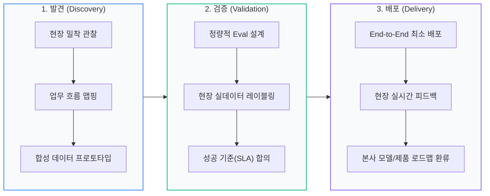

> <strong>핵심 요약</strong>: FDE(Forward Deployed Engineer)는 고객 현장에 들어가 문제를 정의하고, 프로토타입을 만들고, 프로덕션 배포까지 책임지는 소프트웨어 엔지니어입니다. 팔란티어가 2010년대 초 <strong>'Delta'</strong>라는 이름으로 시작한 역할이 AI 시대에 다시 주목받고 있습니다. Lightcast 집계에 따르면 미국 FDE 채용 공고는 2024년 약 200건에서 2025년 약 1,200건, 2026년 1–7월에만 5,200건 이상으로 늘었습니다.

## 🚀 1. 모델은 충분히 좋아졌는데, 왜 도입은 계속 어려운가

2026년의 AI 시장은 이상한 두 얼굴을 하고 있습니다. 한쪽에서는 프런티어 모델이 몇 달마다 벤치마크를 갈아치우고, 다른 한쪽에서는 기업 현장의 파일럿 프로젝트가 여전히 엑셀과 사내 승인 절차 앞에서 멈춰 섭니다.

문제는 모델의 지능이 아닙니다. <strong>모델을 고객의 실제 업무 흐름에 끼워 넣고, 권한과 데이터와 예외 처리를 맞추고, 담당자가 매일 쓸 수 있는 수준까지 끌어올리는 일</strong>이 남아 있습니다. 이 '마지막 1킬로미터'를 걷는 사람이 바로 FDE입니다.

Lightcast의 2026년 9월 분석은 이 역할을 <strong>"가장 빠르게 성장하는 AI 직업"</strong>이라고 부릅니다. 기업이 AI 기술을 <strong>개발하는</strong> 단계에서 <strong>적용하는</strong> 단계로 넘어가면서, 기술 제품과 운영 현장 사이의 간극을 메울 인력이 필요해졌다는 설명입니다.

## 🧭 2. FDE란 무엇인가: 고객 현장에 배치된 소프트웨어 엔지니어

FDE는 이름 그대로 <strong>'전방 배치된 엔지니어'</strong>입니다. 회사 본사에서 제품만 만드는 대신, 고객 조직 안으로 들어가 고객의 문제를 직접 확인하고, 자사 플랫폼과 코드로 해결책을 구현합니다.

팔란티어는 채용 공고에서 FDE를 이렇게 소개합니다.

> <strong>"The Original Forward Deployed Software Engineer"</strong>
> "팔란티어에서 FDSE는 단순한 직함이 아니라 청사진입니다. 우리가 이 독특한 포지션을 개척했고, 뛰어난 엔지니어를 고객 곁에 배치해 가장 절박한 문제를 정면으로 다뤄 왔습니다."

팔란티어 내부에서 이 역할은 <strong>'Delta'</strong>라고 불립니다. 2010년대 초 비즈니스 개발 조직의 팀 이름을 NATO 알파벳으로 붙이던 관행에서 유래했습니다. 반면 제품 플랫폼을 만드는 일반 소프트웨어 엔지니어는 <strong>'Dev'</strong>입니다.

둘의 차이를 팔란티어는 한 문장으로 요약합니다.

> Dev의 초점은 <strong>"하나의 기능, 많은 고객(one capability, many customers)"</strong>이고, Delta의 초점은 <strong>"한 고객, 많은 기능(one customer, many capabilities)"</strong>입니다.

즉 FDE는 특정 고객 한 곳의 여러 문제를 end-to-end로 해결합니다. 고객의 데이터를 다루고, 기존 시스템과 연동하고, 필요하면 제품에 없는 기능을 현장에서 만들고, 그 경험을 다시 제품 로드맵에 피드백합니다. 팔란티어 블로그에 따르면 Delta는 조직상 <strong>비즈니스 개발(Business Development)</strong>에 속하고, 성과는 고객의 목표 달성으로 측정합니다.

중요한 점은 FDE가 <strong>'고객사에 파견된 개발자'</strong>와 다르다는 것입니다. 파견 개발자는 주어진 요구사항을 구현하는 데 초점을 두지만, FDE는 <strong>요구사항 자체를 발견하고 범위를 조정하고, 성공 기준을 합의하는 일</strong>까지 맡습니다. OpenAI의 채용 공고도 이 역할을 "가장 전략적인 고객과 함께 프런티어 모델의 복잡한 end-to-end 배포를 이끄는 사람"으로 정의합니다.

## 🔍 3. 일반 개발자·컨설턴트·솔루션스 아키텍트와 무엇이 다른가

FDE는 기존 직군의 이름만 바꾼 것이 아닙니다. 비슷해 보이는 역할들과 비교하면 책임의 경계가 선명해집니다.

| 비교 항목 | 일반 소프트웨어 엔지니어 | 컨설턴트 | 솔루션스 아키텍트 | FDE |
| :--- | :--- | :--- | :--- | :--- |
| <strong>주된 목표</strong> | 다수 고객을 위한 제품 기능 개발 | 분석·권고·전략 수립 | 기술 자문과 도입 설계 | 특정 고객의 업무 문제를 실제로 해결 |
| <strong>성공 지표</strong> | 제품 지표, 릴리스 품질, 확장성 | 보고서와 권고의 수용도 | PoC·아키텍처 승인 | 프로덕션 채택, 워크플로 임팩트, eval 결과 |
| <strong>코드 작성</strong> | 제품 코드 중심 | 제한적 | PoC·MVP 수준 | 고객 환경에서 직접 프로덕션 코드 작성 |
| <strong>고객 접점</strong> | 상대적으로 낮음 | 높음 | 높음 | 매우 높음. 현장 상주와 여행 포함 |
| <strong>산출물</strong> | 재사용 가능한 제품 기능 | 일회성 분석·권고 | 설계 문서, 데모 | 고객에게 배포된 시스템 + 제품 개선 피드백 |
| <strong>제품 기여</strong> | 핵심 | 낮음 | 중간 | 현장 경험을 제품·리서치로 환류 |

팔란티어는 "Delta가 컨설턴트와 비슷하다는 것은 흔한 오해"라고 짚습니다. 컨설턴트는 보통 <strong>일회성 분석이나 권고</strong>를 만들지만, FDE는 고객과 함께 <strong>장기적으로 운영되는 해결책</strong>을 구축한다는 것입니다. OpenAI 역시 FDE를 솔루션스 아키텍트와 구분합니다. 솔루션스 아키텍트가 주로 자문과 PoC에 집중하고 고객 인프라에 직접 코드를 쓰는 일은 드문 반면, FDE는 <strong>고객의 도구와 인프라 위에서 직접 코드를 작성</strong>합니다.

이 차이는 채용 공고의 문장에서도 드러납니다. OpenAI는 FDE의 업무로 "첫 프로토타입부터 안정적인 프로덕션까지 여러 배포의 기술 전달을 소유", "프런트엔드와 백엔드 전반에 걸친 프로덕션급 코드 작성", "범위·속도·품질 사이의 트레이드오프 결정"을 명시합니다. 팔란티어는 이 역할의 책임이 <strong>"스타트업 CTO의 업무와 비슷하다"</strong>고 설명합니다. 단순한 기술 지원이 아니라 <strong>작은 조직의 기술 책임자에 가까운 역할</strong>입니다.

## 🛠️ 4. FDE의 실제 프로젝트: 발견 → 검증 → 배포

FDE의 일은 정해진 요구사항을 받아 구현하는 방식이 아닙니다. OpenAI FDE 팀을 인터뷰한 Pragmatic Engineer는 고객 프로젝트를 세 단계로 정리합니다.

### 1) 발견(Discovery): 현장에서 진짜 문제를 찾는다

고객사에 며칠 머물며 사용자 옆에 앉아 업무 흐름을 지도로 그립니다. 가장 큰 가치가 발생하는 지점을 찾고, 합성 데이터로 빠르게 프로토타입을 만듭니다. 이 단계의 목표는 완벽한 설계가 아니라 <strong>"무엇을 풀어야 하는지"를 정확히 맞히는 것</strong>입니다.

### 2) 검증(Validation): 만들기 전에 성공 기준을 합의한다

여기서 FDE의 방식이 일반적인 SI 프로젝트와 갈라집니다. 고객이 말한 문제와 실제 데이터·시스템의 현실이 다를 수 있으므로, 본격 개발 전에 <strong>eval(평가 지표)</strong>을 만듭니다. 사용자와 함께 레이블링을 하고, 품질 기준을 정의하고, 그 기준에 맞춰 모델과 기능을 개선합니다. 마지막에는 목표 대비 eval 성능을 보고합니다.

OpenAI는 FDE의 성공을 <strong>"프로덕션 채택, 측정 가능한 워크플로 임팩트, 제품과 모델 로드맵을 바꾸는 eval 기반 피드백"</strong>으로 측정한다고 밝힙니다. 데모가 아니라 <strong>현장에서 실제로 쓰이는가</strong>가 기준입니다.

### 3) 배포(Delivery): 가장 작은 단위로 끝까지 연결한다

검증이 끝나면 고객사에 주 몇 회 상주하며 데이터를 받고, 솔루션을 만들고, 데모합니다. 핵심은 거대한 전사 시스템을 한 번에 뜯어고치는 것이 아니라 <strong>end-to-end로 작동하는 가장 작은 단위</strong>를 먼저 배포하는 것입니다. 그다음 사용 feedback을 받아 범위를 넓힙니다.

Pragmatic Engineer는 OpenAI의 실제 사례도 소개합니다. 음성 모델을 쓰는 콜센터 자동화 고객과 일하면서 FDE가 eval을 만들었고, 초기 성능이 고객의 배포 결정을 끌어내지 못하자 리서치 팀에 현장 데이터를 전달했습니다. 모델 성능이 개선되면서 고객은 해당 솔루션을 프로덕션에 배포한 첫 사례가 됐고, OpenAI의 Realtime API 개선에도 기여했습니다. <strong>현장의 문제가 제품과 모델의 방향을 바꾸는 선순환</strong>이 FDE 역할의 핵심입니다.

## 📈 5. 왜 지금 폭발했나: 숫자로 보는 FDE

Lightcast가 미국 채용 공고를 집계한 결과는 가파릅니다.

| 기간 | 미국 FDE 채용 공고 | 비고 |
| :--- | ---: | :--- |
| 2024년 | 약 200건 | 기준점 |
| 2025년 | 약 1,200건 | 전년 대비 약 6배 |
| 2026년 1–7월 | 5,200건 이상 | 2025년 전체의 4배 이상 |

Lightcast는 절대적인 규모는 기존 기술 직군에 비해 아직 작지만, <strong>증가 속도가 매우 두드러진다</strong>고 평가합니다. 채용 공고에서 요구하는 역량도 일반 소프트웨어 엔지니어와 다릅니다. FDE 공고 상위 5개 스킬에는 <strong>인공지능, 워크플로 관리, Python</strong>이 포함되지만, 일반 소프트웨어 엔지니어 공고에서는 AI와 워크플로 관리가 상위 20위 안에 들지 않습니다. 반대로 일반 개발자 공고에 많은 컴퓨터 과학, 애자일 방법론, 소프트웨어 개발은 FDE 공고에서는 상대적으로 덜 강조됩니다.

이 차이는 역할의 성격을 잘 보여줍니다. FDE는 <strong>엔지니어링 + AI 구현 + 워크플로 설계 + 고객 문제 해결</strong>을 동시에 요구합니다. 코드를 잘 쓰는 것만으로는 부족하고, 고객의 업무를 이해하고 구조화하는 능력이 필요합니다.

물론 숫자를 해석할 때는 주의가 필요합니다. 채용 공고 수는 실제 채용 인원과 같지 않고, 같은 직함이라도 회사마다 요구하는 역할의 범위가 다릅니다. 또한 'FDE'라는 제목이 붙은 공고에는 기존의 솔루션 엔지니어, 기술 컨설턴트, 고객 성공 엔지니어 역할이 일부 포함돼 있을 수 있습니다. 그럼에도 <strong>기업 AI 도입의 병목이 '모델'에서 '현장 적용'으로 이동하고 있다는 신호</strong>로 읽기에는 충분합니다.

## 📋 6. 채용 공고로 본 요구 역량과 보상

이 글에서는 확인 가능한 공식 채용 공고 세 건을 비교했습니다. 회사마다 직함과 요구 수준이 상당히 다르다는 점이 먼저 눈에 띕니다.

| 구분 | Palantir FDSE | OpenAI FDE (SF) | Anthropic FDE (London) |
| :--- | :--- | :--- | :--- |
| <strong>공고상 포지션</strong> | Forward Deployed Software Engineer | Forward Deployed Engineer | Forward Deployed Engineer |
| <strong>경력 요건</strong> | 1년 이상 | 5년 이상 | 4년 이상 |
| <strong>여행 비중</strong> | 최대 25% | 최대 50% | 25–50% |
| <strong>근무 형태</strong> | 하이브리드 | 주 3일 사무실 | 하이브리드 |
| <strong>핵심 업무</strong> | 고객과 함께 플랫폼 커스터마이징, 대규모 데이터 처리, 맞춤 애플리케이션 개발 | 발견·범위 설정·시스템 설계·빌드·프로덕션 롤아웃 소유 | 고객 시스템 안에서 Claude 기반 프로덕션 앱 구축, MCP 서버·서브에이전트·에이전트 스킬 전달 |
| <strong>기술 스택</strong> | Python, Java, C++, TypeScript/JavaScript 등 | Python, JavaScript 등, LLM·생성 모델 활용 경험 | Python 필수, TypeScript·Java 등 우대, LLM 프로덕션 경험 |
| <strong>연봉 범위</strong> | $135,000–$200,000 | $185,000–$300,000 + equity | £225,000–£255,000 |

세 공고의 공통점은 분명합니다.

1. <strong>프로덕션 코드를 직접 쓰는 엔지니어</strong>를 원합니다. 문서와 슬라이드만 만드는 역할이 아닙니다.
2. <strong>고객 앞에서 일한 경험</strong>을 요구합니다. OpenAI는 "고객 대면 업무를 포함한 5년 이상의 엔지니어링 또는 기술 배포 경험"을 명시합니다.
3. <strong>LLM을 실제 제품에 붙여 본 경험</strong>이 중요합니다. Anthropic은 MCP 서버, 서브에이전트, 에이전트 스킬 같은 구체적인 산출물을 언급합니다.
4. <strong>모호함을 견디는 힘</strong>을 봅니다. Anthropic은 "자율적으로 움직이고 모호함 속에서 성과를 내며, 복잡한 조직의 이해관계를 조율할 수 있는 사람"을 찾는다고 씁니다.

연봉은 공고에 표시된 <strong>기본급 범위</strong>입니다. 지역, 경력, 주식 보상, 보너스에 따라 실제 총보상은 달라집니다. 위 숫자만 보고 "FDE가 되면 연봉이 오른다"고 일반화하기는 어렵습니다. 같은 직함이라도 팔란티어의 1년 이상 공고와 OpenAI의 5년 이상 공고는 요구하는 숙련도가 다릅니다.

## ⚠️ 7. 화려한 직함 뒤의 현실

FDE는 매력적인 역할이지만, 모든 개발자에게 맞는 직업은 아닙니다. 공식 자료와 현직자 인터뷰에서 반복해서 나오는 현실적인 조건을 정리했습니다.

### 1) 여행과 현장 근무가 생각보다 많다

OpenAI 샌프란시스코 공고는 <strong>최대 50% 여행</strong>을 명시합니다. Anthropic 런던 공고는 <strong>25–50%</strong>입니다. 고객사에 상주하는 기간에는 본인의 생활 리듬이 바뀔 수 있고, 가족이 있는 경우 현실적인 제약이 됩니다. 채용 공고의 여행 비중은 협상 가능한 경우도 있지만, 역할의 본질상 현장 접점을 피하기는 어렵습니다.

### 2) 역할 정의가 회사마다 다르다

Pragmatic Engineer는 "모든 회사가 자기만의 FDE를 갖고 있다"고 표현합니다. 어떤 회사는 세일즈 파이프라인을 닫는 데 더 많은 비중을 두고, 어떤 회사는 고객 지원이나 핵심 제품 기여를 강조합니다. 입사 전에 <strong>"이 회사에서 FDE의 성공은 무엇으로 측정되는가"</strong>를 반드시 확인해야 합니다. 그렇지 않으면 "기술 영업"과 "파견 개발" 사이에서 역할이 흔들릴 수 있습니다.

### 3) '거절하는 능력'이 성과를 좌우한다

Pragmatic Engineer가 인용한 팔란티어 FDE의 말은 이 역할의 어두운 면을 보여줍니다.

> "이 토론이 정말 회의여야 하는가, 내가 꼭 참석해야 하는가를 스스로에게 묻습니다."

고객의 요청은 끊임없이 들어오고, 긴급한 이슈는 언제든 생깁니다. FDE는 <strong>가장 가치 있는 일에 집중하고, 덜 중요한 요청을 정중하게 거절하는 능력</strong>이 없으면 번아웃되기 쉽습니다. 기술 실력만큼이나 <strong>우선순위 관리와 이해관계 조율</strong>이 중요합니다.

### 4) 창업 파이프라인이라는 이야기에는 선택 편향이 있다

비즈니스 인사이더는 팔란티어의 FDSE 출신 창업자 사례를 소개합니다. 안두릴 창업팀의 트레이 스티븐스와 맷 그림, 그리고 "FDSE는 창업 준비 부트캠프 같았다"고 말한 리사 보가 대표적입니다. 팔란티어 출신 창업자가 많다는 사실은 이 역할이 <strong>비즈니스와 제품을 함께 보는 훈련</strong>이 된다는 점을 보여줍니다.

하지만 이것이 "FDE를 하면 창업자가 된다"는 뜻은 아닙니다. 창업자는 자기 선택으로 되는 것이고, 인터뷰에 등장하는 사람들은 이미 창업에 관심이 있던 사람들입니다. <strong>생존자 편향</strong>을 감안해서 읽어야 합니다.

### 5) 주니어에게는 문이 좁을 수 있다

팔란티어는 1년 이상의 경력으로도 FDSE를 뽑지만, OpenAI와 Anthropic은 각각 5년, 4년 이상을 요구합니다. AI 기업의 FDE는 <strong>엔지니어링 기본기 + 고객 대면 + LLM 프로덕션 경험</strong>을 동시에 요구하는 경우가 많아, 갓 졸업한 개발자가 바로 지원하기는 어렵습니다. 반대로 말하면, <strong>기존 개발자가 전환하기에 현실적인 역할</strong>입니다.

## 🇰🇷 8. 한국 개발자에게 이 역할은 어떤 의미인가

이 글에서 확인한 공식 데이터는 미국과 영국 채용 공고가 중심입니다. 한국 시장의 FDE 채용 규모를 별도로 검증하지는 못했으므로, 국내 시장 전체에 대한 일반화는 피하겠습니다. 다만 한국 개발자에게 의미 있는 변화는 분명히 있습니다.

### 1) 아시아 거점이 생기고 있다

OpenAI는 샌프란시스코와 뉴욕 외에도 런던, 뮌헨, 취리히, 도쿄, 싱가포르 등에서 FDE를 채용합니다. Anthropic은 런던에서 FDE를 채용합니다. <strong>도쿄와 싱가포르는 한국 개발자가 물리적으로 가까운 선택지</strong>입니다. 다만 비자, 영어 능력, 현지 고객과의 커뮤니케이션 역량은 별도로 준비해야 합니다.

### 2) 국내에서는 다른 이름으로 존재한다

국내 기업에도 고객 현장에 들어가 솔루션을 구축하는 일은 이미 있습니다. SI 프로젝트의 기술 리드, 솔루션 엔지니어, 기술 컨설턴트, 고객 성공 엔지니어가 그 역할을 나눠 맡아 왔습니다. 중요한 것은 직함이 아니라 <strong>업무의 범위</strong>입니다. 요구사항을 받아 구현만 했다면 FDE 경험이라고 부르기 어렵고, <strong>문제 정의부터 성공 지표 합의, 배포 이후 개선까지</strong> 맡았다면 그 경험을 FDE 역량으로 설명할 수 있습니다.

### 3) 'AI 도입'은 국내에서도 같은 병목을 만난다

국내 기업도 LLM을 도입할 때 데이터 접근 권한, 사내 시스템 연동, 보안 검토, 사용자 교육이라는 같은 벽에 부딪힙니다. 이 문제를 해결할 수 있는 사람은 <strong>모델 API를 호출할 줄 아는 개발자</strong>가 아니라, <strong>고객의 업무를 이해하고 시스템을 끝까지 연결할 수 있는 개발자</strong>입니다. FDE라는 직함이 없더라도 이 역량의 가치는 앞으로 더 커질 가능성이 높습니다.

## ✅ 9. FDE를 준비하는 6단계 체크리스트

FDE로 전환하거나 관련 역량을 쌓고 싶다면, 아래 순서로 준비하는 것이 현실적입니다.

### 1) end-to-end 배포 사례를 하나 만든다

가장 중요한 것은 <strong>"내가 끝까지 배포해 본 시스템"</strong>입니다. 작은 사내 도구라도 좋습니다. 문제 정의, 요구사항 정리, 구현, 배포, 사용자 feedback 반영까지의 과정을 문서로 남기세요. 채용 담당자는 "무엇을 만들었는가"보다 <strong>"어떤 문제를 어떻게 정의하고 어떤 트레이드오프를 했는가"</strong>를 봅니다.

### 2) LLM을 프로덕션에 붙여 본다

프롬프트만 작성해 본 경험으로는 부족합니다. RAG 파이프라인, 에이전트 워크플로, 평가(eval), 관측 가능성(observability), 비용과 지연 시간 최적화까지 경험해 보세요. Anthropic이 언급한 <strong>MCP 서버, 서브에이전트, 에이전트 스킬</strong>은 좋은 구체적 목표입니다. 직접 만들어 GitHub에 공개하면 포트폴리오가 됩니다.

### 3) 도메인 하나를 깊게 판다

FDE는 산업마다 다른 문제를 풉니다. 금융, 헬스케어, 제조, 물류, 공공 중 하나를 골라 <strong>그 산업의 데이터 구조와 규제, 핵심 지표</strong>를 공부하세요. Anthropic은 금융 서비스, 헬스케어·생명과학, 기타 엔터프라이즈 버티컬 경험을 우대한다고 명시합니다. 도메인 지식은 모델이 대체하기 어려운 차별점입니다.

### 4) 발견과 범위 설정을 연습한다

기술만큼 중요한 것이 <strong>질문하는 능력</strong>입니다. 고객이 "챗봇을 만들어 달라"고 할 때, 진짜 문제는 "반복 문의를 줄이는 것"일 수 있습니다. 사용자 인터뷰, 업무 흐름 매핑, 성공 지표 정의, 범위 축소를 연습하세요. 작은 사이드 프로젝트에서도 <strong>"왜 이 기능을 만드는가"</strong>를 먼저 정의하는 습관이 도움이 됩니다.

### 5) 영어로 일할 수 있는 기본기를 만든다

글로벌 FDE 공고는 영어로 고객을 만나고, 기술 문서를 쓰고, 내부 제품 팀과 논쟁할 수 있는 수준을 요구합니다. 완벽한 발음보다 중요한 것은 <strong>복잡한 기술적 트레이드오프를 논리적으로 설명하는 능력</strong>입니다. 영어 기술 블로그를 읽고, 회의를 진행하고, 문서를 쓰는 연습을 꾸준히 하세요.

### 6) 여행과 모호함을 감당할 수 있는지 솔직하게 점검한다

FDE는 화려한 직함이지만, 현장 출장과 불확실성이 일상입니다. 커리어를 바꾸기 전에 <strong>내 생활 방식과 이 역할이 맞는지</strong> 먼저 확인하세요. 고객사 상주가 어렵다면, 같은 역량을 활용할 수 있는 <strong>솔루션 엔지니어, 기술 컨설턴트, 플랫폼 엔지니어</strong> 역할도 대안이 됩니다.

## 💡 맺음말: 직함보다 '마지막 1킬로미터'를 걷는 능력

FDE의 인기는 단순한 채용 트렌드가 아닙니다. AI 산업이 <strong>"더 좋은 모델을 만드는 경쟁"</strong>에서 <strong>"그 모델을 실제 업무에 정착시키는 경쟁"</strong>으로 이동하고 있다는 신호입니다. 모델 성능이 상향 평준화될수록, 차이는 결국 <strong>현장을 이해하고 끝까지 배포하는 사람</strong>에게서 나옵니다.

FDE라는 직함을 붙일 수 있는 사람은 많지 않습니다. 하지만 그 역할이 요구하는 역량, 즉 <strong>문제 정의, 빠른 프로토타이핑, 프로덕션 품질, 고객과의 커뮤니케이션, 제품에 대한 피드백</strong>은 어떤 개발자에게도 가치가 있습니다. 지금 하는 일이 이 다섯 가지 중 하나라도 줄여 준다면, FDE를 향해 한 걸음 가까워진 셈입니다.

## 📚 참고 자료

* <strong>Lightcast</strong>: [Q: What is a Forward Deployed Engineer? A: The fastest growing AI job.](https://lightcast.io/resources/blog/forward-deployed-engineer-ai-job) (2026-09-15)
* <strong>OpenAI Careers</strong>: [Forward Deployed Engineer (FDE) - SF](https://openai.com/careers/forward-deployed-engineer-(fde)-sf-san-francisco)
* <strong>OpenAI Careers</strong>: [Forward Deployed Engineer - Tokyo](https://openai.com/careers/forward-deployed-engineer-tokyo-tokyo-japan)
* <strong>Anthropic Careers</strong>: [Forward Deployed Engineer, London](https://www.anthropic.com/careers/jobs/5423029008)
* <strong>Palantir Jobs</strong>: [Forward Deployed Software Engineer, New York](https://jobs.lever.co/palantir/dab396d4-2f14-4796-aac0-0d82883dccf0)
* <strong>Palantir Blog</strong>: [Dev versus Delta: Demystifying engineering roles at Palantir](https://blog.palantir.com/dev-versus-delta-demystifying-engineering-roles-at-palantir-ad44c2a6e87) (2019-04-08)
* <strong>Palantir Blog</strong>: [A Day in the Life of a Palantir Forward Deployed Software Engineer](https://blog.palantir.com/a-day-in-the-life-of-a-palantir-forward-deployed-software-engineer-45ef2de257b1) (2020-11-02)
* <strong>The Pragmatic Engineer</strong>: [What are Forward Deployed Engineers, and why are they so in demand?](https://newsletter.pragmaticengineer.com/p/forward-deployed-engineers) (2025)
* <strong>Business Insider</strong>: [Palantir's Forward Deployed Engineer Role Churns Out Startup Founders](https://www.businessinsider.com/palantirs-forward-deployed-engineer-role-churns-out-startup-founders-2025-6) (2025-06)

> <strong>자료 해석 주의</strong>: 채용 공고의 연봉과 여행 비중은 게시 시점과 지역에 따라 달라질 수 있습니다. 본문의 수치는 2026년 11월 기준으로 확인한 공고 내용이며, 실제 조건은 지원 시점에 다시 확인하시기 바랍니다.

## 🔗 함께 읽으면 좋은 글

* [메타 테크리드가 밝히는 '진짜 AX'와 에이전틱 워크플로의 본질](/posts/20260817-1-meta-ax-agentic-workflow/)
* [AI 모델 버전별 진화 핵심 분석: 아키텍처부터 추론·에이전트까지](/posts/20261016-1-ai-model-version-evolution-architecture-guide/)
* [온톨로지(Ontology)란 무엇인가? 이커머스 검색과 AI 추천 혁신의 핵심](/posts/20260827-1-ecommerce-ontology-ai-search-guide/)
