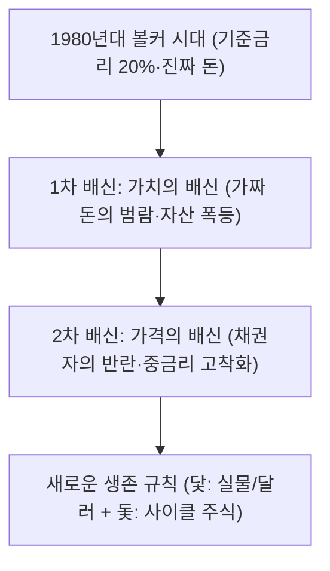
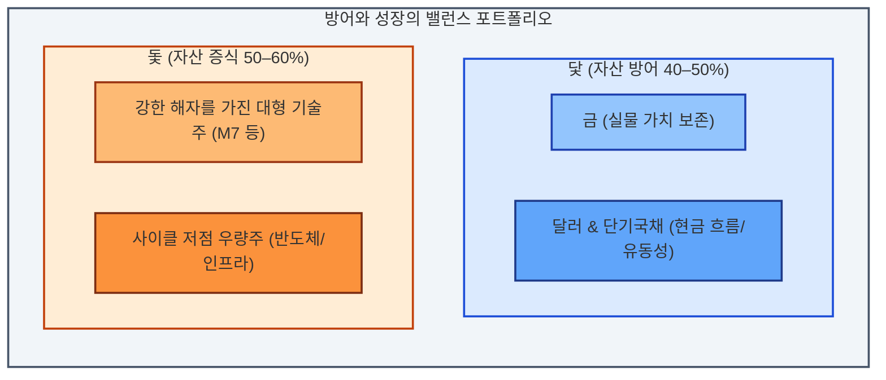

> ⚠️ <strong>면책 고지 (Disclaimer)</strong><br />
> 본 아티클은 거시경제 분석과 역사적 데이터를 바탕으로 한 일반적인 정보 제공을 목적으로 하며, <strong>특정 종목에 대한 투자 권유나 재정적 조언이 아닙니다.</strong> 모든 투자의 판단과 책임은 투자자 본인에게 있습니다.

---

> <strong>이 글의 위치</strong>: 2026년 9월에 정리한 [미국 주식 70년 인플레이션 포트폴리오 분석](/posts/20260902-1-us-stock-70years-inflation-portfolio-strategy/)의 후속편입니다. 전편이 70년 금융사와 4대 기능별 배분을 다뤘다면, 이번 글은 박종훈 소장의 '가짜 돈' 논리와 2026년 현재의 금리·반도체 사이클에 초점을 맞춥니다.

> <strong>3줄 요약</strong>
>
> 1. 자산 가격 상승의 일부는 생산성 향상이 아니라 화폐 가치 하락의 반영입니다.
> 2. 고금리·고물가 국면에서는 '닻(금·달러·단기국채)'과 '돛(우량주·반도체)'을 기능별로 나눠 담습니다.
> 3. 명목 수익률이 아니라 실질 구매력과 기계적 리밸런싱으로 계좌를 관리합니다.

## 📉 \"열심히 일하고 아껴 쓴 내가 왜 벼락거지가 되었을까?\"

지난 수십 년간 대한민국 사회를 지배해 온 상식은 단순했습니다:
> *"성실하게 일해서 월급을 받고, 안 쓰고 아껴서 은행 예·적금에 넣어두면 언젠가 내 집을 마련하고 노후를 준비할 수 있다."*

실제로 1980년대\~1990년대 초반만 해도 정기예금 금리는 연 15\~20%에 달했고, '재형저축(재산형성저축)'은 당시 금리 기준으로 원금이 3\~4년 만에 두 배가 되는 사례도 있었습니다. 당시에는 은행에 돈을 맡기는 행위가 가장 훌륭한 재테크였습니다.

하지만 2020년대에 들어선 지금, 똑같은 방식으로 성실하게 예금만 한 사람들은 스스로를 <strong>'벼락거지'</strong>라 부르고 있습니다. 월급은 제자리걸음인데 서울 주택 가격은 몇 배 뛰었고, 장바구니 물가는 감당하기 힘들 정도로 올랐습니다.

왜 성실함의 대가가 가난이어야 할까요? 개인의 노력이 부족해서였을까요?

경제학자이자 거시경제 전문가인 <strong>박종훈 소장</strong>(전 KBS 경제전문기자, 《가짜 돈 진짜 부》 저자)은 유튜브 채널 *지식인사이드* 인터뷰([영상 출처: 고금리 시대, 내 계좌 든든하게 지켜줄 3가지 자산](https://www.youtube.com/watch?v=vjHv7EyRmlA&t=2307s))를 통해 충격적인 금융사의 진실을 짚어냅니다:

```text
[ 영상의 핵심 메시지(요약) ]

"부동산이나 주식 가격이 오른 게 아닙니다.
 우리가 목숨처럼 모아둔 '법정화폐(종이돈)'의 가치가 구조적으로 폭락한 것입니다."
```

단순히 특정 자산이 급등한 것이 아니라, 우리가 가치를 측정하는 기준점인 <strong>'돈(화폐)이라는 그릇' 자체에서 가치가 줄줄 새고 있었다는 사실</strong>을 깨닫지 못하면, 앞으로 닥쳐올 고물가·중금리 시대에 내 자산을 결코 지켜낼 수 없습니다.

---

## 🏛️ 1. 돈의 두 번의 배신: 40년 동안 무슨 일이 일어났는가?

자본주의 역사 속에서 화폐는 대중을 두 번 배신했습니다.



> <strong>📌 시대 전환 핵심 요약</strong>
> - <strong>볼커 시대 → 1차 배신</strong>: 세계화와 중국의 저가 노동력 유입, 무제한 양적완화(QE)로 인한 유동성 폭발
> - <strong>1차 배신 → 2차 배신</strong>: 탈세계화, 공급망 분절, 정부 부채 급증으로 인한 끈적한 인플레이션과 채권자의 반란
> - <strong>2차 배신 → 생존 규칙</strong>: 안전을 지키는 '닻(금·달러·국채)'과 성장을 견인하는 '돛(사이클 주식)' 분리 대응

### ① 1차 배신: 가치의 배신 (가짜 돈의 범람)
1980\~1981년 폴 볼커(Paul Volcker) 미 연준 의장이 살인적인 인플레이션을 잡기 위해 기준금리를 20%까지 끌어올린 이후, 전 세계는 지난 40년간 <strong>'장기 금리 하락 사이클'</strong>을 탔습니다. 여기에 냉전 종식, 중국의 WTO 가입으로 인한 값싼 노동력(세계화)이 결합되면서 <strong>'저물가·저금리·고성장'의 황금기</strong>가 열렸습니다.

중앙은행들은 위기가 올 때마다 양적완화(QE)로 유동성을 공급했습니다(2008년 글로벌 금융위기, 2020년 팬데믹). 실물 경제의 생산성이 증가해서 부가 늘어난 것이 아니라, 시중 유동성과 통화량이 크게 늘어났습니다.
- <strong>결과</strong>: 돈의 희소성이 사라지면서 실물 자산(부동산, 우량 주식, 금) 대비 화폐 가치가 폭락했습니다. '가짜 돈(Fiat Money)'을 쥐고 있던 사람은 가만히 앉아서 구매력을 빼앗겼습니다.

### ② 2차 배신: 가격의 배신 (채권자와 시장의 반란)
더 무서운 것은 최근 시작된 2차 배신입니다. 40년간 이어진 저금리 파티가 끝나고 인플레이션이 고착화되자, 돈을 빌려주는 주체(시장과 채권자)들이 반란을 일으켰습니다:
> *"가치가 계속 떨어지는 종이돈을 더 이상 연 1\~2%의 헐값에 빌려줄 수 없다."*

중앙은행이 경기 부양을 위해 기준금리를 인하하더라도, 시중 장기금리(미국 10년물 국채 금리 등)는 높은 수준을 유지하는 현상이 나타날 수 있습니다. 막대한 정부 부채, 지정학적 전쟁, 보호무역주의, AI 인프라 구축을 위한 막대한 자금 수요가 맞물려 <strong>'중금리·고물가(Higher for Longer)'</strong> 국면이 길어질 수 있기 때문입니다.

---

## ⚙️ 2. 반도체 사이클(38:30)에서 발견하는 실전 투자 패턴

박종훈 소장은 영상 38분 30초 부근([38:30 타임라인](https://www.youtube.com/watch?v=vjHv7EyRmlA&t=2307s))에서 한국 증시의 핵심 축인 <strong>'반도체 사이클과 거시경제의 상관관계'</strong>를 집중 조명합니다.

반도체는 4차 산업혁명의 쌀이자 글로벌 유동성과 설비투자(Capex) 사이클을 가장 정직하게 반영하는 경기 민감 섹터입니다. 하지만 대다수 개인 투자자들은 사이클의 정점에서 환호하고 바닥에서 공포에 질려 투매합니다.

```text
[ 반도체 및 경기 순환 투자의 역발상 공식 ]

1. "실적이 사상 최대"라는 뉴스가 도배될 때 = 공급 과잉의 전조이자 고점 신호
2. "사상 최악의 적자, 감산 돌입" 기사가 나올 때 = 재고 소진의 신호이자 분할 매수 타이밍
```

### 역사적 위기 속의 패턴 복기
1. <strong>2008년 금융위기</strong>: 유동성 경색으로 모든 자산이 폭락했으나, 위기 직후 각국 중앙은행의 경기 부양책과 설비투자 재개로 반도체와 대형 우량주가 상대적으로 빠르게 회복해 전고점을 넘어선 사례가 있습니다.
2. <strong>2022년 고금리 쇼크</strong>: 금리 급등으로 테크 기업의 서버 투자가 위축되며 일부 메모리 반도체 고정거래가가 70% 이상 하락했습니다. 그러나 감산 발표와 재고 조정이 진행된 2023년 초는 분할 매수 관점에서 유효했던 구간으로 사후 평가됩니다.
3. <strong>현재의 AI 반도체 국면</strong>: 기존 레거시 메모리와 HBM(고대역폭 메모리) 간의 양극화가 심화되고 있습니다. 단순한 P/E(주가수익비율)가 아닌, 글로벌 빅테크 기업들의 <strong>현금 흐름과 Capex 지속 가능성</strong>을 추적하는 것이 투자의 성패를 가릅니다.

---

## 🛡️ 3. 자산을 지키는 '닻(Anchor)'과 성장을 이끄는 '돛(Sail)'의 자산 배분

격변의 고금리·인플레이션 국면에서 개인 투자자가 살아남는 현실적인 방법 중 하나는 <strong>'자산의 기능별 분리'</strong>입니다. 박종훈 소장이 강조하는 자산 배분의 핵심은 배의 안전을 책임지는 <strong>'닻'</strong>과 앞으로 전진하게 만드는 <strong>'돛'</strong>의 조화입니다.

| 구분 | 핵심 자산 | 역할 및 기능 | 대응 국면 |
| :--- | :--- | :--- | :--- |
| <strong>닻 (Anchor)</strong> | <strong>금 (Gold)</strong> | 화폐 가치 하락 방어, 대표적인 가치 저장 자산(가격 변동성 존재) | 스태그플레이션, 통화 불신 |
| <strong>닻 (Anchor)</strong> | <strong>미국 달러 (USD)</strong> | 글로벌 유동성 위기 시 최후의 보루, 저가 매수 총알 | 신용 경색, 금융 시스템 위기 |
| <strong>닻 (Anchor)</strong> | <strong>단기 우량 국채</strong> | 안정적인 현금 흐름 창출(이자 수익), 단기 변동성 완충 | 고금리 장기화 국면 |
| <strong>돛 (Sail)</strong> | <strong>핵심 빅테크 / 반도체</strong> | 인플레이션을 가격에 전가할 수 있는 강한 가격 결정력을 가진 기술 기업 | 완만한 경기 회복, AI 생산성 향상 |
| <strong>돛 (Sail)</strong> | <strong>실물 배당 인프라</strong> | 배당 성장과 물가 연동 수익을 창출하는 자산 | 중물가 지속 국면 |



> <strong>비중은 예시입니다</strong>: 위 40–50%·50–60%는 구조를 설명하기 위한 예시이며, 나이·투자 기간·소득·위험 감수성에 따라 달라져야 합니다. 금·달러·단기국채도 원금 손실이 발생할 수 있습니다. M7은 애플·마이크로소프트·엔비디아·알파벳·아마존·메타·테슬라 등 미국 대형 기술주 7종을 뜻합니다.

### 왜 '금'을 방어 자산으로 고려하는가?
- 금은 이자를 주지 않는 자산입니다. 전통적인 금융 이론에서는 고금리 시대에 금의 매력이 떨어진다고 가르쳤습니다.
- 하지만 최근 수년간 글로벌 중앙은행(특히 중국, 인도 등 신흥국)은 달러 의존도를 낮추기 위해 사상 최대 규모로 금을 매집하고 있습니다.
- 화폐를 무한정 발행할 수 있는 정부와 중앙은행의 신용 리스크가 커질수록, <strong>누구의 부채도 아닌 실물 자산인 금의 상대적 가치</strong>는 장기적으로 지지되는 경향이 있습니다. 다만 금 가격도 단기적으로 크게 출렁일 수 있습니다.

---

## 🔮 4. 앞으로의 투자 방향: 개인 투자자를 위한 3대 행동 지침

1. <strong>'명목 수익률'이 아닌 '실질 구매력'으로 계좌를 평가하라</strong>
   - 1억 원을 예금에 넣어 이자 350만 원을 받았다고 기뻐해서는 안 됩니다. 물가가 5% 올랐다면 실질 구매력 기준으로는 약 150만 원 줄어든 셈입니다(단순 근사).
2. <strong>현금의 역할을 재정의하라</strong>
   - 현금(원화 예금)은 자산을 불리는 도구가 아니라, <strong>폭락장에서 '진짜 자산'을 헐값에 주워 담기 위한 '전략적 대기 자금(옵션)'</strong>으로 활용해야 합니다.
3. <strong>사이클의 역방향으로 걷는 용기를 가져라</strong>
   - 모두가 탐욕에 빠져 특정 테마에 몰려갈 때는 '닻(달러, 금)'의 비중을 점검하고, 공포에 질려 시장을 떠날 때 '돛(우량 혁신 기업, 반도체)'을 분할 매수하는 원칙을 기계적으로 지키는 것이 도움이 됩니다.

---

## 📐 5. 숫자를 읽을 때 주의할 점

- <strong>명목과 실질은 다릅니다.</strong> 물가 상승률을 빼지 않은 수익률은 구매력 기준으로 과대평가됩니다.
- <strong>기간과 통화를 확인해야 합니다.</strong> 같은 자산도 원화·달러, 10년·40년, 배당 재투자 여부에 따라 결론이 달라집니다.
- <strong>사후 편향을 경계해야 합니다.</strong> "그때 샀으면"이라는 문장은 살아남은 사례만 보여줍니다. 중간에 사라진 기업과 시장은 표본에서 빠집니다.
- <strong>비중은 정답이 아닙니다.</strong> 이 글의 숫자는 구조를 이해하기 위한 예시이며, 실제 비중은 투자 기간·현금 흐름·세금·환율을 함께 고려해 정해야 합니다.

---

### 🔗 연관 아티클 & 참고 자료
- <strong>원본 영상:</strong> [고금리 시대, 내 계좌 든든하게 지켜줄 '3가지' 자산ㅣ지식인초대석 EP.187 (박종훈 소장 1부)](https://www.youtube.com/watch?v=vjHv7EyRmlA&t=2307s)
- <strong>참고 도서:</strong> 박종훈 저, 《가짜 돈 진짜 부》
- <strong>금리·물가 통계:</strong> [한국은행 경제통계시스템(ECOS)](https://ecos.bok.or.kr/), [미국 연준 FRED 정책금리](https://fred.stlouisfed.org/series/FEDFUNDS)
- <strong>중앙은행 금 매입 통계:</strong> [World Gold Council – Goldhub](https://www.gold.org/goldhub)
- <strong>관련 글:</strong> [\"미국 주식은 무조건 우상향?\" 70년 금융사가 경고하는 인플레이션 시대 4대 생존 포트폴리오](/posts/20260902-1-us-stock-70years-inflation-portfolio-strategy/)
