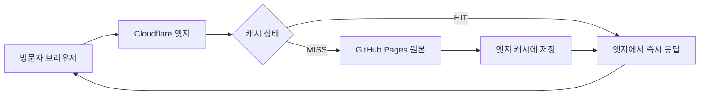
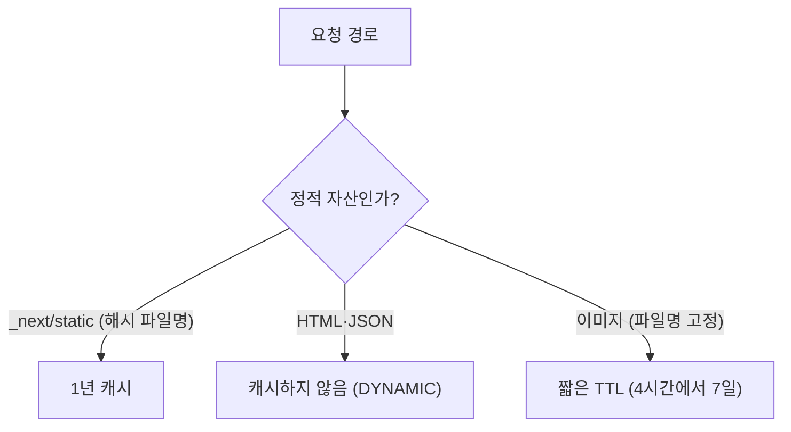

> <strong>이 글의 위치</strong>: 정적 블로그(GitHub Pages + Next.js export)에 Cloudflare 프록시를 적용하면서 실제로 확인한 설정과 수치를 정리했습니다. 렌더링 차단과 LCP 개선은 [웹폰트 @import와 LCP 글](/posts/20261026-1-webfont-import-lcp-render-blocking/)에서, GitHub Pages의 URL·색인 구조는 [slug·리디렉션 글](/posts/20260822-1-github-pages-url-slug-seo-redirection/)에서 먼저 다뤘습니다. 특정 계정의 ID·Zone ID·API 토큰·방문자 로그는 포함하지 않습니다.
>
> <strong>대상 독자</strong>: GitHub Pages·Vercel 같은 정적 호스팅에 Cloudflare 무료 플랜을 붙인 개인 블로그 운영자.

> <strong>3줄 요약</strong>
>
> 1. Cloudflare 프록시의 가장 큰 성능 효과는 <strong>정적 자산의 캐시 수명을 늘리는 것</strong>입니다. HTML은 엣지에 캐시하지 않고, 파일명에 해시가 있는 JS·CSS만 길게 캐시합니다.
> 2. SSL은 반드시 <strong>Full (strict)</strong>로 두고, Flexible은 피합니다. Flexible은 원본 구간을 암호화하지 않고 리디렉션 루프를 만들 수 있습니다.
> 3. 캐시는 성능 기능이면서 <strong>보안 경계</strong>입니다. 인증·개인화 응답, 쿠키가 붙은 응답, 동적 경로는 캐시 대상에서 제외해야 합니다.

## 🚀 1. 정적 블로그에도 CDN 설정이 필요한 이유

GitHub Pages는 이미 전 세계 엣지를 사용하는 정적 호스팅입니다. 그런데도 PageSpeed Insights의 <strong>효율적인 캐시 수명</strong> 항목에는 계속 경고가 남습니다. 이유는 간단합니다. GitHub Pages가 내려주는 캐시 헤더가 짧고, 사용자가 직접 바꿀 수 없기 때문입니다.

이 블로그의 실제 응답은 이랬습니다.

```text
cache-control: max-age=600
```

HTML이든 JS든 CSS든 기본이 10분입니다. 파일명에 콘텐츠 해시가 붙어 있어 내용이 바뀌면 URL도 바뀌는데, 그 장점을 전혀 활용하지 못하는 셈입니다.

Cloudflare 프록시를 앞에 두면 원본을 바꾸지 않고도 다음을 얻을 수 있습니다.

- 전 세계 엣지 캐시와 <strong>캐시 규칙</strong>
- TLS 종료와 HTTP/3, TLS 1.3
- 자동 압축(Gzip·Brotli·Zstandard)
- Early Hints, WAF, 속도 제한 같은 부가 기능

이전 포스트인 [PageSpeed 57점, LCP를 막던 웹폰트 @import와 서드파티 크리티컬 패스 해부](/posts/20261026-1-webfont-import-lcp-render-blocking/)에서 프론트엔드 코드 레벨의 렌더링 차단 리소스를 걷어냈다면, 이번 단계는 <strong>엣지 CDN 인프라 레벨에서 캐시 수명을 1년으로 극대화하고 불필요한 네트워크 종속 체인을 제거하는 과정</strong>입니다.

중요한 것은 <strong>Cloudflare가 만능 가속기가 아니라 "원본 응답을 어떻게 캐시할지 결정하는 계층"</strong>이라는 점입니다. 설정의 핵심도 캐시 범위와 TTL에 있습니다.

## 📊 2. 적용 전후: 숫자로 보는 변화

이 블로그(`nardlog.com`)에서 직접 확인한 값입니다.

| 대상 | 적용 전 | 적용 후 | 판정 |
|---|---|---|---|
| HTML (`/`, `/posts/...`) | `max-age=600` | `max-age=600`, `cf-cache-status: DYNAMIC` | 캐시하지 않음 (의도) |
| `/_next/static/*.js` | `max-age=600` | <strong>`max-age=31536000`</strong>, `HIT` | 1년 캐시 |
| `/_next/static/*.css` | `max-age=600` | <strong>`max-age=31536000`</strong>, `HIT` | 1년 캐시 |
| `/images/*.jpg` | `max-age=600` | `max-age=14400`, 첫 요청 `MISS` → 이후 `HIT` | 4시간 (파일명 고정) |

표의 `max-age`는 <strong>브라우저 캐시</strong> 지시자입니다. 적용 전 값은 GitHub Pages가 보내고, 적용 후 값은 경로에 따라 원본 또는 Cloudflare의 Browser TTL 설정이 결정합니다. Cloudflare의 엣지 TTL은 응답 헤더에 표시되지 않습니다.

핵심은 <strong>HTML은 그대로 두고, 해시가 붙은 빌드 산출물만 길게 캐시</strong>했다는 점입니다. 새 글을 배포하면 엣지는 새 HTML을 즉시 가져오고, 새 HTML은 새 해시 파일명을 가리킵니다. 다만 재방문자의 브라우저는 `max-age=600` 때문에 최대 10분간 이전 HTML을 볼 수 있습니다. 예전 해시 파일은 아무도 참조하지 않으므로 캐시에 남아 있어도 문제가 되지 않습니다.

## 🌐 3. 1단계: 프록시(주황 구름) 켜기

Cloudflare의 Cache Rules는 <strong>DNS 레코드가 프록시(주황 구름) 상태일 때만</strong> 동작합니다. DNS 전용(회색 구름)이면 Cloudflare는 이름만 해석하고 트래픽에는 관여하지 않습니다.

### 해야 할 일

1. DNS → 레코드에서 `A`와 `CNAME` 레코드를 편집합니다.
2. 구름 아이콘을 눌러 <strong>프록시됨(주황)</strong>으로 바꿉니다.
3. IP 주소와 CNAME 대상은 <strong>그대로 유지</strong>합니다. 이 값이 원본 서버 주소입니다.
4. TTL은 `자동`으로 둡니다.

### 확인

```bash
dig +short nardlog.com
# 104.x.x.x / 172.x.x.x 처럼 Cloudflare IP가 나오면 프록시 적용

curl -sI https://nardlog.com/ | grep -iE '^(server|cf-ray):'
# server: cloudflare
# cf-ray: ...
```

### 보안 주의

프록시는 원본 IP를 <strong>완전히 숨기는 장치가 아닙니다</strong>. GitHub Pages처럼 원본 IP가 공개된 호스팅은 특히 그렇습니다. Cloudflare를 "원본 은닉" 용도로 기대하지 말고, WAF·캐시·TLS 계층으로 이해해야 합니다.

## 🔐 4. 2단계: SSL/TLS를 Full (strict)로

SSL/TLS 모드는 성능보다 <strong>보안</strong>에 직결됩니다. Cloudflare 공식 문서도 가능한 한 Full (strict)를 권장합니다.

| 모드 | 브라우저 ↔ Cloudflare | Cloudflare ↔ 원본 | 판정 |
|---|---|---|---|
| Off | HTTP | HTTP | 사용 금지 |
| Flexible | HTTPS | <strong>HTTP</strong> | 사용 금지 |
| Full | HTTPS | HTTPS (인증서 검증 안 함) | 차선 |
| <strong>Full (strict)</strong> | HTTPS | HTTPS + 인증서 검증 | <strong>권장</strong> |

### Flexible을 쓰면 안 되는 이유

- Cloudflare와 원본 사이가 평문 HTTP로 흐릅니다. "자물쇠 아이콘"만 보고 안전하다고 착각하기 쉽습니다.
- 원본이 HTTPS로 리디렉션하면 <strong>무한 리디렉션 루프</strong>가 생깁니다.
- 원본이 HTTP 연결을 거부하면 521·522가 날 수 있습니다. 525(SSL 핸드셰이크 실패)·526(유효하지 않은 인증서)은 Full/Full (strict)에서 원본 인증서를 검증할 때 발생합니다.

### 함께 켤 설정

- <strong>Always Use HTTPS</strong>: HTTP 요청을 HTTPS로 리디렉션
- <strong>Automatic HTTPS Rewrites</strong>: 혼합 콘텐츠 완화
- <strong>Minimum TLS Version</strong>: TLS 1.2 이상
- <strong>HSTS</strong>: 모든 서브도메인이 HTTPS일 때만. `preload`는 되돌리기 어려우므로 초기에는 끄는 편이 안전합니다.

> <strong>Full (strict)의 전제</strong>: 원본이 유효한 인증서를 제시해야 합니다. 인증서가 만료되었거나 도메인과 불일치하면 <strong>526 오류</strong>가 발생합니다. 이때는 모드를 낮추는 대신 원본 인증서를 먼저 점검하세요.

## 🗄️ 5. 3단계: 캐시 규칙 — 범위가 전부다

Cloudflare는 기본적으로 <strong>HTML과 JSON을 캐시하지 않습니다</strong>. 파일 확장자 기준으로 JS·CSS·이미지·폰트 등을 캐시합니다. 이 기본 동작은 정적 블로그에 잘 맞습니다. 우리가 할 일은 <strong>해시가 붙은 정적 자산의 TTL만 늘리는 것</strong>입니다.

### 요청 흐름



### 캐시 범위 판단



### 규칙 만들기

캐싱 → 캐시 규칙 → <strong>규칙 생성</strong>에서 다음처럼 설정합니다.

- <strong>규칙 이름</strong>: `Next static immutable`
- <strong>조건</strong>: `URI 경로` <strong>다음으로 시작</strong> `/_next/static/`
- <strong>캐시 자격 요건</strong>: `캐시 가능`
- <strong>에지 TTL</strong>: `캐시 제어 헤더 무시` → <strong>1년</strong>
- <strong>브라우저 TTL</strong>: `원본 재정의` → <strong>1년</strong>

Next.js는 빌드마다 파일명에 콘텐츠 해시를 붙입니다. 내용이 바뀌면 URL이 바뀌므로 1년 캐시가 안전합니다.

이미지는 파일명이 고정이므로 1년 캐시를 피합니다. 별도 규칙으로 `URI 경로`가 `/images/`로 시작할 때 <strong>Browser TTL만 4시간</strong>으로 재정의하면 교체 주기와 캐시 효율의 균형을 맞출 수 있습니다.

규칙이 여러 개라면 대시보드의 <strong>Rules Simulator</strong>로 어떤 규칙이 적용되는지 먼저 확인합니다. 또한 <strong>Status Code TTL</strong>로 404·5xx에 긴 TTL을 주면 장애 응답이 캐시에 고정될 수 있으므로, 정적 자산 규칙은 정상 200 응답 중심으로 유지합니다.

### 경로별 캐시 권장값

| 경로 | 캐시 | 이유 |
|---|---|---|
| `/_next/static/*` | 1년 | 파일명에 콘텐츠 해시 |
| `/_next/data/*` | 기본값 유지 | 빌드 ID가 포함된 클라이언트 내비게이션 JSON |
| HTML (`/`, `/posts/*`) | 캐시 안 함 | 엣지 즉시 반영, 개인화 여지 |
| `/images/*` | 4시간\~7일 | 파일명 고정 |
| `/rss.xml`, `/sitemap.xml` | 10분\~1시간 | 크롤러가 자주 확인 |
| `/robots.txt` | 1시간 이하 | 배포 시 변경 가능 |

### 캐시하면 콘텐츠 갱신이 막히지 않나?

막히지 않습니다. 단, <strong>대상이 해시 파일명을 가진 정적 자산일 때만</strong> 그렇습니다.

- HTML: 엣지에는 캐시되지 않으므로 배포 즉시 새 HTML을 가져옵니다. 다만 브라우저 캐시(`max-age=600`) 때문에 재방문자는 최대 10분간 이전 HTML을 볼 수 있습니다.
- 해시 JS·CSS: 새 HTML이 새 파일명을 가리킵니다.
- 이미지: 파일명이 고정이므로 1년 캐시하면 교체가 반영되지 않습니다.

Cloudflare 공식 문서에 따르면 브라우저 TTL을 길게 잡으면 수정된 자산이 재방문자에게 즉시 보이지 않을 수 있고, <strong>엣지 캐시를 퍼지해도 방문자 브라우저의 캐시는 지워지지 않습니다</strong>. 이 차이를 모르면 "퍼지했는데 왜 안 바뀌지?"라는 상황을 만납니다.

### 캐시 키와 Vary

Cloudflare의 기본 캐시 키는 호스트·경로·쿼리 중심으로 구성됩니다. 여기에 쿠키나 사용자별 헤더를 넣으면 캐시 적중률이 떨어지고, 잘못 설계하면 개인화 응답이 섞일 수 있습니다. `Vary`는 Cache Rules의 <strong>Cache Key → Vary</strong>에서 다루며, `user-agent`처럼 값이 많은 헤더를 `passthrough`로 두면 캐시가 조각조각 나뉩니다. 정적 블로그는 <strong>기본 캐시 키를 그대로 두는 것</strong>이 가장 안전합니다.

## ⚡ 6. 4단계: 압축과 프로토콜

Cloudflare는 텍스트 기반 응답을 자동으로 압축합니다. 현재 문서 기준으로 플랜과 브라우저에 따라 Gzip·Brotli·Zstandard가 선택되며, <strong>Free 플랜은 Zstandard가 기본</strong>입니다. 별도로 "Brotli를 켠다"는 설정에 집착할 필요가 없습니다.

함께 확인할 항목은 다음과 같습니다.

- <strong>HTTP/3</strong>: QUIC 기반. 네트워크 → HTTP/3에서 활성화.
- <strong>TLS 1.3</strong>: 기본 활성화. 0-RTT는 재전송 공격 위험이 있어 민감한 요청에는 주의.
- <strong>Early Hints</strong>: HTML에 `Link: rel=preload` 또는 `preconnect` 헤더가 있을 때만 효과가 있습니다. Next.js 정적 export가 이런 헤더를 자동으로 넣지 않는다면 켜도 체감 효과는 제한적입니다. 또한 일부 크롤러에는 비활성화됩니다.
- <strong>0-RTT</strong>: 성능 이점은 있지만 결제·로그인처럼 부작용이 큰 요청에는 신중해야 합니다.

> <strong>압축의 함정</strong>: Automatic HTTPS Rewrites, Rocket Loader, Polish, Email Address Obfuscation, RUM(Web Analytics) 같은 기능이 켜져 있으면 Cloudflare가 응답을 압축 해제 후 다시 압축할 수 있습니다. 성능 기능이 오히려 CPU 비용을 늘리는 조합이니, 필요한 기능만 켜세요.

## 🧯 7. 5단계: Rocket Loader·Auto Minify·Cache Everything 정리

### 7-1. Rocket Loader & Auto Minify
- <strong>Rocket Loader</strong>: 모든 JavaScript를 비동기 지연 로드하여 첫 화면을 앞당기려 하지만, Next.js처럼 <strong>하이드레이션 순서와 React 런타임에 의존하는 프레임워크</strong>에서는 이벤트 핸들러가 끊기거나 화면이 깜빡이는 심각한 부작용을 일으킵니다. 반드시 <strong>OFF</strong>로 둡니다.
- <strong>Auto Minify</strong>: 2024년 8월 5일 deprecated된 기능입니다. 신규 대시보드에서는 보이지 않지만, 기존에 켜져 있던 존은 API(`PATCH /zones/{zone_id}/settings/minify`, 값 `{"css":"off","html":"off","js":"off"}`)로 끌 수 있습니다. Next.js가 이미 JS·CSS를 압축하므로 Cloudflare에서 한 번 더 손댈 이유도 없습니다.

### 7-2. [실전 트러블슈팅] Cloudflare가 주입하는 부가 스크립트 점검
프록시를 켜면 Cloudflare가 HTML을 변환하면서 부가 스크립트를 넣는 경우가 있습니다. 모두 성능에 영향을 줄 수 있으므로, 실제로 필요한 기능인지 확인하는 것이 좋습니다.

1. <strong>Email Address Obfuscation (이메일 주소 난독화)</strong>
   - <strong>동작</strong>: 페이지의 이메일 주소를 `[email protected]` 형태로 바꾸고, `email-decode.min.js`를 <strong>`defer`</strong>로 주입합니다. Cloudflare 공식 문서 기준으로 이 스크립트는 <strong>렌더링을 차단하지 않습니다</strong>.
   - <strong>판단</strong>: 렌더링 차단은 아니지만 제3자 요청과 다운로드가 하나 늘어나는 것은 사실입니다. 이메일 노출 방지가 필요 없다면 <strong>보안 → 설정 → Email Address Obfuscation</strong>에서 끌 수 있습니다.
   - <strong>예외</strong>: 특정 주소만 보호를 끄려면 HTML에 `<!--email_off-->...<!--/email_off-->`를 넣거나 Configuration Rule을 사용합니다.
2. <strong>Cloudflare Web Analytics (RUM 비콘)</strong>
   - <strong>동작</strong>: Web Analytics의 자동 설정이 켜져 있으면 `beacon.min.js`가 페이지에 주입됩니다. 자동 설정은 프록시된 사이트에서 사용할 수 있습니다.
   - <strong>판단</strong>: 이미 GA4 등으로 충분하다면 중복 측정이므로 <strong>Web Analytics → Manage site → Disable</strong>로 끌 수 있습니다. 다만 "프록시를 켜면 무조건 주입된다"는 뜻은 아니므로, 먼저 대시보드에서 실제 활성화 여부를 확인하세요.
   - <strong>참고</strong>: 원본이 `Cache-Control: public, no-transform`을 보내면 Cloudflare가 HTML을 변형하지 못해 비콘이 주입되지 않습니다.

### 7-3. Cache Everything은 쓰지 않기

HTML까지 캐시하는 `Cache Everything`은 정적 사이트에서도 위험합니다.

- 새 글 배포가 늦게 반영됩니다.
- 댓글·북마크·개인화 위젯이 섞이면 사용자별 내용이 캐시될 수 있습니다.
- 퍼지 타이밍을 놓치면 오래된 페이지가 노출됩니다.

정적 블로그는 <strong>기본 캐시 + 정적 자산 규칙</strong> 조합이 가장 안전합니다.

## 🛡️ 8. 보안 체크리스트 — 캐시는 편리하지만 위험하다

캐시는 성능 기능이지만, 잘못 설정하면 <strong>다른 사용자의 응답이 노출되는 사고</strong>로 이어집니다. Cloudflare 공식 문서의 캐시 보안 권고를 이 블로그에 맞게 정리하면 다음과 같습니다.

### 8-1. 진짜 정적인 파일만 캐시하기

Cloudflare는 "캐시 키가 같은 요청"끼리 응답을 재사용합니다. 인증 여부, 쿠키, 사용자 역할에 따라 내용이 달라지는 응답을 캐시하면 <strong>캐시 포이즈닝</strong>이나 <strong>캐시 디셉션</strong>의 대상이 됩니다.

- `Authorization` 헤더나 세션 쿠키에 따라 달라지는 응답은 캐시하지 않습니다.
- `Set-Cookie`가 붙은 응답은 기본적으로 캐시되지 않지만, 캐시 규칙으로 강제하지 않습니다.
- `GET` 본문이 응답 내용을 바꾸는 구조는 피합니다. Cloudflare는 GET 본문을 캐시 키에 포함하지 않습니다.
- 신뢰할 수 없는 요청 헤더 값을 응답 본문에 반사하지 않습니다.

### 8-2. Cache Deception Armor

동적 경로를 캐시하는 사이트라면 <strong>Cache Deception Armor</strong>를 켭니다. URL 확장자와 실제 `Content-Type`이 다르면 캐시하지 않는 기능입니다. 예를 들어 `/newsfeed/foo.jpg`가 실제로는 HTML을 반환하면 캐시를 막습니다.

주의: 공식 문서에 따르면 <strong>Edge TTL 캐시 규칙이 이 보호를 덮어쓸 수 있습니다</strong>. 동적 경로에 긴 Edge TTL을 주는 설정과 Cache Deception Armor를 동시에 쓰지 마세요.

### 8-3. Vary 헤더 최소화

`Vary`는 Cache Rules의 <strong>Cache Key → Vary</strong>에서 설정합니다. `User-Agent`처럼 값이 많은 헤더를 `passthrough`로 두면 캐시가 무의미해지고, 예상치 못한 변형이 저장됩니다. 기본값을 `bypass`로 두고, 꼭 필요한 헤더만 `normalize`로 명시하는 방식이 안전합니다.

### 8-4. WAF와 속도 제한

- <strong>WAF Managed Rules</strong>: 알려진 공격 패턴 차단. 무료 플랜에서도 기본 규칙을 사용할 수 있습니다.
- <strong>Rate Limiting</strong>: 로그인·검색·폼 제출처럼 비용이 큰 경로에만 좁게 적용합니다. 전체 트래픽에 걸면 정상 사용자와 검색 크롤러가 차단될 수 있습니다.
- <strong>Under Attack Mode</strong>: 공격 중에만 임시로 사용합니다. 상시로 켜면 SEO와 사용자 경험이 모두 나빠집니다.
- <strong>Bot Fight Mode</strong>: 정상 크롤러까지 챌린지할 수 있으므로 Search Console·네이버 서치어드바이저의 수집 상태를 함께 봅니다.

### 8-5. 인증서와 HSTS

- Full (strict)는 원본 인증서 검증을 포함합니다.
- HSTS는 모든 서브도메인이 HTTPS일 때만 켭니다.
- `preload`는 브라우저에 하드코딩되므로, 롤백 계획이 없으면 초기에는 켜지 않습니다.

### 8-6. API 토큰과 계정 정보

- API 토큰은 <strong>Zone 단위로 최소 권한</strong>만 부여합니다.
- 토큰·계정 ID·Zone ID는 저장소, 블로그, 클라이언트 코드에 넣지 않습니다.
- GitHub Actions 등에서는 환경 변수/시크릿으로 주입하고, 유출 의심 시 즉시 회전합니다.

## 🔎 9. 검증: 헤더와 명령어

설정은 대시보드에서 끝나지 않습니다. 실제 응답 헤더로 확인해야 합니다.

### 정적 자산 캐시

```bash
# 현재 HTML이 참조하는 첫 JS 파일을 추출
u=$(curl -s https://nardlog.com/ | grep -o '/_next/static/[^"]*\.js' | head -1)
echo "$u"
curl -sI "https://nardlog.com$u" | grep -iE '^(cache-control|cf-cache-status|age|server):'
```

기대값:

```text
server: cloudflare
cache-control: max-age=31536000
cf-cache-status: HIT
```

첫 요청은 `MISS`, 두 번째 요청부터 `HIT`가 정상입니다.

캐시를 잠시 비우고 원본 변경을 확인하려면 <strong>Development Mode</strong>를 사용합니다. 3시간 뒤 자동 해제되지만, 켜 둔 채 잊지 않도록 합니다.

### HTML은 캐시되지 않아야 함

```bash
curl -sI https://nardlog.com/ | grep -iE '^(cache-control|cf-cache-status):'
# cache-control: max-age=600
# cf-cache-status: DYNAMIC
```

`DYNAMIC`은 오류가 아니라 "이 응답은 캐시 규칙의 대상이 아니다"라는 뜻입니다. 엣지가 항상 원본에서 새 HTML을 가져오는 이유이기도 합니다. 다만 브라우저 캐시(`max-age=600`)는 별개이므로, 재방문자는 최대 10분간 이전 HTML을 볼 수 있습니다.

### PageSpeed 점수와 캐시의 관계

PageSpeed Insights의 실험실(Lighthouse) 점수는 보통 캐시를 비운 상태로 측정합니다. 그래서 TTL을 1년으로 늘려도 실험실 점수는 그대로일 수 있습니다. 이 설정이 직접 개선하는 것은 <strong>"효율적인 캐시 수명" 감사 항목</strong>과 <strong>재방문자의 체감 속도</strong>입니다. 필드 데이터(CrUX)는 사용자 브라우저 캐시의 영향을 받으므로, 배포 직후보다 며칠 뒤에 보는 편이 정확합니다.

### 자동 압축(Zstandard / Brotli) 협상 확인

Cloudflare가 텍스트 리소스를 실제로 최신 알고리즘으로 압축하여 전송하는지 점검합니다.

```bash
curl -sI -H "Accept-Encoding: gzip, br, zstd" https://nardlog.com/ | grep -iE '^(content-encoding|cf-cache-status):'
# 기대값:
# content-encoding: zstd  (브라우저가 zstd를 지원할 때 가장 우선 협상됨)
```

### HTTP/3 (QUIC) 및 TLS 1.3 협상 확인

브라우저가 엣지 서버와 최신 전송 프로토콜로 핸드셰이크하는지 확인합니다.

```bash
curl -Iv --http3 https://nardlog.com/ 2>&1 | grep -iE '(ALPN|SSL connection|HTTP/3)'
# ALPN: offers h3, h2, http/1.1
# Connected using HTTP/3
```

### 이미지

```bash
curl -sI https://nardlog.com/images/cloudflare_web_performance_cache_ssl_guide_thumbnail.jpg | grep -iE '^(cache-control|cf-cache-status):'
```

이미지는 파일명이 고정이므로 1년 캐시를 피합니다. 4시간에서 7일 정도가 무난합니다.

### `cf-cache-status` 읽는 법

| 값 | 의미 |
|---|---|
| `HIT` | 엣지 캐시에서 응답 |
| `MISS` | 캐시에 없어 원본에서 가져옴 |
| `EXPIRED` | TTL 만료 후 재검증 |
| `REVALIDATED` | 원본과 비교해 재사용 |
| `DYNAMIC` | 캐시 대상이 아님 |
| `BYPASS` | 규칙 또는 요청 특성으로 캐시 우회 |

### 증상별 원인과 해결

| 증상 | 흔한 원인 | 확인·해결 |
|---|---|---|
| JS·CSS가 계속 DYNAMIC | 프록시 아님, 규칙 미매칭, Set-Cookie·private 응답 | dig로 Cloudflare IP 확인, Rules Simulator로 규칙 확인 |
| 같은 URL이 계속 MISS | TTL 0, Vary passthrough로 캐시 키 분리, 데이터센터별 캐시 | cache-control·vary 확인, Cache Key 단순화 |
| 526 오류 | Full (strict)에서 원본 인증서 무효·만료 | 원본 인증서 교체, 모드를 낮추지 않기 |
| 리디렉션 루프 | Flexible + 원본 HTTPS 강제 | Full (strict)로 변경 |
| 배포 후 옛 내용 | 브라우저 캐시(max-age=600), 서비스 워커, 퍼지 누락 | 강력 새로고침, HTML Browser TTL 조정, URL 퍼지 |
| BYPASS | Bypass 규칙, Development Mode | 규칙·Development Mode 해제 |

## ↩️ 10. 롤백과 운영 주의사항

### 즉시 롤백

문제가 생기면 프록시된 DNS 레코드를 모두 <strong>DNS 전용(회색 구름)</strong>으로 되돌리면 됩니다. 저장소 변경은 없습니다. 전파 시간은 TTL에 따르지만 대체로 빠릅니다.

### GitHub Pages 인증서 갱신

프록시 환경에서는 GitHub Pages의 인증서 갱신이 지연되거나 실패하는 사례가 있습니다. 갱신이 막히면 잠시 DNS 전용으로 되돌려 갱신을 완료한 뒤 다시 프록시를 켜는 방법이 있습니다. 만료일을 주기적으로 확인하세요.

### 캐시 퍼지의 한계

- 엣지 퍼지는 방문자 브라우저 캐시를 지우지 않습니다.
- 해시 파일명을 쓰면 퍼지 자체가 거의 필요 없습니다.
- HTML을 캐시하기 시작하면 배포마다 퍼지 전략이 필요해집니다. 정적 블로그는 HTML을 캐시하지 않는 편이 운영 비용이 낮습니다.

### 무료 플랜의 제약

- Cache Rules는 무료 플랜에서 10개까지 만들 수 있습니다.
- Edge TTL의 최소값은 플랜에 따라 다릅니다. 무료 플랜은 2시간이 최소입니다.
- Tiered Cache는 무료 플랜에서도 켤 수 있습니다. Cache Reserve는 별도 추가 요금제가 필요합니다.

## 🧭 11. 정리

Cloudflare 설정은 "기능을 많이 켜는 일"이 아니라 <strong>캐시의 경계를 정확히 긋는 일</strong>입니다.

이 블로그에서 실제로 효과가 있었던 순서는 다음과 같습니다.

1. 프록시를 켜고 TLS를 Full (strict)로 고정
2. `/_next/static/`만 1년 캐시
3. HTML·이미지는 캐시하지 않거나 짧게 유지
4. Rocket Loader·Cache Everything은 끄고, Auto Minify는 켜져 있으면 API로 정리
5. WAF·속도 제한은 좁은 범위에만 적용
6. 헤더(`cf-cache-status`, `cache-control`)로 배포 후 검증

성능 점수는 이 설정만으로 극적으로 오르지 않을 수 있습니다. 하지만 <strong>재방문 비용</strong>은 분명히 줄어들고, 무엇보다 캐시 사고를 예방하는 구조가 됩니다. 정적 블로그라면 이 조합이 가장 안전하고 유지비가 낮습니다.

---

> <strong>참고 자료</strong>
>
> - [Cloudflare Cache Rules](https://developers.cloudflare.com/cache/how-to/cache-rules/)
> - [Edge and Browser Cache TTL](https://developers.cloudflare.com/cache/how-to/edge-browser-cache-ttl/)
> - [Default cache behavior](https://developers.cloudflare.com/cache/concepts/default-cache-behavior/)
> - [Full (strict)](https://developers.cloudflare.com/ssl/origin-configuration/ssl-modes/full-strict/)
> - [Content compression](https://developers.cloudflare.com/speed/optimization/content/compression/)
> - [Rocket Loader](https://developers.cloudflare.com/speed/optimization/content/rocket-loader/)
> - [Early Hints](https://developers.cloudflare.com/cache/advanced-configuration/early-hints/)
> - [Avoid web cache poisoning](https://developers.cloudflare.com/cache/cache-security/avoid-web-poisoning/)
> - [Cache Deception Armor](https://developers.cloudflare.com/cache/cache-security/cache-deception-armor/)
> - [Vary](https://developers.cloudflare.com/cache/concepts/vary/)
> - [Tiered Cache](https://developers.cloudflare.com/cache/how-to/tiered-cache/)
> - [Turn off Auto Minify via API](https://developers.cloudflare.com/speed/optimization/content/troubleshooting/disable-auto-minify/)
> - [Web Analytics FAQ](https://developers.cloudflare.com/web-analytics/faq/)
