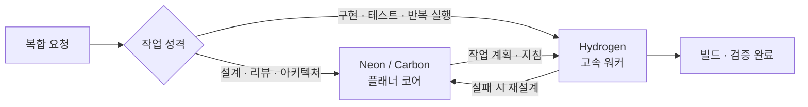

> <strong>이 글의 위치</strong>: 지난 10월 공개된 [구글 Gemini 4 Argon 완전 분석: 100만 토큰과 가격](/posts/20261014-1-gemini-4-argon-analysis-guide/)의 후속편입니다. 2026년 11월 10일 <strong>Carbon</strong>, 11월 12일 <strong>Hydrogen</strong>에 이어 <strong>11월 18일 Gemini 4 Neon</strong>까지 합류한 4종 라인업의 스펙과 역할 분담을 정리합니다.

> <strong>3줄 요약</strong>
>
> 1. 구글은 Gemini 4 세대부터 Pro/Flash 대신 원소명(<strong>Argon · Carbon · Hydrogen · Neon</strong>) 체계를 도입해, 11월 18일 Neon 출시로 4종 라인업을 완성했습니다.
> 2. <strong>Carbon</strong>(11/10 GA)은 AA Index 60(High)·62 tok/s의 최상위 심층 추론 모델, <strong>Hydrogen</strong>(11/12)은 173 tok/s·\$1.50/\$7.50의 초고속 실행 모델, <strong>Neon</strong>(11/18)은 두 모델 사이를 잇는 코딩·에이전트 특화 중간 티어(AA Index 61 Xhigh·약 101\~110 tok/s·\$3.00/\$15.00)입니다.
> 3. 실무에서는 단일 모델 고정보다 Antigravity의 <strong>Orchestrator (Neon)</strong>처럼 <strong>Neon·Carbon으로 설계·리뷰하고 Hydrogen으로 구현·테스트를 병렬 실행</strong>하는 멀티 모델 라우팅이 비용과 속도 양면에서 유리합니다.

---

## 🧪 1. 왜 Pro·Flash 대신 원소 이름(Argon · Carbon · Hydrogen · Neon)일까?

Gemini 3.x 세대까지는 Pro · Flash라는 체급 명칭을 썼습니다. 하지만 에이전트 기반 코딩과 자율 실행 워크플로가 보편화되면서, 단순히 "크고 느린 모델 vs 작고 빠른 모델"의 이분법만으로는 역할을 설명하기 어려워졌습니다.

구글은 2026년 10월 [Gemini 4 Argon](/posts/20261014-1-gemini-4-argon-analysis-guide/)을 시작으로, 11월 10일 <strong>Gemini 4 Carbon</strong>, 11월 12일 <strong>Gemini 4 Hydrogen</strong>, 11월 18일 <strong>Gemini 4 Neon</strong>을 잇따라 공개하며 4단 원소 라인업을 완성했습니다.

- <strong>Argon (아르곤 — 9월 30일 Fairwind, 10월 중순 확대)</strong>: 100만 토큰 컨텍스트와 안정적인 장시간 추론을 갖춘 <strong>표준 프론티어 엔진</strong>
- <strong>Carbon (카본 — 11월 10일 GA)</strong>: Argon보다 추론 깊이와 자가 검증 루프를 극한까지 끌어올린 <strong>최상위 아키텍트·보안 모델</strong>
- <strong>Hydrogen (하이드로겐 — 11월 12일 출시)</strong>: Gemini 4 패밀리의 지능을 가볍고 빠른 실행 루프로 옮긴 <strong>초고속 워크호스 모델</strong>
- <strong>Neon (네온 — 11월 18일 출시)</strong>: Carbon급 추론 정밀도와 Hydrogen급 실용 속도의 균형을 맞춘 <strong>코딩·에이전트 특화 중간 티어 모델</strong>

---

## 💎 2. Gemini 4 Carbon: 극한의 추론 깊이와 보안·아키텍처 특화

<strong>Gemini 4 Carbon</strong>은 2026년 10월 28일 사이버 방어 조직용 Fairwind 프로그램으로 먼저 공개된 뒤, <strong>11월 10일</strong> 개발자와 기업을 대상으로 정식 출시(GA)되었습니다.

### 1) 설계 목적과 강점
단순히 정답을 빨리 내놓는 것보다, <strong>문제를 끝까지 검증하고 아키텍처의 근본 원인(Root Cause)을 찾아내는 능력</strong>에 초점을 맞췄습니다.
- <strong>깊은 Thinking 루프</strong>: 턴당 훨씬 많은 내부 추론(Thinking) 토큰을 소모하며 다단계 검증을 수행합니다. 구글도 Carbon이 Argon보다 더 많은 토큰을 쓴다고 명시합니다.
- <strong>최고 수준의 벤치마크</strong>: Artificial Analysis Intelligence Index v5 기준 <strong>60점(High)</strong>으로 전체 4위권이며, CursorBench 4.0·Perplexity WANDR·Zapier AutomationBench에서 1위를 기록했습니다. 차선 외부 모델 대비 작업당 비용은 2배 이상 낮습니다. 보안 영역에서는 Fairwind 프로그램을 통해 SEC-bench Pro(취약점 탐지)·ExploitGym(공격)·CWE-bench v1(패치)에서 선두를 기록했습니다.
- <strong>트레이드오프</strong>: 내부 검증 단계가 길고 출력이 상세한 만큼 출력 속도는 <strong>62 tok/s (High)</strong>로 Hydrogen보다 느리고, 작업당 토큰 소비량도 많습니다.

### 2) 도입 가격 정책 (100만 토큰 컨텍스트 공통)
- <strong>얼리버드 프로모션 가격 (\~2026년 11월 30일까지)</strong>: 입력 <strong>\$2.00</strong> / 출력 <strong>\$10.00</strong> (1M 토큰 기준)
- <strong>정규 표준 가격 (2026년 12월 1일부터)</strong>: 입력 <strong>\$4.00</strong> / 출력 <strong>\$20.00</strong> (1M 토큰 기준)
- <strong>무료 티어 없음</strong>: Carbon은 Free tier에서 제공되지 않으며, 사고(Thinking)·도구 지시 토큰까지 모두 과금됩니다. 테스트는 Google AI Studio 유료 호출이나 <strong>배치 API</strong>(입력 \$1.00 / 출력 \$5.00, 1M 기준)로 진행하면 됩니다.
- <strong>캐시 입력</strong>: 100만 토큰당 \$0.10(11월 30일까지) → \$0.20(12월 1일부터). 암시적 캐싱만 지원합니다.

---

## ⚡ 3. Gemini 4 Hydrogen: Gemini 4 패밀리의 초고속 실행 엔진

<strong>Gemini 4 Hydrogen</strong>은 Carbon 정식 출시 이틀 뒤인 <strong>2026년 11월 12일</strong> 공개되었습니다. Gemini 3.8 Flash에서 넘어오는 팀을 위한 사실상의 후속 모델로, 같은 100만 토큰 컨텍스트와 100만 토큰 long decode를 유지하면서 실행 속도와 지능을 끌어올렸습니다.

### 1) 설계 목적과 강점
- <strong>압도적인 처리 속도</strong>: Artificial Analysis 측정 출력 속도는 <strong>173 tok/s (Xhigh)</strong>입니다. Carbon (62 tok/s, High)과 노력도가 달라 단순 배수 비교는 주의해야 하지만, 체감 차이는 분명합니다. 구글은 기본값인 high 설정에서 Gemini 3.8 Flash 대비 <strong>작업 완료가 2.5배 빠르다</strong>고 발표했습니다.
- <strong>4단계 추론 노력도 제어 (low · medium · high · xhigh)</strong>: 작업 난이도에 따라 Thinking 깊이를 조절할 수 있습니다. 기본 high에서 Intelligence Index 51, 최고 단계인 xhigh에서 <strong>54</strong>를 기록했습니다. Terminal-Bench 4.1은 <strong>57%(3.8 Flash 18.2%)</strong>로 3배 이상 올라섰고, 허위 주장 생성도 5배 이상 줄었습니다.
- <strong>대중적인 접근성</strong>: 100만 토큰 통합 컨텍스트(텍스트·이미지·오디오·비디오·PDF)를 유지하면서 <strong>Free tier가 제공</strong>됩니다. Carbon과 가장 큰 차이입니다.
- <strong>도메인 추론 벤치마크</strong>: 구글 발표 기준 HLE-Diamond 58.8%, <strong>Vals Tax Agent Bench 1위(52.3%)</strong>, Vals Legal Research Bench 공동 1위(55.8%), AutomationBench-AA 동급 선두입니다.
- <strong>검색·앱 전면 투입</strong>: Hydrogen은 Google Search에 전 세계적으로 투입된 "Search 최대 업그레이드"이기도 합니다. 같은 모델이 검색 답변과 API 실행을 함께 담당합니다.

### 2) 도입 가격 정책
- <strong>플랫(고정) 가격</strong>: 입력 <strong>\$1.50</strong> / 출력 <strong>\$7.50</strong> (1M 토큰 기준)
- <strong>배치</strong>: 입력 \$0.75 / 출력 \$3.75, <strong>캐시 입력</strong>: \$0.075 (모두 1M 토큰 기준)

---

## ✨ 4. Gemini 4 Neon: 코딩·에이전트 실무의 중간 허브 (11월 18일 추가)

<strong>Gemini 4 Neon</strong>(`gemini-4-neon`)은 <strong>2026년 11월 18일</strong> 공개된 Gemini 4 패밀리의 중간 티어(Mid-Tier) 프론티어 모델입니다. Hydrogen으로는 복잡한 다중 파일 리팩토링이 아쉽고, Carbon을 상시 쓰기엔 속도와 토큰 비용이 부담스러운 실무 개발자의 공백을 정확히 메웁니다.

### 1) 설계 목적과 강점
- <strong>Carbon에 맞먹는 지능과 높은 속도</strong>: Artificial Analysis Intelligence Index에서 <strong>`xhigh` 기준 61점</strong>(글로벌 최상위 3위권)을 기록하면서도, 출력 속도는 약 <strong>101\~110 tok/s</strong> 수준으로 Carbon(62 tok/s)보다 훨씬 빠르게 응답합니다.
- <strong>에이전트 제어력(Steerability) 및 장문 정확도</strong>: 다단계 도구 호출과 중간 지시 수정 능력을 평가하는 <strong>Vals Index · Agent Arena Index</strong> 최상위권에 올랐으며, 100만 토큰 컨텍스트 기반 <strong>GraphWalks 95.2%</strong>를 기록해 대규모 저장소 단위 코딩과 터미널 작업에 강합니다.
- <strong>4단계 추론 노력도 제어</strong>: Hydrogen과 마찬가지로 `low · medium · high(기본) · xhigh` 4단계 Thinking 제어를 지원해, 일반 코딩부터 복잡한 아키텍처 판단까지 단일 모델로 폭넓게 커버합니다.

### 2) 도입 가격 정책
- <strong>표준 가격</strong>: 입력 <strong>\$3.00</strong> / 출력 <strong>\$15.00</strong> (1M 토큰 기준, Carbon 정규가 \$4/\$20보다 25% 저렴)
- <strong>캐시 입력 (암시적 캐싱)</strong>: 100만 토큰당 <strong>\$0.15</strong> (95% 할인)
- <strong>무료 티어 없음</strong>: Carbon과 마찬가지로 Free API 티어는 제공되지 않으며, 유료 API, Google AI Pro/Ultra 구독, Google Antigravity 등에서 이용할 수 있습니다.

---

## 📊 5. Argon · Carbon · Neon · Hydrogen 4종 스펙 한눈에 비교

네 모델 모두 <strong>100만 토큰 통합 컨텍스트 윈도우</strong>와 <strong>Long Decode(연속 출력)</strong> 기반을 공유하지만, 속도와 추론 깊이, 비용 구조가 명확하게 나뉩니다.

| 비교 항목 | Gemini 4 Argon | Gemini 4 Carbon | Gemini 4 Neon | Gemini 4 Hydrogen |
| :--- | :--- | :--- | :--- | :--- |
| <strong>정식 출시 (GA)</strong> | 2026년 10월 중순 | 2026년 11월 10일 | <strong>2026년 11월 18일</strong> | 2026년 11월 12일 |
| <strong>핵심 포지션</strong> | 표준 프론티어 | 최상위 심층 추론·보안 | <strong>코딩·에이전트 균형 허브</strong> | 초고속 실행 워크호스 |
| <strong>Thinking 깊이</strong> | 3단계 (최대 high) | 3단계 (최대 high) | <strong>4단계 (최대 xhigh)</strong> | 4단계 (최대 xhigh) |
| <strong>출력 속도 (tok/s)</strong> | 65 tok/s | 62 tok/s (High) | <strong>약 101\~110 tok/s</strong> | <strong>173 tok/s</strong> (Xhigh) |
| <strong>AA Index</strong> | 50 | 60 (High) | <strong>61</strong> (Xhigh) | 54 (Xhigh) · 51 (High) |
| <strong>주요 강점</strong> | 장기 세션 안정성 | CursorBench·보안 선두 | 저장소 코딩·Agent Arena·GraphWalks 95.2% | Terminal-Bench 4.1 57%·초고속 |
| <strong>입력 / 출력 (1M)</strong> | \$2/\$10 (12/1부터 \$4/\$20) | \$2/\$10 (12/1부터 \$4/\$20) | <strong>\$3.00 / \$15.00</strong> | 플랫 <strong>\$1.50 / \$7.50</strong> |
| <strong>무료 티어</strong> | 없음 | 없음 | 없음 | <strong>제공</strong> |
| <strong>추천 작업</strong> | 일반 개발·장문 문서 | 보안 감사·난해한 디버깅 | <strong>다중 파일 리팩토링·단독 주력 코딩</strong> | 반복 코딩·테스트·UI 수정 |

<strong>표 읽는 법</strong>: Intelligence Index와 tok/s는 Artificial Analysis 및 공개 벤치마크 측정값이며, 모델별로 측정에 사용한 노력도(High·Xhigh)가 다릅니다.

---

## 🔄 6. 실전 워크플로: `Orchestrator (Neon)`과 멀티 모델 조합

이번 11월 업데이트에서 가장 눈여겨볼 지점은 단일 모델의 우열이 아니라 <strong>멀티 모델 협업(Orchestration)</strong>입니다. Google Antigravity에서는 기존 `Orchestrator (Argon)`에 이어 <strong>`Orchestrator (Neon)`</strong>이 새롭게 추가되었습니다.

- <strong>`Orchestrator (Neon)` 구조</strong>: 판단력이 높고 응답도 빠른 <strong>Neon이 플래너·리뷰어(설계 코어)</strong>를 맡고, 실제 코드 수정·패키지 실행·반복 테스트는 <strong>Hydrogen 서브에이전트</strong>가 병렬로 처리합니다.
- <strong>효율 검증</strong>: 구글에 따르면 멀티 모델 오케스트레이터는 Terminal-Bench 4.0에서 최상위 모델에 근접한 성공률을 유지하면서 평균 <strong>쿼터 24% 절감, 19% 빠른 완료</strong>를 기록했습니다.

### 실무자 모델 선택 체크리스트
1. <strong>평소 주력 코딩 · 다중 파일 리팩토링 · 에이전트 세션</strong>: <strong>Gemini 4 Neon</strong> 또는 <strong>`Orchestrator (Neon)`</strong>
   - Carbon에 가까운 추론력을 훨씬 빠른 속도와 25% 낮은 정규 단가로 쓸 수 있어, 11월 18일 이후 가장 균형 잡힌 주력 선택지입니다.
2. <strong>극한의 난해한 버그 원인 추적 · 보안 취약점 감사</strong>: <strong>Gemini 4 Carbon</strong>
   - Thinking 비용이 들더라도 첫 단추를 잘못 꿰어 나중에 전체를 뜯어고치는 비용을 막아줍니다.
3. <strong>단순 구현 · 컴포넌트 다수 생성 · 테스트 루프 · 무료 API 실험</strong>: <strong>Gemini 4 Hydrogen</strong>
   - 빠른 응답 속도와 저렴한 단가(\$1.50/\$7.50), Free tier 접근성 덕분에 수정–실행–검증 사이클을 여러 번 돌려도 부담이 적습니다.
4. <strong>기존 안정적인 장기 워크플로 유지</strong>: <strong>Gemini 4 Argon</strong>
   - 장기 작업의 예측 가능성과 안정성이 검증된 표준 선택지입니다.

---

## 🧭 7. 정리

2026년 11월 <strong>Carbon · Hydrogen · Neon</strong>의 순차 합류로 구글 Gemini 4 라인업은 <strong>"깊은 검증(Carbon) · 균형 잡힌 주력 코딩(Neon) · 초고속 실행(Hydrogen)"</strong>의 3축이 뚜렷해졌습니다.

단일 모델로 모든 요청을 처리하기보다 <strong>`Orchestrator (Neon)`처럼 설계·검증은 Neon(또는 Carbon)에, 반복 구현과 테스트는 Hydrogen에 맡기는 이원화 전략</strong>을 적용하면 비용과 대기 시간을 동시에 줄일 수 있습니다.

---

> <strong>수치 기준</strong>: 2026년 11월 19일 업데이트(Neon 반영). tok/s·Intelligence Index는 Artificial Analysis 및 공개 벤치마크 측정값(Carbon High, Hydrogen·Neon Xhigh 기준)이며, 측정 주체·노력도·시점에 따라 달라질 수 있습니다. Argon·Carbon의 \$2/\$10 가격은 2026년 11월 30일까지의 도입가입니다.

> <strong>참고 자료</strong>
>
> - [Google — Gemini 4 Carbon is now available](https://blog.google/innovation-and-ai/models-and-research/gemini-models/gemini-4-carbon-now-available/)
> - [Google — Introducing Gemini 4 Hydrogen](https://blog.google/innovation-and-ai/models-and-research/gemini-models/introducing-gemini-4-hydrogen/)
> - [Google — Build with Gemini 4 Hydrogen](https://blog.google/innovation-and-ai/technology/developers-tools/build-with-gemini-4-hydrogen/)
> - [Google — Google Search gets a major upgrade with Gemini 4 Hydrogen](https://blog.google/products-and-platforms/products/search/gemini-4-hydrogen-search-upgrade/)
> - [Google AI — Gemini models](https://ai.google.dev/gemini-api/docs/models)
> - [Google AI — Gemini API pricing](https://ai.google.dev/gemini-api/docs/pricing)
> - [Artificial Analysis — Gemini 4 Carbon](https://artificialanalysis.ai/models/gemini-4-carbon)
> - [Artificial Analysis — Gemini 4 Hydrogen](https://artificialanalysis.ai/models/gemini-4-hydrogen)
> - [OpenRouter — Gemini 4 Carbon](https://openrouter.ai/google/gemini-4-carbon)
> - [OpenRouter — Gemini 4 Hydrogen](https://openrouter.ai/google/gemini-4-hydrogen)
> - [OpenRouter — Gemini 4 Neon](https://openrouter.ai/google/gemini-4-neon)
> - [이전 글: 구글 Gemini 4 Argon 완전 분석: 100만 토큰과 가격](/posts/20261014-1-gemini-4-argon-analysis-guide/)
