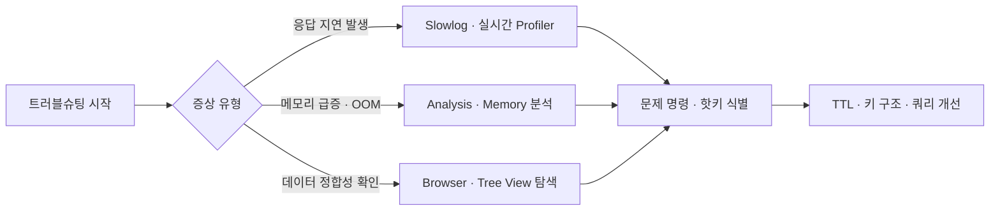

> <strong>이 글의 위치</strong>: 앞서 [트래픽 급증 시 DB 병목 해결기: Spring Boot + Lettuce Redis 캐싱](/posts/20260825-1-spring-boot-lettuce-redis-caching-traffic-bottleneck/)에서 인메모리 캐싱 아키텍처를 다뤘다면, 이 글은 <strong>실제 Redis 내부의 키·TTL·메모리·슬로우 쿼리를 눈으로 확인하고 진단하는 공식 GUI 도구(Redis Insight)</strong>의 설치와 실전 사용법을 정리합니다.

> <strong>3줄 요약</strong>
>
> 1. <strong>Redis Insight</strong>는 Redis 공식 무료 GUI 클라이언트로, Mac에서는 `brew install --cask redis-insight` 한 줄로 설치·업데이트할 수 있습니다.
> 2. 단순 키 조회(Browser)를 넘어 <strong>Workbench(자동완성 CLI), 실시간 Profiler, Slowlog, Memory Analysis</strong>를 한 화면에서 제공해 운영 트러블슈팅 시간을 크게 줄여줍니다.
> 3. 프로덕션 환경에 연결할 때는 <strong>SSH 터널링·TLS</strong>를 적용하고, MONITOR 기반 실시간 Profiler는 서버 부하를 유발할 수 있으므로 짧은 시간만 제한적으로 사용해야 합니다.

---

## 🔍 1. Redis Insight가 필요한 이유 (`redis-cli`의 한계)

터미널에서 `redis-cli`로 간단한 GET·SET·INFO를 치는 것은 빠릅니다. 하지만 실제 백엔드 서비스를 운영하다 보면 CLI만으로는 답답한 순간이 반드시 찾아옵니다.

- <strong>계층형 키 구조 파악의 어려움</strong>: `product:detail:1024`, `session:user:42`처럼 콜론(`:`)으로 구분된 수만 개의 키가 쌓였을 때 전체 분포를 한눈에 보기 어렵습니다.
- <strong>복합 자료구조 가독성 저하</strong>: `Hash`, `Sorted Set`, `Stream`, `JSON`, 압축된 바이너리/MessagePack 데이터의 내부 필드를 터미널 텍스트로 읽기는 매우 비효율적입니다.
- <strong>성능·메모리 병목 추적</strong>: "지금 어떤 키가 메모리를 가장 많이 차지하는지", "어떤 명령어가 느리게 실행되는지(Slowlog)"를 실시간으로 필터링해 보려면 GUI 분석기가 훨씬 유리합니다.

<strong>Redis Insight</strong>는 과거 서드파티 유료 GUI를 대체하는 <strong>Redis 공식 무료 GUI</strong>로, Mac(Apple Silicon/Intel), Windows, Linux, Docker 환경을 모두 지원합니다. Redis OSS와 Redis Cloud는 공식 지원 대상이며, Microsoft Azure Managed Redis(구 Azure Cache for Redis)에서도 동작합니다. 내부적으로는 Electron 기반 데스크톱 앱이며, Docker로 띄우면 브라우저에서 접속하는 로컬 웹 UI(5540 포트)로 동작합니다.

---

## 💻 2. Redis Insight 다운로드 및 설치 (Mac · Windows · Docker)

### 1) macOS 설치 방법 (Homebrew 추천)

Mac 개발 환경에서는 Homebrew Cask를 이용하면 설치와 이후 버전 업그레이드를 가장 깔끔하게 관리할 수 있습니다.

```bash
# 1. Redis Insight 설치 (Apple Silicon M1–M4 / Intel 자동 대응)
brew install --cask redis-insight

# 2. 추후 최신 버전 업데이트 시
brew upgrade --cask redis-insight
```

> <strong>참고</strong>: Homebrew Cask는 macOS 12(Monterey) 이상을 요구합니다. 공식 문서 기준 지원 OS는 macOS 10.15 이상이므로, 그보다 오래된 맥에서는 DMG를 직접 받아야 합니다. 또한 Cask 버전은 GitHub 릴리스보다 늦게 따라오는 경우가 있습니다(2026년 11월 17일 기준 GitHub 최신 3.10.0, Cask 3.8.0). 최신 기능이 필요하면 DMG를 쓰는 편이 빠릅니다.

Homebrew를 쓰지 않는 경우 아래 공식 경로에서도 직접 내려받을 수 있습니다.
- <strong>공식 웹사이트</strong>: [redis.io/insight](https://redis.io/insight/)
- <strong>GitHub 릴리스</strong>: Apple Silicon은 arm64, Intel은 x64 자산을 선택합니다.
- <strong>Mac App Store</strong>: 앱스토어에서 Redis Insight 검색 후 무료 설치 가능(공식 문서에 Apple Store 배포 명시)

```bash
# GitHub 릴리스 자산 이름
Redis-Insight-mac-arm64.dmg   # Apple Silicon (M1–M4)
Redis-Insight-mac-x64.dmg     # Intel Mac
```

### 2) Windows · Docker 설치 방법

- <strong>Windows</strong>: [공식 다운로드 페이지](https://redis.io/insight/)에서 Windows용 설치 파일(`.exe`)을 내려받아 실행합니다.
- <strong>Docker (웹 브라우저 접속형)</strong>: 로컬에 앱을 설치하지 않고 컨테이너로 띄워 `http://localhost:5540`으로 접속하는 방식입니다.

```bash
# 연결 정보·설정을 남기지 않는 일회성 실행
docker run -d --name redisinsight -p 5540:5540 \
  redis/redisinsight:latest

# 연결 정보를 보존하려면 /data 볼륨을 붙입니다 (공식 문서 권장)
docker run -d --name redisinsight -p 5540:5540 \
  -v redisinsight:/data redis/redisinsight:latest
```

컨테이너 상태는 `http://localhost:5540/api/health/`로 확인할 수 있습니다. 볼륨 권한 오류가 나면 컨테이너 내부 UID 1000이 해당 볼륨에 접근할 수 있는지 점검해야 합니다.

---

## 🔐 3. 첫 데이터베이스 연결 및 실무 보안 설정

설치 후 앱을 실행하고 <strong>Add Redis Database</strong>를 클릭하면 연결 설정 화면이 나옵니다.

| 입력 항목 | 로컬 개발 환경 예시 | 운영/스테이징 환경 권장 설정 |
| :--- | :--- | :--- |
| <strong>Host / Port</strong> | `127.0.0.1` / `6379` | 내부 VPC 엔드포인트 또는 SSH 터널 경유 |
| <strong>Database Alias</strong> | `local-redis` | `prod-cache-readonly` 등 환경 구분 명칭 |
| <strong>Username / Password</strong> | 비움 (또는 `default`) | Redis 6+ <strong>ACL 기반 최소 권한 계정</strong> 입력 |
| <strong>Use TLS</strong> | OFF | <strong>ON</strong> (외부/클라우드 연결 시 암호화 필수) |
| <strong>Use SSH Tunnel</strong> | OFF | <strong>ON</strong> (Bastion 호스트 경유 접속 시 필수) |

> ⚠️ <strong>운영 DB 연결 시 보안 체크리스트</strong><br />
> 프로덕션 Redis를 로컬 PC의 Redis Insight에 직접 여는 것은 피해야 합니다. 반드시 <strong>SSH 터널링(Bastion)</strong>을 거치고, 단순 모니터링·조회 목적이라면 ACL에서 쓰기와 위험 명령이 제거된 <strong>Read-Only 계정</strong>으로 연결하는 것이 안전합니다.
>
> ```bash
> # Redis 6+ ACL: 읽기 전용 + 위험 명령 회수
> ACL SETUSER insight-ro on >강력한비밀번호 allkeys \
>   +@read -@write -monitor -flushall -flushdb -config -shutdown
> ```
>
> `+`는 권한 <strong>부여</strong>, `-`는 <strong>회수</strong>입니다. +@write가 아니라 -@write로 써야 읽기 전용이 되고, MONITOR(@admin·@dangerous 계열)나 FLUSHALL·CONFIG는 별도로 회수해야 합니다. Profiler를 꼭 써야 한다면 +monitor를 잠깐 열었다가 확인 직후 다시 닫으세요. allkeys는 모든 키 접근을 뜻하므로, 운영에서는 이 자리에 필요한 프리픽스 패턴만 지정해 피해 범위를 줄이는 편이 좋습니다.

> 🔒 <strong>연결 정보 저장 주의</strong>: Redis Insight는 등록한 호스트·계정 정보를 로컬 프로필에 저장합니다. 공용 PC나 공유 계정에서는 비밀번호 저장 옵션을 끄고, 퇴사·장비 교체 시 프로필을 삭제하는 편이 안전합니다.

---

## 🛠️ 4. 실무 핵심 사용법 5가지

단순한 키 조회를 넘어 트러블슈팅에 바로 쓰이는 5가지 핵심 기능입니다.



### 1) Browser & Tree View (키 탐색과 TTL 관리)
- <strong>Tree View 전환</strong>: 좌측 키 목록 상단에서 `Tree View`를 켜면 `product:detail:*`, `auth:session:*`처럼 구분자(`:`) 기준으로 키를 폴더처럼 묶어 보여줍니다.
- <strong>안전한 검색 (SCAN 기반)</strong>: Redis Insight의 키 검색은 서버를 멈추는 KEYS *가 아니라 논블로킹 방식인 <strong>SCAN</strong>을 사용하므로, 운영 중에도 비교적 안전하게 패턴(\*user\*) 필터링이 가능합니다. 다만 SCAN MATCH는 결국 키 공간 전체를 훑기 때문에, 키가 수백만 개라면 검색 한 번도 CPU를 잡아먹습니다. 앞에 와일드카드를 붙이는 \*user\* 패턴보다 user:*처럼 프리픽스를 고정하는 편이 훨씬 빠릅니다.
- <strong>인라인 편집 & 압축 해제</strong>: TTL 남은 시간을 초 단위로 즉시 확인·수정할 수 있고, GZIP·LZ4·Snappy·ZSTD·Brotli로 압축된 값과 MessagePack(LZ4) 페이로드도 화면에서 바로 해제해 읽을 수 있습니다.

### 2) Workbench (명령어 자동완성 & 시각화)
- 기존 `redis-cli`와 달리 <strong>명령어 자동완성, 문법 힌트, 실행 히스토리</strong>를 제공합니다.
- 여러 줄의 명령어를 한 번에 실행하고 결과를 표(Table)나 JSON 트리로 시각화하므로, `HGETALL`이나 ZRANGE ... WITHSCORES 결과를 검증할 때 특히 편리합니다.

### 3) 실시간 Profiler (트래픽 실시간 추적)
- 현재 Redis 서버로 들어오는 모든 명령어를 실시간 스트림으로 캡처해 보여주는 기능입니다(내부적으로 MONITOR 기반 동작).
- 애플리케이션(Spring Boot 등)이 실제로 어떤 키를 몇 번 조회하는지, <strong>캐시 히트 후 불필요한 중복 호출이 발생하지 않는지</strong> 검증할 때 유용합니다.
- <strong>주의</strong>: 실시간 Profiler는 MONITOR를 사용하므로 비용이 큽니다. Redis 공식 문서는 <strong>단일 MONITOR 클라이언트만으로도 처리량이 50% 이상 줄 수 있다</strong>고 경고합니다. 트래픽이 몰리는 운영 서버에서는 절대 장시간 켜두지 말고, 5\~10초 내외로 짧게 확인한 뒤 즉시 중지하세요. 프로덕션에서 상시 추적이 필요하면 Profiler 대신 Slowlog와 애플리케이션 APM을 조합하는 편이 안전합니다.

### 4) Slowlog & Latency 모니터링
- Profiler를 켜지 않고도 이미 발생한 병목을 추적하려면 <strong>Slowlog</strong> 탭을 봅니다. 내부적으로 서버의 SLOWLOG GET 결과를 읽어 옵니다.
- `slowlog-log-slower-than` 기준(기본 10ms = 10000μs)을 초과한 무거운 명령어(KEYS, 대용량 SMEMBERS, 거대한 LRANGE 등)의 실행 시각, 소요 시간(μs), 클라이언트 IP를 기록으로 남겨줍니다. 보관 개수는 `slowlog-max-len`(기본 128개)까지입니다.
- CLI에서 같은 값을 직접 확인·조정할 수도 있습니다.

```bash
CONFIG GET slowlog-log-slower-than   # 현재 기준(μs) 확인
CONFIG SET slowlog-log-slower-than 5000   # 5ms로 낮춰 더 많이 수집
SLOWLOG GET 10                        # 최근 10건 조회
```

- <strong>해석 주의</strong>: Slowlog의 소요 시간은 <strong>명령 실행 구간만</strong> 측정합니다. 네트워크 지연이나 클라이언트 큐 대기는 잡히지 않으므로, 애플리케이션 지연과 Slowlog가 따로 놀면 커넥션 풀·직렬화 구간을 먼저 의심해야 합니다.

### 5) Memory Analysis & Database Analysis
- <strong>키 프리픽스별 메모리 점유율</strong>을 자동 분석해 "어떤 도메인 키가 전체 메모리의 몇 %를 차지하는지", "TTL이 설정되지 않아 영구 방치된 키(`No Expiry`)가 얼마나 있는지" 리포트로 뽑아줍니다.
- 분석은 키를 샘플링해 MEMORY USAGE류 조회를 수행하므로, 수백만 키 규모에서는 분석 자체가 부하가 될 수 있습니다. 운영 시간대를 피해 돌리는 편이 좋습니다.
- <strong>Redis Copilot</strong>: 내장 AI 어시스턴트를 통해 자연어로 쿼리를 생성하거나 현재 데이터 구조에 대한 진단 힌트를 얻을 수 있습니다. 다만 쿼리·스키마 정보가 외부 LLM으로 전송될 수 있고 계정 로그인이 필요할 수 있으므로, 사내 데이터 반출 정책을 먼저 확인하세요.

---

## ❓ 5. 자주 겪는 문제 (FAQ)

<strong>Q1. 연결 테스트가 계속 실패합니다.</strong><br />
호스트·포트가 맞는지, 서버의 bind 설정과 방화벽(보안 그룹)이 열려 있는지부터 확인합니다. 클라우드 Redis라면 <strong>Use TLS</strong>를 켜야 하고, Redis 6 이상에서 ACL 사용자를 쓰는 경우 <strong>Username</strong>을 비우면 `default` 사용자로 인증을 시도합니다.

<strong>Q2. NOAUTH나 WRONGPASS 오류가 납니다.</strong><br />
비밀번호만 설정한 구형 구성이면 Username을 비우고 Password만 넣습니다. ACL로 사용자별 권한을 나눈 환경이면 Username에 실제 ACL 사용자명을 넣어야 하며, +@read만 준 계정은 쓰기 시도 시 NOPERM이 납니다.

<strong>Q3. Docker로 띄운 Redis Insight에서 호스트의 Redis가 안 보입니다.</strong><br />
컨테이너 안에서 `127.0.0.1`은 컨테이너 자신을 가리킵니다. Docker Desktop(Mac·Windows)에서는 호스트 주소를 `host.docker.internal`로 넣고, Linux에서는 `--network host` 또는 브리지 게이트웨이 IP를 사용합니다.

<strong>Q4. Cluster나 Sentinel도 붙을 수 있나요?</strong><br />
가능합니다. 연결 설정에서 Cluster(자동 탐색)와 Sentinel(마스터 이름 지정) 옵션을 제공하므로, 단일 노드 대신 해당 모드를 선택하면 됩니다.

---

## 🧭 6. 정리

인메모리 캐싱은 DB 부하를 획기적으로 줄여주지만, 반대로 <strong>만료되지 않은 키(TTL 누락), 거대 키(Big Key), 무거운 O(N) 명령어</strong>가 쌓이면 Redis 자체가 새로운 병목이 됩니다.

- <strong>아키텍처 설계</strong>: [Spring Boot + Lettuce Redis 캐싱 DB 병목 해결기](/posts/20260825-1-spring-boot-lettuce-redis-caching-traffic-bottleneck/)처럼 비동기 커넥션과 적절한 TTL·Jitter를 설계합니다.
- <strong>실전 관측</strong>: 로컬 개발 단계부터 <strong>Redis Insight</strong>를 붙여 키 네이밍 컨벤션(`도메인:식별자`), TTL 만료 동작, 실제 메모리 점유율, Slowlog를 눈으로 검증하는 습관을 들이면 운영 장애를 사전에 차단할 수 있습니다.

---

> <strong>버전 기준</strong>: 2026년 11월 17일 확인. Redis Insight GitHub 최신 릴리스 3.10.0, Homebrew Cask 3.8.0, 공식 지원 OS는 macOS 10.15 이상(Cask는 macOS 12 이상)입니다. 화면 명칭과 일부 기능은 버전에 따라 다를 수 있으며, MONITOR·Slowlog 수치는 Redis 공식 문서를 기준으로 했습니다.

> <strong>참고 자료</strong>
>
> - [Redis Insight 공식 페이지](https://redis.io/insight/)
> - [Redis Insight 공식 문서 (Docs)](https://redis.io/docs/latest/operate/redisinsight/)
> - [Redis Insight — Install on Docker (5540 포트·볼륨)](https://redis.io/docs/latest/operate/redisinsight/install/install-on-docker/)
> - [Redis Insight — Install on desktop (지원 OS·배포 채널)](https://redis.io/docs/latest/operate/redisinsight/install/install-on-desktop/)
> - [Redis — MONITOR 명령과 처리량 비용](https://redis.io/docs/latest/commands/monitor/)
> - [Redis — SLOWLOG GET](https://redis.io/docs/latest/commands/slowlog-get/)
> - [GitHub — RedisInsight Releases (DMG·EXE 자산)](https://github.com/redis/RedisInsight/releases)
> - [Homebrew Formulae — redis-insight](https://formulae.brew.sh/cask/redis-insight)
> - [이전 글: 트래픽 급증 시 DB 병목 해결기: Spring Boot + Lettuce Redis 캐싱](/posts/20260825-1-spring-boot-lettuce-redis-caching-traffic-bottleneck/)
