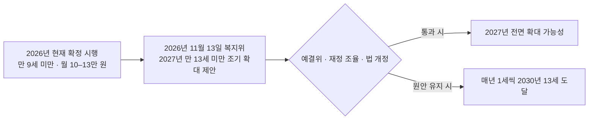

> <strong>이 글의 위치</strong>: 2026년 11월 중순 보도로 관심이 커진 <strong>아동수당 확대 이슈</strong>를 정리했습니다. 현재 실제로 지급되는 <strong>2026년 확정 기준</strong>과 국회에서 논의 중인 <strong>2027년 조기 확대안</strong>을 구분해, 헷갈리는 부분을 한 번에 정리합니다.

> <strong>3줄 요약</strong>
>
> 1. <strong>현재(2026년) 확정 기준</strong>: <strong>만 9세 미만(0\~107개월)</strong> 모든 아동에게 소득 무관하게 기본 월 10만 원, 지역 가산을 더하면 최대 월 13만 원이 매월 25일 지급됩니다. 2026년 4월 24일부터 확대·소급이 시작됐습니다.
> 2. <strong>11월 논의(추진안)</strong>: 11월 13일 국회 보건복지위 전체회의에서 <strong>2027년 1월부터 만 13세 미만 전체(0\~12세)에게 확대</strong>하고 지급액도 <strong>월 20만\~30만 원</strong>으로 올리자는 부대의견이 여야 합의로 의결됐습니다. (예결위 심사·법 개정·재정 확보 필요)
> 3. <strong>신청 핵심</strong>: 출생일 포함 <strong>60일 이내</strong>에 복지로나 주민센터에 신청하면 출생한 달부터 소급 지급됩니다. 2017년생은 별도 부칙 특례로 2026\~2029년 계속 받습니다.

---

## 🔥 1. 왜 지금 '아동수당'이 다시 화제가 되었을까?

2026년 11월 13일 국회 보건복지위원회 전체회의에서 <strong>2027년도 예산안 예비심사 결과</strong>가 여야 합의로 의결됐고, 여기에 <strong>아동수당 확대 일정을 앞당기자는 부대의견</strong>이 담기면서 관심이 집중됐습니다.

- <strong>현행 법정 일정</strong>: 2026년 만 9세 미만 → 2027년 만 10세 미만 → 2030년 만 13세 미만까지 매년 1세씩 확대
- <strong>2026년 11월 복지위 부대의견</strong>: 단계적 확대를 기다리지 않고 <strong>2027년 1월부터 만 13세 미만(0\~12세) 전체</strong>에 지급하도록 「아동수당법」 부칙의 지급 연령 특례를 정비하자는 제안
- <strong>지급액 인상 요구</strong>: 아동기본수당 수준인 <strong>월 20만\~30만 원</strong>으로 올리자는 의견도 함께 담겼습니다. 이 경우 대상은 382만 명(2027년 기준)으로 늘고, 연 5조 원 안팎의 추가 재정이 필요합니다.

다만 이 내용은 <strong>예산결산특별위원회(예결위)의 최종 예산 심사, 재정당국 조율, 관련 법률 개정</strong>을 모두 거쳐야 효력이 발생합니다. 따라서 <strong>"현재 당장 바뀌어 지급되는 금액"과 "내년 이후 추진 중인 논의안"을 정확히 구분</strong>해서 보셔야 합니다.

| 연도 | 현행 법 기준 | 2027 조기 확대안 |
| :--- | :--- | :--- |
| 2026 | 만 9세 미만 (시행 중) | - |
| 2027 | 만 10세 미만 | <strong>만 13세 미만</strong> (논의) |
| 2028 | 만 11세 미만 | - |
| 2029 | 만 12세 미만 | - |
| 2030 | 만 13세 미만 | - |

*(※ 오른쪽 열은 2026년 11월 복지위 부대의견으로, 아직 확정된 법이 아닙니다.)*

---

## 💰 2. 2026년 현재 시행 중인 아동수당 지원 대상·지급액

2026년부터 아동수당은 기존 만 8세 미만에서 <strong>만 9세 미만</strong>으로 확대됐고, 거주 지역에 따라 <strong>추가 지원금</strong>이 붙습니다. 2026년 3월 20일 개정 「아동수당법」이 공포됐고, 전산 준비를 거쳐 <strong>4월 24일부터 확대·소급 지급</strong>이 시작됐습니다.

### 1) 지원 대상 및 기본 원칙
- <strong>연령 기준</strong>: <strong>만 9세 미만(0\~107개월)</strong> — 만 9세 생일이 속한 달의 <strong>전달</strong>까지 지급
- <strong>소득·재산 기준</strong>: <strong>무관</strong> (부모 소득이나 자산 규모와 관계없이 보편 지급)
- <strong>국적 요건</strong>: 대한민국 국적을 보유하고 주민등록번호가 정상 부여된 아동. 복수국적자, 난민인정자, 「재한외국인 처우 기본법」상 특별기여자도 포함되며, 난민인정 심사 진행 중인 경우는 제외됩니다.

### 2) 지역별 월 지급 금액 (2026년 5월 지급분부터)

| 거주 지역 구분 | 현금 지급액 | 지역사랑상품권 선택 시 |
| :--- | :--- | :--- |
| <strong>수도권</strong> | <strong>월 10만 원</strong> | - |
| <strong>비수도권</strong> | <strong>월 10만 5천 원</strong> | - |
| <strong>인구감소지역 (우대)</strong> | <strong>월 11만 원</strong> | <strong>월 12만 원</strong> |
| <strong>인구감소지역 (특별)</strong> | <strong>월 12만 원</strong> | <strong>월 13만 원</strong> |

*(※ 인구감소지역 우대·특별지역 구분은 보건복지부 고시로 정해집니다. 지역사랑상품권 +1만 원은 지자체가 주민 의견 수렴과 조례 개정을 거쳐 시행하므로, 같은 인구감소지역이라도 시행 시점이 다를 수 있습니다.)*

### 3) 2026년 4월 확대·소급과 2017년생 특례
- 2026년 1월분부터 확대 대상과 지역 가산이 소급 적용됐습니다. 4월 24일 지급에서는 그동안 8세 생일이 지나 수당이 끊겼던 <strong>2017년 1월\~2018년 3월생</strong> 45만 명 가운데 약 43만 명에게 1\~3월분 <strong>1,687억 원</strong>이 소급 지급됐습니다(4월 전체 255만 명·3,892억 원).
- <strong>2017년생 특례</strong>: 2017년 출생아는 2026\~2029년 동안 나이와 관계없이 매년 1\~12월분을 받습니다. 2026년에 만 9세가 지나 끊기는 일은 없습니다.
- 지급 정보가 확인되지 않아 4월에 받지 못한 경우에는 정보 확인 후 미지급분이 소급 지급됩니다. 복지로나 주민센터에서 지급 정보를 확인하세요.

---

## 📅 3. 지급일, 신청 방법, 그리고 '60일 소급' 주의사항

### 1) 지급일 및 수령 계좌
- <strong>지급일</strong>: <strong>매월 25일</strong> (「아동수당법 시행령」 제9조). 25일이 토요일·공휴일(일요일 포함)이면 <strong>직전 평일</strong>로 앞당겨 입금됩니다. 예를 들어 2026년 10월 25일은 일요일이라 10월 23일(금)에 지급됐습니다.
- <strong>입금 계좌</strong>: 아동 본인 또는 보호자 명의 계좌
- <strong>지급 정지</strong>: 아동의 국외 체류가 90일 이상 이어지거나 행방불명·거주불명으로 등록되면 지급이 멈출 수 있습니다.

### 2) 신청 방법 (온라인 · 오프라인)
- <strong>온라인 신청</strong>: [복지로(bokjiro.go.kr)](https://www.bokjiro.go.kr/) PC·앱에서 보호자 본인 인증 후 신청합니다. 부모가 보호자인 경우에만 온라인 신청이 가능합니다. [정부24(gov.kr)](https://www.gov.kr/)에서는 <strong>미지급 아동수당 지급청구</strong> 민원을 별도로 처리합니다.
- <strong>방문 신청</strong>: 아동의 주민등록상 주소지 관할 <strong>읍·면·동 행정복지센터(주민센터)</strong> 방문
- <strong>출생신고 동시 신청</strong>: 출생신고 시 <strong>'행복출산 원스톱 서비스'</strong>를 이용하면 아동수당·부모급여·첫만남이용권 등을 한 번에 신청할 수 있습니다.
- <strong>준비물</strong>: 신청인 신분증, 수당을 받을 계좌 정보. 보호자가 부모가 아닌 경우 등은 추가 서류가 필요할 수 있습니다.

### 3) 절대 놓치면 안 되는 '60일 소급' 규칙
- <strong>출생일 포함 60일 이내 신청</strong>: <strong>출생한 달부터 소급</strong>해서 전액 지급
- <strong>60일 경과 후 신청</strong>: 신청일이 속한 달부터만 지급 (지나간 달은 소급 불가)

---

## ❓ 4. 자주 묻는 질문 (FAQ)

<strong>Q1. 2027년부터 정말 만 13세까지 월 20만\~30만 원을 받을 수 있나요?</strong> 
아직 <strong>확정된 사항이 아닙니다.</strong> 2026년 11월 13일 복지위 부대의견은 2027년 1월부터 13세 미만 전체에 지급하고 지급액을 20만\~30만 원으로 올리자는 제안일 뿐, 예결위 최종 심사와 「아동수당법」 개정, 재정 확보가 남아 있습니다. 정부 예산안의 아동기본수당(2027년 7월 이후 출생아부터 기본 20만·지방 우대 30만 원)과도 별개 논의입니다.

<strong>Q2. 만 9세 생일이 있는 달에도 나오나요?</strong> 
아니요. 법령상 "만 9세 미만"이므로 <strong>만 9세 생일이 속한 달의 전달</strong>까지만 지급됩니다. 예를 들어 11월이 만 9세 생일이라면 10월 25일이 마지막 지급일입니다.

<strong>Q3. 2017년생인데 작년에 수당이 끊겼습니다. 다시 받을 수 있나요?</strong> 
받을 수 있습니다. 2026년 개정으로 2017년 1월\~2018년 3월생이 다시 대상에 포함됐고, 2026년 1\~3월분은 4월 24일에 소급 지급됐습니다. 2017년생은 2026\~2029년 동안 생일과 관계없이 매년 1\~12월분을 받는 특례가 적용됩니다. 4월 소급분을 받지 못했다면 복지로나 행정복지센터에서 지급 정보를 확인하세요.

<strong>Q4. 아이 육아·가족 일정을 한눈에 관리할 수 있는 도구가 있을까요?</strong> 
매월 25일 수당 입금일, 예방접종, 어린이집·학교 준비물 일정을 놓치지 않으려면 블로그 내 무료 도구인 [가족 일정 플래너](/planner/)에 등록해 구글 캘린더·ICS로 내보낼 수 있습니다. 아이와 집에서 천천히 시계·달력·단위를 익히는 [어린이 생활 교육 놀이터](/edu/)와 [아둥바둥 대신 느긋하게 키우는 교육법](/posts/20261005-2-leisurely-child-education-guide/) 글도 함께 참고해 보세요.

---

## 🧭 5. 정리

이번 아동수당 이슈의 핵심은 <strong>"2026년 현재 만 9세 미만(월 10만\~13만 원)으로 운영 중인 제도를, 2027년부터 만 13세 미만까지 앞당겨 확대하자는 국회 논의"</strong>입니다.

- <strong>2026년</strong>: 만 9세 미만, 월 10만\~13만 원. 4월 24일부터 확대·소급이 시행됐고, 2017년생은 2026\~2029년 특례가 적용됩니다.
- <strong>2027년</strong>: 현행 법대로면 만 10세 미만이지만, 복지위 부대의견이 관철되면 만 13세 미만 전체로 확대됩니다. 예결위 심사와 법 개정, 연 5조 원 규모의 재정 확보가 관건입니다.
- <strong>신청</strong>: 출생 후 60일 이내에 신청해야 출생월부터 소급받을 수 있습니다. 2014\~2016년생은 조기 확대가 확정될 경우 2027년 추가 수급 대상이 됩니다.

---

> <strong>기준 안내</strong>: 2026년 11월 17일 기준. 2026년 지급 기준은 보건복지부 보도자료(2026.4.23)와 복지로 안내를, 2027년 확대 논의는 2026.11.17 보도를 기준으로 정리했습니다. 2027년 확대안과 지역사랑상품권 가산 시점은 국회 예산 심의·법 개정·지자체 공고에 따라 달라질 수 있습니다.
>
> <strong>참고 자료</strong>
>
> - [보건복지부 — 아동수당 지급(지원 대상·금액)](https://www.mohw.go.kr/menu.es?mid=a10711030100)
> - [보건복지부 보도자료 — 아동수당 대상·금액 확대, 4월부터 지급 시작(2026.4.23)](https://www.mohw.go.kr/board.es?mid=a10503010100&bid=0027&act=view&list_no=1490257)
> - [복지로 — 아동수당 상세 안내](https://www.bokjiro.go.kr/ssis-tbu/twataa/wlfareInfo/moveTWAT52011M.do?wlfareInfoId=WLF00001171)
> - [복지로 뉴스 — 아동수당 9세 미만 확대, 1\~3월분 소급해 24일 지급](https://www.bokjiro.go.kr/ssis-tbu/cms/pc/news/news/1309692_1114.html)
> - [경기일보 — 2027년 아동수당 13세 미만 확대 추진(2026.11.17)](https://www.kyeonggi.com/article/20261117580139)
> - [한국일보 — 내년부터 중1까지 20만\~30만 원?(2026.11.17)](https://www.hankookilbo.com/news/article/A2026111512290002992)
> - [정부24 — 미지급 아동수당 지급청구](https://www.gov.kr/mw/AA020InfoCappView.do?CappBizCD=13520000072)
> - [관련 글: 아둥바둥 대신 느긋하게 키우는 교육법](/posts/20261005-2-leisurely-child-education-guide/)
