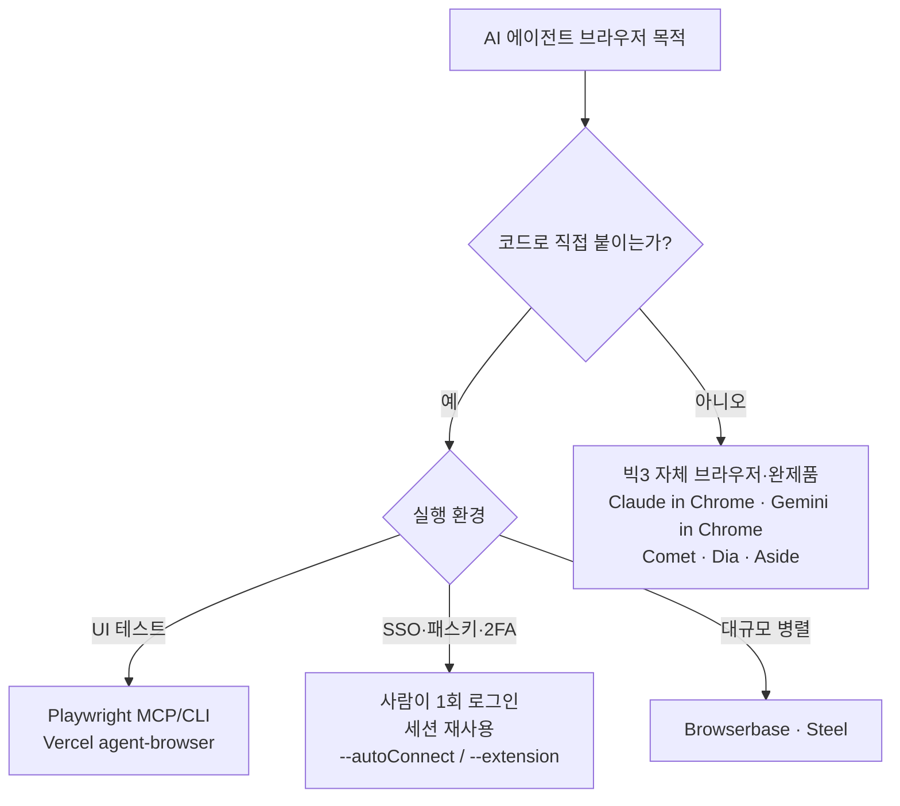

> <strong>이 글의 위치</strong>: 앞서 [AI 브라우저 Aside 설치법: Mac 다운로드부터 실전까지](/posts/20261005-1-aside-ai-browser-mac-install-guide/)에서 완제품 AI 브라우저의 온보딩을 다뤘다면, 이 글은 <strong>ChatGPT · Claude · Gemini 3개 모델에게 같은 질문을 던졌을 때 드러난 관점 차이</strong>, <strong>2026년 11월 기준 공식 문서 팩트체크</strong>, 그리고 <strong>직접 부딪힌 패스키 로그인 실패 사례</strong>를 함께 정리한 글입니다.

> <strong>3줄 요약</strong>
>
> 1. <strong>핵심 구분</strong>: "AI 에이전트가 쓰기 좋은 브라우저"는 사람이 쓰는 <strong>완제품 AI 브라우저(Comet·Dia·Aside 등)</strong>, 빅3가 직접 만든 <strong>자체 브라우저 에이전트(Claude in Chrome·Gemini in Chrome·ChatGPT 데스크톱)</strong>, 코드가 조종하는 <strong>에이전트용 인프라(Playwright MCP·DevTools MCP·agent-browser·Browser Use)</strong>로 나뉩니다.
> 2. <strong>3사의 시각 차이</strong>: <strong>Gemini</strong>는 기능·편의성(DOM 압축, 로컬 모델 연동, 기존 세션 재사용) 중심의 카탈로그를 제시했고, <strong>ChatGPT</strong>는 "특별한 AI 브라우저보다 표준 Chrome + Playwright가 본질"이라며 리스크를 짚었으며, <strong>Claude</strong>는 로컬 모델의 다단계 실패율·프로필 보안·광고성 비교 글까지 가장 날카롭게 걸러냈습니다.
> 3. <strong>팩트체크 결과</strong>: <strong>ChatGPT Atlas는 2026년 8월 9일 종료</strong>됐고(OpenAI 공식 안내), <strong>Chrome DevTools MCP의 `--autoConnect`</strong>는 Chrome 144+ 공식 기능, <strong>Vercel `agent-browser`</strong>는 Rust CLI(Apache-2.0)로 확인됐습니다. <strong>Playwright MCP</strong>는 `--extension`으로 이미 로그인된 브라우저에 붙을 수 있습니다. 반면 실제 로그인 실험에서는 <strong>패스키·2FA</strong>가 자동화의 마지막 벽이었습니다.

---

## 🔍 1. 같은 질문, 세 AI의 갈라진 시선 (ChatGPT · Claude · Gemini)

세 모델 모두에게 <strong>"AI 에이전트가 사용하기 좋은 브라우저는 무엇인가?"</strong>를 묻고, 이어서 동일한 비교표를 평가하게 했습니다. 거론하는 도구 목록은 거의 같았지만, <strong>무엇을 추천하고 무엇을 경계하느냐</strong>에서 세 모델의 성격 차이가 극명하게 드러났습니다.

| 비교 항목 | Gemini | ChatGPT | Claude |
| :--- | :--- | :--- | :--- |
| <strong>핵심 프레이밍</strong> | 개발용 도구 4종 vs 완제품 1종 | 표준 Chrome + Playwright가 본질 | 사람용 AI 브라우저 vs 에이전트 인프라 |
| <strong>추천 포인트</strong> | DOM 압축(Browser Use), 로컬 모델 연동, --autoConnect 편의성 | 인터페이스·연결 방식이 브라우저 자체보다 중요 | 로컬 테스트(Playwright MCP), 사내 SSO(DevTools MCP), 운영(Browserbase) |
| <strong>리스크·한계 경고</strong> | 비교적 낙관적 (장점 위주 서술) | 로그인 세션 노출 권한, 봇 우회 정당성 경고 | <strong>작은 로컬 모델의 다단계 실패율</strong>, 약관 문제, <strong>자사 홍보성 "1위 글" 경계</strong> |
| <strong>종료/미확인 항목 처리</strong> | ChatGPT Atlas를 추천 목록에 그대로 포함 | Atlas 상태 및 @e1 문서 별도 확인 권고 | Atlas 종료 언급 경고 + --autoConnect·agent-browser는 문서 검증 유보 |

요약하면 <strong>기능 지도는 Gemini가 가장 깔끔하게 그렸고, 실무 함정과 보안 리스크는 ChatGPT와 Claude가 훨씬 냉정하게 짚어냈습니다.</strong>

> <strong>읽는 순서 주의</strong>: 위 표는 "모델이 그렇게 답했다"는 <strong>관찰 기록</strong>이지 사실 판정이 아닙니다. 모델은 틀린 도구를 추천할 수도 있고, 반대로 맞는 도구를 의심할 수도 있습니다. 아래 2장에서 도구의 실존 여부와 동작 방식을 공식 문서로 다시 확인했습니다.

---

## 🧪 2. 5가지 스택 실전 분석과 팩트체크

세 모델의 답변에서 교차 검증이 필요한 항목들을 실제 공식 문서·릴리스 현황(2026년 11월 기준)과 대조한 결과입니다. 모델 답변은 실행 시점·웹 검색·도구 설정에 따라 달라질 수 있으므로, 아래 표의 <strong>도구 사실</strong>은 공식 문서를 기준으로 읽어 주세요.

### 한눈에 보는 5가지 스택

| 스택 | 인터페이스·세션 | 강점 | 주의 |
| :--- | :--- | :--- | :--- |
| Playwright MCP·CLI | MCP/CLI · 영구 프로필(기본) 또는 --extension | 표준·범용, 코딩 에이전트 친화 | MCP는 토큰 소모 큼 |
| Browser Use | Python/TS · 로컬 Chrome/CDP | 커스텀 에이전트, 로컬 모델 | 다단계는 모델 성능 의존 |
| Chrome DevTools MCP | MCP · 기존 Chrome 세션(--autoConnect) | SSO·2FA 뒤 업무 | 프로필 전체 노출 |
| Vercel agent-browser | CLI/MCP · 새 브라우저 또는 --cdp | 저토큰 UI 검증 | DOM 변경 시 재스냅샷 |
| 클라우드 | SDK/API · 클라우드 프로필 | 대규모 병렬 | 약관·비용·반출 |

### 1) Playwright MCP·CLI + Browser Use (로컬 오픈소스)

- <strong>Playwright MCP</strong>: Microsoft가 관리하는 MCP 서버로, 스크린샷 대신 <strong>접근성 스냅샷(Accessibility Snapshot)</strong>을 구조화해 전달합니다. `npx @playwright/mcp@latest`로 실행하며, <strong>`--extension`</strong> 플래그를 쓰면 Playwright Extension을 설치한 Edge·Chrome의 <strong>이미 실행 중인 브라우저</strong>에 연결할 수 있습니다. `--isolated`는 프로필을 메모리에만 두어 디스크에 남기지 않습니다. 반대로 기본값은 <strong>영구 프로필</strong>(macOS `$HOME/Library/Caches/ms-playwright/mcp-...`)이라 한 번 로그인한 세션이 다음 실행까지 유지되고, `--user-data-dir`로 위치를 고정할 수 있습니다.
- <strong>Playwright CLI + Skills</strong>: Playwright MCP 공식 README는 "코딩 에이전트라면 CLI+Skills가 더 토큰 효율적"이라고 직접 안내합니다. MCP는 거대한 도구 스키마와 접근성 트리를 컨텍스트에 올리지만, CLI는 짧은 명령 단위로 실행되기 때문입니다. 즉 <strong>MCP는 범용 클라이언트에, CLI+Skills는 코딩 에이전트에 더 잘 맞는 흐름</strong>으로 갈라졌습니다.
- <strong>Browser Use</strong>: Python/TypeScript 라이브러리(MIT). 화면 스크린샷을 통째로 넘기는 대신 DOM·접근성 트리의 상호작용 요소에 번호를 매겨 텍스트로 압축하고, `mode='ultrafast'`에서는 접근성 트리 ID로 바로 동작합니다. 로컬 모델은 OpenAI 호환 엔드포인트로 연결합니다(예: Ollama `http://localhost:11434/v1`). 비전 기반 동작도 선택적으로 쓸 수 있습니다.
- <strong>Claude의 핵심 지적</strong>: Gemini는 로컬 LLM과 묶어 "비용 없이 자동화"하는 점을 강조했지만, Claude는 <strong>"작은 로컬 모델은 여러 단계(Multi-step)가 이어지는 웹 조작에서 클라우드 프론티어 모델보다 훨씬 자주 실패한다"</strong>고 짚었습니다. 이 지적은 도구가 아니라 <strong>모델 선택의 문제</strong>이므로, 도구 평가와 분리해서 읽어야 합니다.
- <strong>권장</strong>: 단순 조회·단발성 테스트는 로컬 모델로 실험 가능하지만, 다단계 폼 입력이나 예외 처리가 필요한 실무는 상용 모델이나 `Playwright MCP` 조합이 안정적입니다.

### 2) Chrome DevTools MCP와 --autoConnect (기존 세션 연결)

- <strong>팩트체크 결과</strong>: <strong>실존 및 공식 지원</strong>. Chrome for Developers 문서에 따르면 <strong>Chrome 144 이상</strong>에서 `chrome://inspect/#remote-debugging`의 원격 디버깅을 켠 뒤, MCP 설정에 <strong>`--autoConnect`</strong>(카멜케이스)를 추가하면 현재 실행 중인 Chrome에 붙습니다. 연결 시 Chrome이 권한을 물으면 <strong>Allow</strong>를 눌러야 합니다.
- <strong>플래그 표기 주의</strong>: `--auto-connect`(하이픈)는 Chrome DevTools MCP의 플래그가 아니라 <strong>Vercel `agent-browser` 쪽 표기</strong>입니다. 두 도구를 같은 글에서 다룰 때 가장 헷갈리기 쉬운 부분입니다.
- <strong>언제 쓰는가</strong>: 매번 새 헤드리스 브라우저를 띄우면 막히는 <strong>사내망 SSO, 2단계 인증, 기존 로그인 세션</strong>을 그대로 써야 할 때 가장 현실적인 해법입니다. 이미 로그인한 탭에서 디버깅·레이아웃 수정을 이어가는 용도로도 적합합니다.
- <strong>보안 주의</strong>: 공식 문서도 <strong>"auto-connect가 활성화되면 에이전트가 열린 탭, 세션 스토리지, 로컬 스토리지, 쿠키 등 브라우저 프로필의 모든 데이터에 접근한다"</strong>고 경고합니다. 개인 금융·메일·SNS가 로그인된 메인 프로필에 그대로 붙이지 말고, <strong>업무용 별도 Chrome 프로필</strong>을 분리하세요. 사용 통계·성능 추적 전송을 끄려면 `--no-usage-statistics`, `--no-performance-crux`를 함께 지정합니다.

### 3) Vercel agent-browser와 @e1 참조 방식

- <strong>팩트체크 결과</strong>: <strong>실존 및 고효율 도구</strong>. Vercel Labs가 공개한 <strong>Rust 네이티브 CLI</strong>(Apache-2.0)로, `npm install -g agent-browser` 후 `agent-browser install`로 Chrome for Testing을 준비합니다. Homebrew(`brew install agent-browser`)와 `npx` 실행도 지원합니다.
- <strong>동작 원리</strong>: `agent-browser snapshot -i`를 실행하면 상호작용 가능한 요소만 압축한 텍스트에 `[ref=e1]` 같은 짧은 ID가 붙고, 이후 `agent-browser click @e1`처럼 <strong>한 줄 명령</strong>으로 조작합니다. 명령은 백그라운드 데몬이 Chrome DevTools Protocol로 처리하며, 브라우저는 명령 사이에도 계속 열려 있습니다.
- <strong>토큰 절약의 정확한 이유</strong>: "MCP를 없앤 도구"라기보다, <strong>접근성 트리를 짧은 ref 텍스트로 바꾸고 `-i`로 상호작용 요소만 읽으며, 한 번에 한 명령만 주고받기</strong> 때문입니다. 실제로 `agent-browser mcp`로 MCP 서버 모드도 제공하므로, MCP 클라이언트에서도 쓸 수 있습니다.
- <strong>실무 팁</strong>: 스냅샷 이후 DOM이 바뀌면 ref가 무효가 되므로 다시 스냅샷을 떠야 합니다. 대상이 가려져 있거나 비활성·화면 밖이면 클릭이 "성공"으로 처리되지 않고 실패하므로, 배너를 닫고 재시도하는 루프가 필요합니다. `--cdp` 또는 `--auto-connect`로 실행 중인 Chrome에 붙을 수도 있고, Browserbase·Browserless·Browser Use 같은 클라우드 브라우저 제공자와 연결할 수 있습니다.

### 4) Browserbase·Bright Data·Steel (클라우드 브라우저 인프라)

- <strong>역할</strong>: 수십\~수백 개의 격리된 원격 브라우저를 서버리스로 병렬 실행할 때 쓰는 인프라입니다. Browserbase가 공개한 TypeScript 프레임워크 <strong>`Stagehand`</strong>, 오픈소스 브라우저 API <strong>`Steel`</strong>, 프록시·수집 계층의 <strong>Bright Data</strong>가 대표적입니다.
- <strong>현실적 한계</strong>: 일부 비교표는 "CAPTCHA 우회·스텔스 모드"를 만능 장점으로 적지만, ChatGPT와 Claude가 모두 지적했듯 <strong>대상 사이트의 이용약관(ToS) 위반 소지</strong>가 있어 일반 기업 사내 업무나 정상 API 대용으로는 쓸 일이 적습니다. 대규모 병렬 수집이 정당한 업무라도 robots.txt·약관·개인정보 처리 방침을 먼저 확인해야 합니다. Browser Use Cloud도 stealth·CAPTCHA 해결을 제공하지만, 그 기능이 대상 사이트의 약관을 면제해 주지는 않습니다.

### 5) 완제품·내장형 AI 브라우저(Comet·Dia·Edge Copilot·Aside)와 Atlas 종료

- <strong>팩트체크 핵심 (`ChatGPT Atlas` 종료)</strong>: Gemini의 답변에는 `ChatGPT Atlas`가 추천 브라우저로 올라와 있었지만, <strong>OpenAI는 2026년 7월 9일 종료를 발표하고 8월 9일자로 서비스를 종료</strong>했습니다. 이후 에이전트 기능의 무게 중심은 <strong>ChatGPT 데스크톱 앱(ChatGPT Work·Codex)과 Chrome 플러그인</strong>으로 옮겨갔습니다. AI가 오래된 학습 데이터나 웹 스니펫을 인용해 종료된 제품을 추천할 수 있음을 보여주는 단적인 사례입니다.
- <strong>현재 선택지</strong>: 코드 작성 없이 일반 사용자가 브라우저 자체에 에이전트 작업을 맡기고 싶다면 Perplexity <strong>Comet</strong>(Mac·Windows·iOS·Android), 업무용으로 재편된 <strong>Dia</strong>(macOS·Windows, 무료), <strong>Edge Copilot</strong>, 혹은 Mac에서 자격증명 Vault와 루틴 자동화를 지원하는 <strong>[Aside](/posts/20261005-1-aside-ai-browser-mac-install-guide/)</strong> 등을 검토하는 편이 맞습니다.
- <strong>광고성 비교 글 주의</strong>: Claude가 짚었듯 검색 상위에는 특정 신생 브라우저를 "압도적 1위"로 꼽는 마케팅 성격의 글이 섞여 있을 수 있습니다. 제품명보다 <strong>누가 쓴 글인지, 어떤 조건에서 측정했는지</strong>를 먼저 확인하세요.

### 팩트체크 판정 요약

| 확인 항목 | 판정 | 근거 |
| :--- | :--- | :--- |
| ChatGPT Atlas 종료 | <strong>사실</strong> · 2026-08-09 | OpenAI Help Center |
| Chrome --autoConnect | <strong>사실</strong> · Chrome 144+ | Chrome for Developers |
| Vercel agent-browser | <strong>사실</strong> · Rust CLI·Apache-2.0 | GitHub README |
| Playwright MCP --extension | <strong>사실</strong> | microsoft/playwright-mcp |

---

## 🌐 3. 빅3는 자기 브라우저를 어떻게 만들었나

세 모델의 답변만 비교하면 "남의 도구를 고르는 이야기"로 끝납니다. 그런데 2026년 11월 현재 <strong>ChatGPT·Claude·Gemini는 각자 다른 방식으로 브라우저에 에이전트를 붙이고 있습니다.</strong> 이 차이가 실사용 선택에 더 직접적입니다.

| 서비스 | 2026년 11월 상태 | 특징과 주의점 |
| :--- | :--- | :--- |
| <strong>Claude in Chrome</strong> | Chrome 확장 · 2026-08-26 정식 출시(GA), 유료 플랜 전체 | 이미 로그인된 페이지를 읽고 클릭·입력·폼 작성. 단계별 승인 없이 자율 실행할 수 있지만, 행동마다 안전 분류기가 검사합니다. Anthropic은 프롬프트 인젝션 위험을 별도 문서로 경고합니다. |
| <strong>Gemini in Chrome</strong> | Chrome 내장 · 2026-01-28 Gemini 3 업데이트 | 사이드 패널, 여러 탭 비교, <strong>auto browse</strong>(다단계 자동 탐색). macOS·Windows·Chromebook Plus 대상이며 Personal Intelligence는 순차 제공 예정입니다. |
| <strong>ChatGPT</strong> | 독립 브라우저 없음 · 데스크톱 앱으로 통합 | Atlas 종료 후 <strong>ChatGPT 데스크톱 앱(ChatGPT Work·Codex)</strong>과 Chrome 플러그인으로 브라우저 기능을 제공합니다. "AI 전용 브라우저"를 새로 설치하는 대신 기존 Chrome을 쓰는 방향입니다. |

> <strong>실무 판단</strong>: 빅3 자체 브라우저는 설치·설정이 가장 쉽지만, 페이지 내용이 각 벤더의 클라우드로 전송된다는 전제가 있습니다. 사내 어드민·고객 데이터 화면이라면 브라우저 확장 허용 목록과 데이터 처리 정책을 먼저 확인해야 합니다. 반대로 "내가 이미 로그인한 사이트에서 반복 작업을 맡기는" 용도라면 DevTools MCP보다 Claude in Chrome이나 Gemini in Chrome이 더 간단한 경우가 많습니다.

---

## 🧩 4. 실전 사례: 에이전트 브라우저가 패스키 앞에서 멈춘 이유

이 글을 쓰면서 코딩 에이전트의 내장 브라우저로 3사 공유 링크를 열어 봤습니다. 이번 시도에서는 ChatGPT·Gemini 링크가 바로 열린 반면, <strong>Claude 공유 링크는 로그인 화면으로 리디렉션</strong>됐습니다. 공유 범위가 제한된 링크이거나 비로그인 접근을 막아 둔 경우에도 같은 일이 생기므로, 이것만으로 "Claude 링크는 원래 로그인이 필요하다"고 일반화할 수는 없습니다.

문제는 그다음이었습니다. 내장 브라우저 안에서 "Google 계정으로 로그인"을 눌렀지만 인증은 다음 단계에서 멈췄습니다.

- <strong>관측된 오류</strong>: "문제가 발생했습니다 — 블루투스가 켜져 있고 기기가 서로 가까이에 있는지 확인하세요"
- <strong>오류의 정체</strong>: 비밀번호가 틀렸다는 뜻이 아닙니다. Chrome이 <strong>휴대폰을 패스키 인증기로 쓰는 하이브리드(Bluetooth) 전송</strong>에서 띄우는 안내입니다. 즉 "인증기와 연결이 안 됐다"는 신호입니다.

### 왜 자동화 브라우저에서 패스키가 막히나

| 층위 | 무슨 일이 일어나나 | 결과 |
| :--- | :--- | :--- |
| 키 | 개인키는 기기 밖으로 나오지 않고, 서버에는 공개키만 저장됩니다 | 비밀번호·TOTP 시드처럼 복사해 넘길 수 없음 |
| 확인 | Touch ID·Windows Hello·휴대폰 승인 같은 OS UI가 필요합니다 | 헤드리스·원격에는 UI가 없고, 있어도 사람이 눌러야 함 |
| 세션 | 로그인 상태는 쿠키·로컬 스토리지·신뢰 기기 표시로 그 프로필에만 남습니다 | 새 인스턴스를 띄우면 매번 처음부터 |

세 줄로 줄이면 이렇습니다. <strong>패스키는 "비밀번호가 없어서"가 아니라 "사람이 그 자리에서 확인해야 해서" 자동화가 어렵습니다.</strong> 반대로 TOTP는 시드만 있으면 코드를 계산할 수 있어 자동화가 쉽습니다. 기기 간에 동기화되는 패스키(iCloud 키체인·Google 비밀번호 관리자)도 암호화된 사본이라 파일로 꺼내 다른 브라우저에 넣을 수 없습니다. 인증 수단의 성질이 자동화 가능성을 갈랐습니다.

### 인증 수단별 자동화 난이도

| 인증 수단 | 난이도 | 현실적인 접근 |
| :--- | :--- | :--- |
| 공개 페이지 | 낮음 | 익명 세션 그대로 조회 |
| 아이디·비밀번호 | 낮음 | 전용 테스트 계정 + 시크릿 저장소 |
| TOTP 6자리 | 중간 | 시드 값을 시크릿 저장소에 두고 코드 생성 |
| 패스키(플랫폼 인증기) | 높음 | 사람이 1회 로그인한 프로필 재사용 |
| 패스키(휴대폰 하이브리드) | 매우 높음 | 원격 브라우저에는 Bluetooth 라디오 자체가 없음 |
| SSO(SAML·OIDC) | 조건부 | 세션 재사용 또는 서비스 계정·토큰 |

### 실무 해결 순서

1. <strong>로그인 단계는 자동화하지 않습니다.</strong> 사람이 한 번 로그인하고 그 프로필을 물려받습니다. Playwright MCP는 기본이 영구 프로필이라 로그인 상태가 세션 사이에 유지되고, `--user-data-dir`로 위치를 고정할 수 있습니다. `--isolated`를 쓰면 반대로 매번 초기화됩니다.
2. <strong>이미 쓰는 Chrome에 붙입니다.</strong> Chrome DevTools MCP `--autoConnect` 또는 Playwright MCP `--extension`으로 로그인된 세션을 재사용하되, 업무용 프로필을 분리합니다.
3. <strong>그래도 자동 로그인이 필요하면 인증 수단을 바꿉니다.</strong> 패스키가 강제된 개인 계정 대신 비밀번호+TOTP 테스트 계정이나 IdP의 서비스 계정·OAuth 클라이언트를 씁니다.
4. <strong>WebAuthn 자체를 검증해야 하면 가상 인증자를 씁니다.</strong> Chromium CDP의 `WebAuthn.enable`과 `WebAuthn.addVirtualAuthenticator`(ctap2·internal, hasResidentKey, hasUserVerification, automaticPresenceSimulation)로 실제 계정이 아닌 테스트 계정에서만 흉내 냅니다. Playwright는 `context.newCDPSession(page)`, Puppeteer는 `page.createCDPSession()`으로 접근합니다.

> <strong>하지 말 것</strong>: 2단계 인증·패스키 우회, 세션 쿠키 복사·공유, 잠금이 걸릴 때까지 로그인 반복. 2FA는 뚫는 대상이 아니라 <strong>사람이 한 번 통과하고 세션만 재사용하는 대상</strong>입니다.
>
> <strong>실험의 한계</strong>: 링크 1개·계정 1개·시도 1회에서 나온 관측입니다. 브라우저 종류, 계정의 패스키 등록 상태, 사내 정책에 따라 결과가 달라질 수 있습니다.

---

## 🧭 5. 내 환경에 맞는 브라우저 선택 가이드

### 상황별 최종 추천
1. <strong>로컬 코딩 에이전트(Claude Code, Cursor, Antigravity)의 UI 검증</strong>: <strong>Playwright MCP/CLI</strong> 또는 <strong>Vercel `agent-browser`</strong>. 토큰 예산이 빠듯하면 CLI+Skills 쪽이 유리합니다.
2. <strong>사내 시스템·SSO·로그인 뒤의 반복 업무 자동화</strong>: <strong>Chrome DevTools MCP (`--autoConnect`) + 전용 Chrome 프로필 분리</strong>. Chrome 144+ 조건을 먼저 확인하세요.
3. <strong>패스키·2FA가 걸린 사이트</strong>: 자동 로그인을 시도하지 말고 <strong>사람이 1회 로그인한 프로필 재사용</strong>. WebAuthn 자체를 검증할 때만 테스트 계정 + CDP 가상 인증자를 씁니다.
4. <strong>Python/TS 커스텀 AI 에이전트 개발</strong>: <strong>Browser Use + Playwright</strong>. 복잡한 다단계 작업에는 상용 추론 모델을 권장합니다.
5. <strong>이미 로그인한 사이트에서 코드 없이 작업 위임</strong>: <strong>Claude in Chrome</strong> 또는 <strong>Gemini in Chrome</strong>. 사내 데이터 반출 정책을 먼저 확인하세요.
6. <strong>개발 설정 없이 리서치·요약·웹 작업 위임</strong>: <strong>Comet / Dia / Aside</strong>. Atlas는 종료됐으므로 추천 목록에서 빼야 합니다.

---

## 🔒 6. 도입 전 반드시 챙길 보안 4원칙

1. <strong>브라우저 프로필 분리</strong>: 개인 은행, 회사 메일, 비밀번호 관리자가 로그인된 기본 Chrome 프로필에 에이전트를 연결하지 마세요. `--autoConnect`는 편리한 만큼 프로필 전체 데이터를 넘깁니다.
2. <strong>최소 권한 원칙</strong>: 읽기·요약만 필요한 작업과 결제·삭제·전송 권한이 있는 세션을 분리하고, 민감한 작업 전에는 반드시 사용자 확인(Human-in-the-Loop) 단계를 둡니다. 2단계 인증·패스키는 우회 대상이 아니라, 사람이 한 번 통과하고 세션만 재사용하는 대상으로 다루세요.
3. <strong>프롬프트 인젝션 경계</strong>: 웹페이지·이메일·문서 안의 문장은 <strong>명령이 아니라 데이터</strong>로 취급해야 합니다. "이전 지시를 무시하고…" 같은 문구를 에이전트가 따라 하지 않도록 시스템 프롬프트와 도구 권한을 분리하고, 가능하면 도메인 허용 목록을 쓰세요.
4. <strong>약관 및 데이터 반출 검토</strong>: 클라우드 AI 브라우저에 사내 어드민 화면을 띄워 요약시키는 것은 해당 화면 데이터가 외부 서버로 전송됨을 의미합니다. 확장 프로그램 허용 목록, 보존 기간, 학습 사용 여부를 사내 보안 정책과 대조하세요.

---

> <strong>기준 안내</strong>: 2026년 11월 17일 기준. 3사 답변과 패스키 실패 사례는 직접 수행한 <strong>실험 기록</strong>이고, 도구의 실존·플래그·지원 범위는 아래 공식 문서로 대조했습니다. Atlas 종료일과 Chrome auto-connect 요구 버전처럼 시점에 민감한 값은 변동될 수 있습니다.
>
> <strong>참고 자료</strong>
>
> - [OpenAI Help Center — ChatGPT Atlas retirement](https://help.openai.com/en/articles/20001371-chatgpt-atlas-retirement)
> - [Chrome for Developers — Connect your AI agent to your personal browser with auto-connect](https://developer.chrome.com/docs/devtools/agents/use-cases/auto-connect)
> - [GitHub — microsoft/playwright-mcp](https://github.com/microsoft/playwright-mcp)
> - [GitHub — microsoft/playwright-cli](https://github.com/microsoft/playwright-cli)
> - [GitHub — vercel-labs/agent-browser](https://github.com/vercel-labs/agent-browser)
> - [GitHub — browser-use/browser-use](https://github.com/browser-use/browser-use)
> - [Chrome DevTools Protocol — WebAuthn](https://chromedevtools.github.io/devtools-protocol/tot/WebAuthn/)
> - [Playwright — Authentication (storageState)](https://playwright.dev/docs/auth)
> - [Anthropic — Claude in Chrome](https://claude.com/claude-in-chrome)
> - [Google — Chrome gets new Gemini 3 features, including auto browse](https://blog.google/products-and-platforms/products/chrome/gemini-3-auto-browse/)
> - [Perplexity — Comet](https://www.perplexity.ai/comet)
> - [Dia — The browser for better days at work](https://www.diabrowser.com/)
> - [관련 글: AI 브라우저 Aside 설치법: Mac 다운로드부터 실전까지](/posts/20261005-1-aside-ai-browser-mac-install-guide/)
