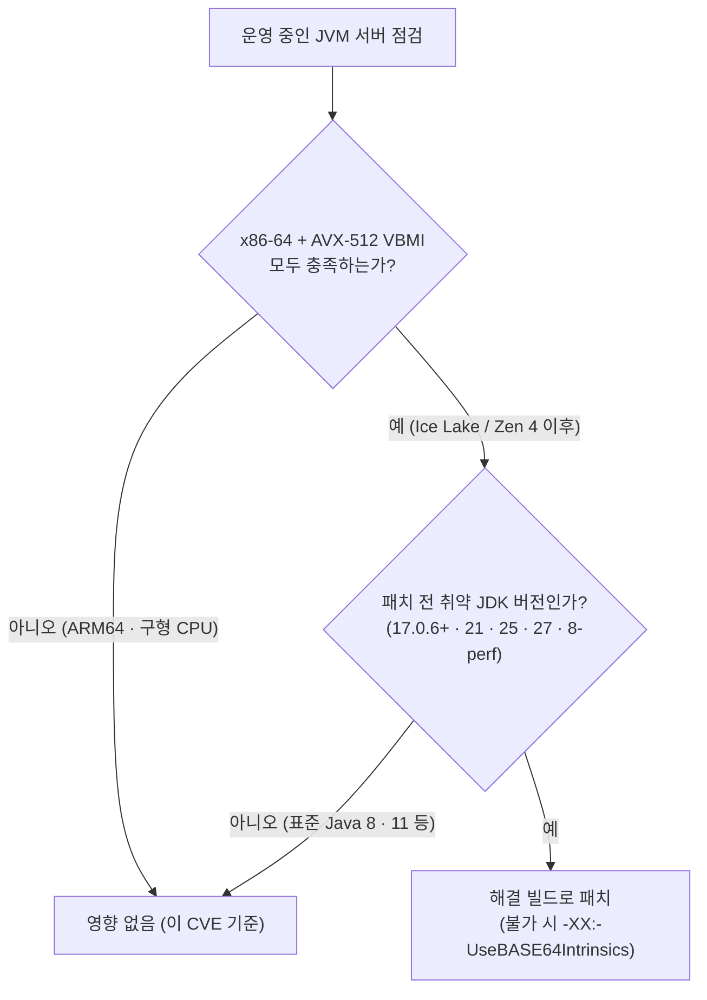

> <strong>이 글의 위치</strong>: 2026년 11월 17일(현지 시각) Oracle 11월 정기 보안 패치(CSPU), 11월 18일 KISA 보호나라 보안 공지, CISA 권고로 이어진 <strong>Java4Shell(CVE-2026-114938)</strong>의 발생 조건, 영향 버전, 패치 전 즉시 적용할 수 있는 JVM 완화 옵션을 실무 운영 관점에서 정리했습니다.

> <strong>3줄 요약</strong>
>
> 1. <strong>취약점 정체</strong>: `CVE-2026-114938`(별칭 <strong>Java4Shell</strong>)은 OpenJDK HotSpot의 최적화된 <strong>Base64 디코더에서 발생하는 힙 경계 밖 쓰기(CWE-787)</strong>입니다. 인증 없이 원격 코드 실행(Pre-Auth RCE)까지 이어질 수 있으며, <strong>CVSS 4.0 9.2(Critical)</strong>로 평가됐습니다.
> 2. <strong>발생 조건이 까다로움</strong>: <strong>패치되지 않은 Java 17.0.6 이상</strong>(21·25·27 포함)이거나 Oracle Java SE 8 Enterprise Performance Pack `8u511b33-perf`인 상태에서, <strong>`AVX-512 VBMI`를 지원하는 x86-64 CPU</strong>(Intel Ice Lake 이후, AMD Zen 4 이후)여야 합니다. ARM64와 표준 Java 8·11은 이 취약점의 영향을 받지 않습니다.
> 3. <strong>대응 순서</strong>: 1순위는 벤더 패치(`17.0.21.1`, `21.0.13.1`, `25.0.5.1`, `27.0.1.1`, `8u513-perf`) 적용 후 <strong>JVM 재시작</strong>입니다. 즉시 패치가 어렵다면 <strong>`-XX:-UseBASE64Intrinsics`</strong>로 취약 경로를 끌 수 있지만, 이는 패치를 대신하지 못하는 임시 조치입니다.

> <strong>공식 원문 바로가기</strong>: [KISA 보호나라 보안 공지](https://www.boho.or.kr/kr/bbs/view.do?searchCnd=&bbsId=B0000133&searchWrd=&menuNo=205020&pageIndex=1&categoryCode=&nttId=72313) · [Oracle 2026년 11월 CSPU](https://www.oracle.com/security-alerts/cspunov2026.html) · [Red Hat RHSB-2026-018](https://access.redhat.com/security/vulnerabilities/RHSB-2026-018)

---

## 🚨 1. Java4Shell (`CVE-2026-114938`) 취약점이란?

2026년 11월 17일(현지 시각) Oracle이 발표한 11월 정기 보안 패치(CSPU)와 11월 18일 [KISA 보호나라 보안 공지](https://www.boho.or.kr/kr/bbs/view.do?searchCnd=&bbsId=B0000133&searchWrd=&menuNo=205020&pageIndex=1&categoryCode=&nttId=72313), CISA 권고의 공통 핵심은 자바(Java) 보안 취약점 <strong>Java4Shell (`CVE-2026-114938`)</strong>입니다.

- <strong>발생 위치</strong>: OpenJDK HotSpot의 최적화된 <strong>Base64 디코더(`java.util.Base64.Decoder`) intrinsics</strong>. AVX-512 명령으로 여러 바이트를 한 번에 처리하는, 손으로 작성한 어셈블리 루틴입니다.
- <strong>취약점 유형</strong>: 경계 밖 쓰기(Out-of-bounds Write, CWE-787)로 인한 힙 메모리 손상. 64자를 디코딩해 48바이트를 채운 뒤 남은 패딩을 처리하는 단계에서 음수 길이가 64바이트 쓰기로 해석되고, 그 결과 50바이트 결과 배열의 끝에서 <strong>62바이트</strong>를 넘겨 씁니다. Java는 그 뒤에서야 입력을 거부합니다.
- <strong>위험도</strong>:
  - <strong>CVSS 4.0</strong>: <strong>9.2 (Critical)</strong> — 취약점을 발견한 Calif 연구팀 평가
  - <strong>Oracle CVSS 3.1</strong>: <strong>8.1 (High)</strong>
- <strong>공격 입력의 형태</strong>: 패딩(`=`)이 붙은 짧은 Base64 문자열입니다. 65자 입력이 트리거이고, 구버전 17 계열은 129자였습니다. 악용 가능성을 고려해 실제 페이로드 문자열은 싣지 않습니다.
- <strong>왜 위험한가</strong>: Base64는 HTTP Basic 인증 헤더, 세션·JWT 토큰, 파일 업로드, 메시지 본문 등 인증 전후를 가리지 않고 등장합니다. 공격자는 로그인 없이도 애플리케이션이 Base64를 디코딩하는 지점까지 도달할 수 있고, 성공하면 힙 메모리의 키·토큰을 읽거나 코드를 실행할 수 있습니다.

Calif 연구팀은 기본 구성 상태에서 아래 제품의 RCE를 시연했습니다.

| 구분 | 시연된 제품 |
| :--- | :--- |
| <strong>인증 전(Pre-Auth)</strong> | Keycloak, Atlassian Jira·Confluence, JFrog Artifactory, Jenkins, PingFederate |
| <strong>인증 후(Post-Auth)</strong> | Apache Kafka Broker, Apache Solr, Elasticsearch, Gerrit, Netflix Spinnaker |

목록은 전체가 아니며, Apache Struts·Spring Boot 샘플 앱에서도 RCE가 확인됐습니다. 인증이나 파일 업로드처럼 흔한 기능이 취약 경로를 노출할 수 있다는 뜻입니다. 별도로 Java 클라이언트가 악성 서버에 TLS로 접속하는 것만으로 감염되는 클라이언트 측 공격도 보고됐습니다.

국내에서도 공공·금융·대기업 시스템 상당수가 Java로 운영되기 때문에, KISA와 주요 보안업체가 동시에 대응 안내를 냈습니다. 이 글은 그중에서도 "우리 서버가 영향받는지"와 "오늘 무엇을 먼저 할지"에 집중합니다.

> <strong>확인된 사실과 진행 중인 사항</strong><br />
> 2026년 11월 17일 기준으로 공개된 실제 악용 사례는 확인되지 않았습니다. 다만 결함의 원리와 공격 기법이 패치 전에 유출됐고, 연구팀은 제품별 익스플로잇을 추후 공개할 예정이라고 밝혔습니다. 제품마다 별도의 체인이 필요해 보편적 익스플로잇은 없지만, 그 사실이 특정 표적(예: 사내 Keycloak)을 보호해 주지는 않습니다.

---

## ⚙️ 2. 우리 서버도 위험할까? (영향 조건 판별)

Log4Shell과 달리, 이번 `Java4Shell`은 <strong>소프트웨어 버전 + CPU 하드웨어 명령어 셋 + 공격자 입력이 닿는 Base64 디코딩 경로</strong>라는 세 조건이 모두 맞아떨어져야 작동합니다.



### 서버에서 10초 만에 확인하는 명령어

Linux 서버나 컨테이너에서 아래 명령어로 세 조건 중 앞의 두 가지를 바로 확인할 수 있습니다.

```bash
# 1. 현재 실행 중인 Java 버전 확인 (17.0.6 이상인지)
java -version

# 2. AVX-512 VBMI 지원 여부 확인
#    네 플래그가 모두 출력되어야 하드웨어 조건을 만족합니다.
grep -m1 '^flags' /proc/cpuinfo | tr ' ' '\n' | grep -E '^(avx512f|avx512bw|avx512_vbmi|bmi2)$'

# lscpu로 한 번에 보려면
lscpu | grep -o -E 'avx512f|avx512bw|avx512_vbmi|bmi2' | sort -u
```

`avx512_vbmi` 하나만 확인하면 부족합니다. AVX-512 VBMI 계열 명령을 실제로 쓰려면 `avx512f`·`avx512bw`·`avx512_vbmi`·`bmi2`가 함께 있어야 하므로, 네 개가 모두 나오는지 봐야 합니다.

- <strong>`ARM64` 서버</strong> (AWS Graviton, Mac M1\~M4 등): 영향받지 않습니다.
- <strong>표준 Java 8 / Java 11</strong>: 이 취약점(`CVE-2026-114938`)의 영향을 받지 않습니다. Red Hat은 해당 버전에 취약 코드 경로 자체가 없다고 설명합니다. *(단, Oracle Java SE 8 Enterprise Performance Pack `8u511b33-perf`는 예외적으로 영향 대상입니다.)*
- <strong>같은 CSPU의 다른 CVE는 8·11도 해당</strong>: 이번 Oracle 패치에는 Java 8(`8u511b33` → `8u513`)과 Java 11(`11.0.33.0.3` → `11.0.33.1`)을 고치는 취약점도 함께 들어 있습니다. "Java4Shell은 해당 없음"과 "이번 패치는 적용 불필요"는 다른 이야기입니다.
- <strong>하드웨어 조건은 오늘의 판단 기준일 뿐</strong>: 인스턴스 타입 변경이나 신규 하드웨어 도입으로 조건이 바뀔 수 있습니다. 취약 CPU가 아니라는 이유로 자산 목록에서 제외하지 말고, 패치 대상은 버전 기준으로 관리하세요.

### 공격자가 닿을 수 있는 Base64 경로 확인

버전과 CPU 조건이 맞는다면, 마지막으로 <strong>외부 입력이 `java.util.Base64` 디코딩 지점까지 도달하는지</strong>를 봐야 합니다. 모든 Base64 호출이 곧 취약점은 아니지만, 아래 경로는 우선 확인 대상입니다.

- `Authorization: Basic ...` 헤더를 직접 파싱하는 인증 필터·인터셉터
- JWT·SAML·세션 토큰을 `java.util.Base64`로 디코딩하는 코드
- 파일 업로드나 메시지 본문을 Base64 문자열로 받는 API
- 사내 공통 라이브러리처럼 여러 서비스가 함께 쓰는 디코딩 유틸

```bash
# Java 소스에서 Base64 디코딩 지점 찾기 (Url/Mime 디코더 포함)
grep -rnE --include='*.java' 'Base64\.get(Url|Mime)?Decoder\(' src/
```

프레임워크나 라이브러리가 자체 디코더를 쓰면 취약한 intrinsic을 타지 않을 수 있습니다. 반대로 직접 디코딩하는 코드가 있다면, 그 입력이 인증 전에 외부에서 들어오는지까지 확인하세요.

---

## 📦 3. 영향 받는 버전과 해결(패치) 버전

Oracle 공식 CSPU(2026년 11월)와 KISA 보호나라 공지가 제시한 해결 버전은 다음과 같습니다.

| 메이저 버전 | 취약 빌드 (예시) | 해결된 패치 버전 (Fixed) |
| :--- | :--- | :--- |
| <strong>Java 8 (Performance Pack)</strong> | `8u511b33-perf` | <strong>`8u513-perf`</strong> |
| <strong>Java 17</strong> | `17.0.6` 이상 \~ `17.0.21.0.3` | <strong>`17.0.21.1`</strong> 이상 |
| <strong>Java 21</strong> | `21.0.13.0.3` 이하 | <strong>`21.0.13.1`</strong> 이상 |
| <strong>Java 25</strong> | `25.0.5.0.3` 이하 | <strong>`25.0.5.1`</strong> 이상 |
| <strong>Java 27</strong> | `27.0.1.0.3` 이하 | <strong>`27.0.1.1`</strong> 이상 |
| <strong>Oracle GraalVM for JDK 17·21</strong> | `17.0.21.0.3` / `21.0.13.0.3` | <strong>`17.0.21.1` / `21.0.13.1`</strong> |
| <strong>Oracle GraalVM Enterprise 21</strong> | `21.3.20.0.3` | <strong>`21.3.20.1`</strong> |

- <strong>표준 Java 8·11은 이 취약점의 대상이 아닙니다</strong>: KISA 표에서 `CVE-2026-114938` 행에 Java 8·11이 없는 이유입니다. 같은 표의 다른 CVE(`CVE-2026-114939`, `CVE-2026-114940`)는 8·11도 포함하므로 패치 자체는 함께 적용하는 편이 안전합니다.
- <strong>OpenJDK 배포판</strong>: Amazon Corretto는 11월 17일 `17.0.21.1.2`로 수정본을 배포했습니다. Eclipse Temurin, Azul Zulu, Microsoft Build of OpenJDK, BellSoft Liberica, SAP SapMachine, Red Hat OpenJDK는 벤더별 공지를 확인해야 합니다. Red Hat은 11월 17일 기준 RHEL의 `java-17-openjdk`·`java-21-openjdk`와 미들웨어 번들 JVM을 조사 중이며, 빌드별 영향 여부와 수정본은 보안 권고(RHSB-2026-018) 업데이트로 안내한다고 밝혔습니다.
- <strong>버전 표기 주의</strong>: 17·21·25·27은 네 번째 자리가 `.1`인 빌드(예: `17.0.21.1`)에 픽스가 포함됩니다. Java 8은 `8u513` 계열인지 확인하세요. KISA 표의 영향받는 버전(`17.0.21.0.3` 등)과 해결 버전을 혼동하지 마세요.

*(※ 컨테이너를 쓴다면 호스트가 아니라 이미지 안에 번들된 JDK가 기준입니다. `eclipse-temurin`, `amazoncorretto` 등 베이스 이미지 태그를 최신 보안 빌드로 올린 뒤 다시 빌드해야 합니다.)*

---

## 🛡️ 4. 해결 방법: 패치부터 임시 완화까지

### 1) 정석 대응: JDK 업그레이드 + 서비스 재시작
우선순위는 인터넷에 노출된 인증·CI/CD·협업 시스템입니다. Keycloak, Jenkins, Jira·Confluence, Artifactory처럼 인증 전에 Base64를 처리하는 서비스부터 처리하세요.

1. 패키지 매니저 또는 공식 배포처에서 위 해결 버전으로 JDK/JRE를 업데이트합니다.
2. <strong>도커(Docker) 컨테이너 점검</strong>: 호스트 OS가 아니라 컨테이너 베이스 이미지(`eclipse-temurin`, `amazoncorretto` 등) 내부에 번들된 Java가 취약한 경우가 흔합니다. 베이스 이미지를 최신 태그로 다시 빌드·배포하세요.
3. <strong>반드시 JVM 재시작</strong>: 파일을 덮어썼더라도 이미 떠 있는 Java 프로세스(Spring Boot, Tomcat, Kafka 등)를 재시작하지 않으면 기존 메모리의 취약 코드가 계속 동작합니다.

### 2) 임시 완화 조치 (당장 재배포·업그레이드가 어려울 때)
서비스 다운타임이나 호환성 검증 때문에 즉시 JDK 버전을 올릴 수 없다면, JVM 기동 옵션(JAVA_OPTS)에 아래 플래그를 추가해 취약한 Base64 최적화 경로를 끌 수 있습니다.

```bash
# [권장] Base64 Intrinsics 최적화만 비활성화 (다른 AVX-512 성능은 유지)
-XX:-UseBASE64Intrinsics

# [대안] AVX-512 사용 범위를 2로 제한 (x86 전용)
-XX:UseAVX=2
```

두 옵션 중 하나만 적용하면 됩니다. `-XX:-UseBASE64Intrinsics`는 취약한 디코더만 표준 구현으로 되돌리므로 성능 영향이 상대적으로 작고, Base64를 대량으로 디코딩하는 서비스는 처리량 저하를 먼저 측정해 보세요. `-XX:UseAVX=2`는 더 넓은 최적화를 끄기 때문에 성능 손실이 더 큽니다.

> ⚠️ <strong>플래그 적용 시 주의사항</strong><br />
> <strong>`-XX:-UseBASE64Intrinsics`</strong>는 아키텍처를 가리지 않습니다. ARM64에서도 JVM이 정상 기동하며, 해당 최적화가 원래 없으므로 플래그가 하는 일이 없을 뿐입니다. 반면 <strong>`-XX:UseAVX=2`</strong>는 x86 전용 옵션이라 ARM64(Apple Silicon·Graviton) JVM에서는 기동 자체가 실패합니다. 공통 기동 스크립트에 넣을 때는 이 차이를 구분하세요.
>
> 또한 이 플래그들은 <strong>패치를 대신하지 못합니다</strong>. 리버스 프록시나 WAF도 완화책이 아닙니다. 요청 버퍼링이 일부 체인을 깨뜨릴 뿐, 취약한 JVM은 그대로 남습니다.

### 3) 패치·플래그가 실제로 적용됐는지 확인
패키지만 올리고 재시작하지 않는 실수가 가장 흔합니다. 아래 세 가지로 확인하세요.

```bash
# 실행 중인 Java 프로세스와 기동 옵션 확인
ps -ef | grep [j]ava

# 새로 실행한 셸 기준 버전 확인
java -version

# 실제 구동 중인 JVM의 버전·옵션 확인 (PID는 위에서 확인)
jcmd <PID> VM.system_properties | grep -E 'java.version|java.vm.version'
```

`java -version`은 셸의 PATH가 가리키는 JDK를 볼 뿐, 이미 떠 있는 서비스의 JVM을 보장하지 않습니다. 반드시 `jcmd`나 프로세스 목록으로 <strong>실행 중인 JVM</strong>을 확인하세요.

### 4) 자산 인벤토리 전수 점검 체크리스트
- [ ] 직접 설치한 `JAVA_HOME` 외에 <strong>사내 솔루션(Jenkins, Jira, Confluence, Nexus, Artifactory, Keycloak, PingFederate)</strong> 내부 번들 JRE 버전 확인
- [ ] Docker / Kubernetes 클러스터 내 실행 중인 파드의 베이스 이미지 자바 버전 스캔
- [ ] 어플라이언스·관리 콘솔처럼 소프트웨어 목록에 별도 항목으로 잡히지 않는 번들 런타임 확인
- [ ] 패치 전까지 인터넷에 직접 노출된 관리 콘솔(Jenkins, Keycloak 어드민 등) 방화벽·VPN 접근 통제 강화
- [ ] 패치 후 서비스별 재시작 여부와 실제 빌드 번호를 변경 관리 기록에 남기기

---

## 🧭 5. 정리

이번 `Java4Shell (CVE-2026-114938)`은 인증 없이 네트워크를 통해 닿을 수 있는 Base64 디코더 결함이라는 점에서 위험도가 높습니다. 다만 Log4Shell처럼 "JVM이면 무조건"은 아니고, <strong>패치되지 않은 Java 17.0.6 이상 + AVX-512 VBMI를 지원하는 x86-64 CPU + 취약 경로로 들어오는 공격자 입력</strong>이라는 세 조건이 겹쳐야 성공합니다.

운영 중인 서버가 이 조합에 해당한다면 오늘 바로 베이스 이미지와 번들 JDK 버전을 확인해 <strong>해결 빌드로 올리고 재시작</strong>하세요. 재시작이 어렵다면 `-XX:-UseBASE64Intrinsics`로 시간을 벌 수 있지만, 임시 조치라는 점을 팀에 명확히 공유해야 합니다. 반대로 ARM64이거나 표준 Java 8·11이라면 이 CVE에서는 벗어나 있습니다. 그래도 같은 CSPU에 포함된 다른 취약점이 있으니, "영향 없음" 확인과 "패치 불필요" 결정은 분리해서 판단하시기 바랍니다.

---

## ❓ 6. 자주 묻는 질문(FAQ)

### Java4Shell 취약점은 무엇인가요?
OpenJDK의 최적화된 Base64 디코더에서 발생하는 힙 경계 밖 쓰기(CWE-787) 취약점입니다. `java.util.Base64`가 공격자 입력을 디코딩하는 경로에 AVX-512 VBMI 명령이 쓰이면, 조작된 짧은 입력만으로 결과 버퍼 밖 62바이트를 덮어쓸 수 있습니다. CVSS 4.0 기준 9.2로 평가됐습니다.

### 우리 서버가 영향받는지 어떻게 확인하나요?
`java -version`으로 패치되지 않은 17.0.6 이상인지 확인하고, `grep -m1 '^flags' /proc/cpuinfo`로 `avx512f`·`avx512bw`·`avx512_vbmi`·`bmi2` 네 플래그가 모두 있는지 봅니다. 여기에 더해 애플리케이션이 외부 입력을 `java.util.Base64`로 디코딩하는지까지 확인해야 실제 노출 여부를 판단할 수 있습니다.

### 이번 자바 보안 패치에서 어떤 버전으로 올려야 하나요?
Java 17은 `17.0.21.1`, 21은 `21.0.13.1`, 25는 `25.0.5.1`, 27은 `27.0.1.1` 이상으로 올립니다. Java 8 Performance Pack은 `8u513-perf`입니다. OpenJDK 배포판은 Amazon Corretto·Temurin·Zulu 등 벤더가 같은 픽스를 포함해 배포한 빌드인지 확인하세요.

### 패치 없이 해결할 수 있나요?
완전한 해결은 해결 빌드로 올리는 것입니다. 당장 어렵다면 `-XX:-UseBASE64Intrinsics`로 취약 경로를 끌 수 있지만, JVM 재시작이 필요하고 Base64를 대량 처리하는 서비스는 성능 저하가 있을 수 있으며 패치를 대신하지 못합니다.

### Java 8·11도 패치해야 하나요?
이 취약점(`CVE-2026-114938`)은 표준 Java 8·11에 취약 코드 경로가 없어 영향받지 않습니다. 다만 같은 2026년 11월 CSPU에 포함된 다른 취약점은 8·11도 고치므로, "이 CVE는 해당 없음"과 "패치 불필요"를 같은 뜻으로 쓰면 안 됩니다.

### 패치 후 JVM 재시작이 꼭 필요한가요?
필요합니다. JDK 파일만 교체하고 실행 중인 JVM을 재시작하지 않으면 메모리에 올라간 기존 코드가 계속 동작합니다. `jcmd <PID> VM.system_properties`로 실제 구동 중인 JVM의 버전을 확인하세요.

---

> <strong>기준일</strong>: 2026년 11월 18일(2026-11-19 공식 링크·FAQ 보강). Oracle CSPU(2026년 11월), KISA 보호나라 보안공지(2026-11-18), Red Hat 보안 권고(RHSB-2026-018), Calif 기술 분석, Qualys 권고를 바탕으로 작성했습니다. OpenJDK 배포판별 정확한 마이너 패치 번호와 RHEL 빌드 영향 여부는 사용 중인 벤더 공지를 함께 확인하세요.
>
> <strong>참고 자료</strong>
>
> - [KISA 보호나라 — Oracle 제품 보안 업데이트 권고(2026-11-18)](https://www.boho.or.kr/kr/bbs/view.do?searchCnd=&bbsId=B0000133&searchWrd=&menuNo=205020&pageIndex=1&categoryCode=&nttId=72313)
> - [Oracle Critical Security Patch Update — November 2026](https://www.oracle.com/security-alerts/cspunov2026.html)
> - [Red Hat — RHSB-2026-018 (CVE-2026-114938)](https://access.redhat.com/security/vulnerabilities/RHSB-2026-018)
> - [Calif — Java4Shell: Write once, RCE everywhere](https://calif.io/java4shell)
> - [Qualys — Java4Shell 대응 가이드](https://blog.qualys.com/vulnerabilities-threat-research/2026/11/17/how-to-find-mitigate-and-patch-the-critical-java4shell-flaw-cve-2026-114938-now)
> - [NVD — CVE-2026-114938](https://nvd.nist.gov/vuln/detail/CVE-2026-114938)
> - [관련 글: 트래픽 급증 시 DB 병목 해결기: Spring Boot + Lettuce Redis 캐싱](/posts/20260825-1-spring-boot-lettuce-redis-caching-traffic-bottleneck/)
