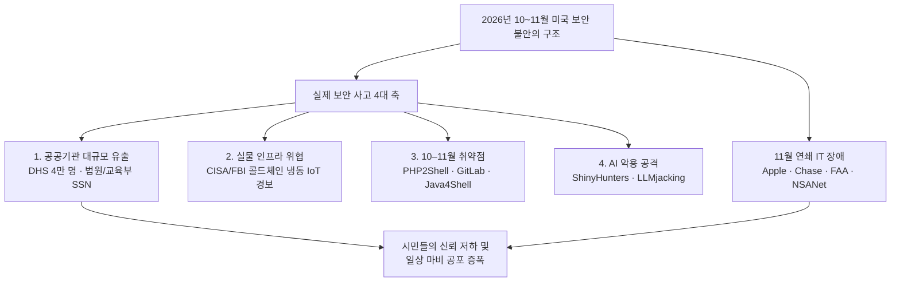

> <strong>이 글의 위치</strong>: 2026년 11월 중순 미국 SNS에서 "미국이 대규모 사이버 공격을 받고 있다"는 불안이 빠르게 퍼졌습니다. 이 글은 <strong>실제 사이버 공격이 아니었던 연쇄 IT 장애(오해)</strong>와, <strong>시민들의 불안을 키운 진짜 보안 사고 4가지(사실)</strong>를 명확히 구분해 정리합니다.

> <strong>3줄 요약</strong>
>
> 1. <strong>공포의 도화선 (오해)</strong>: 11월 중순 Apple(iCloud·Apple Pay), Chase 은행, FAA 항공 관제, 심지어 미국 국가안보국(NSANet)까지 장애가 겹치며 사이버 공격설이 퍼졌으나, NSA와 애플·체이스·FAA는 모두 <strong>"정비 작업·내부 시스템 오류·라우터 장애"</strong>라며 외부 공격 가능성을 부인했습니다.
> 2. <strong>불안이 가라앉지 않는 진짜 이유 (사실)</strong>: 바로 직전인 10\~11월 <strong>DHS 직원 4만여 명 유출, 애리조나 법원 등 공공기관 SSN 유출, 산업용 냉동·콜드체인 IoT 해킹 경고, 'Black October' 대형 취약점·AI 피싱</strong>이 실제로 연달아 터졌기 때문입니다.
> 3. <strong>핵심 교훈</strong>: 국가 기반시설이 해킹이 아니라 단순 업데이트 실수로 멈춰도 일상(결제·항공·은행)이 마비된다는 취약성과, 일상 속 개인정보·계정 탈취 위험이 동시에 커지고 있습니다.

---

## 🚨 1. 왜 미국 시민들이 "사이버 공격" 공포에 휩싸였을까?

2026년 11월 중순, 미국 시민들이 매일 쓰는 핵심 인프라와 최고 기밀 기관에서 <strong>동시다발적인 서비스 장애</strong>가 며칠 사이에 몰려 발생했습니다.

| 장애 발생 대상 | 체감 피해 및 상황 | 공식 발표 원인 |
| :--- | :--- | :--- |
| <strong>Apple (iCloud · Apple Pay)</strong> | 결제 및 클라우드 동기화 중단 | 시스템·서비스 내부 장애 |
| <strong>Chase Bank 등 주요 은행</strong> | 뱅킹 앱·결제 처리 오류 | 소프트웨어 글리치(오류) |
| <strong>항공사 및 FAA</strong> | 데이터·라우터 문제로 항공기 이륙 중단(Ground Stop) | 네트워크·라우터 기술 장애 |
| <strong>NSA (`NSANet`)</strong> | 기밀 내부 통신망 장애, 포트 미드 본부 직원 출근 분산 | 소프트웨어 업데이트·유지보수 오류 |

결제(Apple Pay·은행), 이동(항공), 국방·정보(NSA)가 거의 같은 시기에 흔들리자 TikTok과 X(구 트위터)에서는 <strong>"외국 세력의 동시다발 사이버 공격이 시작됐다"</strong>는 추측이 폭발적으로 확산됐습니다.

NSA는 내부망 장애가 <strong>정비(유지보수) 작업 중 발생</strong>했다고 밝혔고, 애플과 체이스는 내부 시스템·소프트웨어 오류, FAA는 라우터 장애라고 각각 설명했습니다. 네 사건 모두에서 외부 해킹의 증거는 확인되지 않았습니다.

---

## 🧩 2. 해명이 나와도 불안이 가라앉지 않는 진짜 보안 이슈 4가지

11월의 연쇄 장애 자체는 해킹이 아니었지만, 미국 시민들이 곧바로 "공격이다"라고 믿어버린 데에는 분명한 배경이 있습니다. 바로 직전인 <strong>2026년 10월('Black October')부터 11월 중순까지 실제로 대형 보안 사고들이 꼬리를 물고 터졌기 때문</strong>입니다.

### ① 정부·공공기관의 민감 정보 유출 (DHS · 법원 · 교육부)
- <strong>국토안보부(DHS) 내부자 정보 유출</strong>: 데이터 투명성 단체 <strong>Distributed Denial of Secrets(DDoS)</strong>가 'Department of Peace'를 자칭하는 조직이 확보했다는 자료를 공개했습니다. 세관국경보호국(CBP), 이민세관단속국(ICE), 사이버 보안을 총괄하는 CISA 소속까지 포함한 <strong>DHS 직원·계약직 41,000명 이상</strong>의 실명, 직책, 전화번호, 업무 이메일과 작전명·감시 프로그램·잠복 근무 배정 정보까지 담겼습니다.
- <strong>시민 사회보장번호(SSN) 및 학생 기록 노출</strong>: 2026년 9월 24일 애리조나 법원 시스템이 침해돼 벌금·배상금 납부자 <strong>약 130만 명</strong>의 이름과 SSN, 15만 건이 넘는 아동보호(위탁) 기록이 복사됐습니다. 일부 주 교육 당국에서도 학생·지원자 데이터 사고가 이어지며 "내 주민번호와 신용 정보가 이미 다크웹에 돌아다닌다"는 무력감이 커졌습니다.

### ② 식품·의약품을 노린 '콜드체인' 실물 인프라 해킹 경고
- 2026년 11월 초, <strong>CISA(미국 사이버보안·인프라보안국)와 FBI</strong>는 이례적인 긴급 합동 경보를 발령했습니다.
- 인터넷에 연결된 <strong>미국·유럽 산업용 냉동·냉장 설비(콜드체인 IoT)</strong>에 해커가 침투해 <strong>온도를 원격으로 조작</strong>하는 공격이 진행 중이라는 내용이었습니다. 단순 정보 유출을 넘어 마트 식품과 병원 의약품 공급망이 마비될 수 있다는 점에서 일반 시민들의 체감 공포가 컸습니다.

### ③ 'Black October' 소프트웨어 취약점 연쇄와 11월 긴급 패치
- 10월 중순에는 웹·개발 인프라의 핵심인 <strong>PHP(`PHP2Shell`)와 GitLab</strong> 등에서 치명적 원격 코드 실행(RCE) 결함이 연달아 공개됐습니다. Cloudflare 집계에 따르면 전 세계 취약점 공격 시도는 1월 하루 20만 건에서 10월 <strong>하루 200만 건</strong>까지 늘었고, 선거 사이트는 12개월간 <strong>3억 9,200만 건</strong>의 스캔을 받았습니다. 다만 선거일(11월 3일)에는 공격 급증이 확인되지 않았습니다.
- 여기에 11월 중순에는 AI 모델 연결 서버 <strong>LiteLLM의 원격 코드 실행(`CVE-2026-40217`, CISA KEV 11/18 등재)</strong> 경보와 함께, 기업 서버 상당수를 떠받치는 자바 런타임의 치명적 결함인 <strong>[Java4Shell 영향 확인과 해결 방법](/posts/20261118-1-java4shell-cve-2026-114938-security-advisory-guide/)</strong>까지 터지면서 기업과 공공기관의 피로감이 극에 달했습니다.

### ④ AI 기반 보이스 피싱(Vishing)과 대기업 고객 데이터 탈취
- `ShinyHunters` 같은 갈취 조직들이 단순 이메일 피싱을 넘어, <strong>기업 고객센터와 직원을 상대로 한 정교한 전화 피싱(Vishing)</strong>으로 Salesforce·Microsoft Entra 계정을 탈취하는 사례가 급증했습니다.
- 통신사·스포츠·유통 등 미국 주요 브랜드의 고객 데이터가 반복적으로 유출·협박 대상이 되면서, 일반 소비자 입장에서는 "내가 비밀번호를 잘 관리해도 기업이 뚫린다"는 불안이 일상화되었습니다.

---

## 🛡️ 3. 일반 사용자와 기업이 당장 챙겨야 할 현실적 대응

미국의 사례는 한국을 포함한 모든 디지털 사회에 동일한 교훈을 줍니다.

1. <strong>결제·인증 단일 의존 피하기</strong>: Apple Pay나 특정 은행 앱 장애에 대비해 실물 카드·보조 결제 수단과 오프라인 백업 수단을 항상 유지합니다.
2. <strong>계정 유출 전제하의 방어 (MFA & 비밀번호 분리)</strong>: 공공기관이나 대형 브랜드가 뚫리더라도 연쇄 피해를 막으려면, 금융·메인 이메일·업무 계정마다 <strong>서로 다른 비밀번호 + 패스키(Passkey) 또는 앱 기반 2단계 인증(TOTP)</strong>을 적용해야 합니다.
3. <strong>신용·결제 알림 실시간 활성화</strong>: 미국 연방 기관들이 시민들에게 가장 먼저 권고한 조치는 <strong>신용 보고서 모니터링과 카드·계좌 실시간 결제 알림</strong>입니다. 이상 징후를 하루라도 빨리 알아채야 피해를 끊을 수 있습니다.
4. <strong>기업·개발팀의 공급망 패치 점검</strong>: 직접 짠 코드가 안전해도 내부에 번들된 JVM(`Java4Shell`), AI 게이트웨이(`LiteLLM`), 외부 노출 IoT 장비가 뚫리면 전체가 위험해집니다.

---

## ❓ 4. 자주 묻는 질문(FAQ)

### 11월 미국의 연쇄 장애는 사이버 공격인가요?
아닙니다. NSA는 내부망 장애가 정비(유지보수) 작업 중 발생했다고 밝혔고, 애플·체이스는 내부 시스템·소프트웨어 오류, FAA는 라우터 장애로 설명했습니다. 네 사건 모두 외부 해킹의 증거는 확인되지 않았습니다. 다만 실제 보안 사고가 잇따른 시기와 겹치면서 공포가 증폭됐습니다.

### DHS 유출로 일반 시민의 정보도 털렸나요?
이번에 공개된 자료의 직접 대상은 DHS 직원·계약직 41,000명 이상입니다. 일반 시민의 신청·납부 기록까지 포함됐다는 보도는 확인되지 않았습니다. 다만 DHS와 계약·거래 관계가 있거나 관련 기관에 종사한다면 신용 모니터링과 표적 피싱 주의가 필요합니다.

### 한국 기업과 개발자에게 어떤 의미가 있나요?
이번 사안의 공통점은 공격이 외부 노출 IoT, 번들 JVM, AI 게이트웨이 같은 <strong>공급망 구성요소</strong>를 통해 들어온다는 점입니다. LiteLLM처럼 실제 악용이 확인되었거나 Java4Shell처럼 긴급 패치가 권고된 구성요소의 패치 여부를 확인하고, 금융·업무 계정은 서로 다른 비밀번호와 패스키·TOTP로 분리해 두는 것이 현실적인 대비입니다.

---

## 🧭 5. 정리

2026년 11월 미국을 뒤흔든 "사이버 공격 공포"는 <strong>단일 대형 해킹 사건 때문이 아니라, ① 10\~11월 실제 터진 정부·민간·실물 인프라 보안 사고들의 누적과 ② Apple·은행·항공·NSA의 연쇄 IT 장애가 한꺼번에 겹치며 폭발한 신뢰 위기</strong>입니다.

기술 장애와 실제 사이버 공격을 구분해 냉정하게 사실관계를 파악하되, <strong>대규모 서비스도 언제든 멈추고 대기업도 뚫릴 수 있다는 전제</strong> 위에서 개인의 인증 보안과 결제·데이터 백업을 점검해 두는 것이 가장 현실적인 대응입니다.

---

> <strong>기준 안내</strong>: 2026년 11월 19일 기준. CISA·FBI 권고, CISA KEV, Cloudflare 선거 보안 리포트와 CNN·Nextgov·The Guardian·The Record 보도를 바탕으로 정리했습니다.
>
> <strong>참고 자료</strong>
>
> - [The Guardian — Non-profit group leaks data of more than 40,000 homeland security workers (2026-10-28)](https://www.theguardian.com/us-news/2026/oct/28/homeland-security-data-leak)
> - [The Guardian — DHS personnel data leak (2026-10-29)](https://www.theguardian.com/us-news/2026/oct/29/dhs-personnel-data-leak)
> - [The Record — Arizona courts say hackers stole info on more than 1.3 million people](https://therecord.media/arizona-courts-say-hackers-stole-info-on-over-1-million)
> - [CISA — US Government Partners Urge Hardening Industrial Refrigeration and Cold Chain Monitoring Systems](https://www.cisa.gov/resources-tools/resources/us-government-partners-urge-hardening-industrial-refrigeration-and-cold-chain-monitoring-systems)
> - [Cloudflare — Internet traffic and attacks during the 2026 U.S. midterm elections](https://blog.cloudflare.com/internet-traffic-2026-us-election/)
> - [CISA — Known Exploited Vulnerabilities Catalog (CVE-2026-40217, 2026-11-18 등재)](https://www.cisa.gov/known-exploited-vulnerabilities-catalog)
> - [GitHub Security Advisory — BerriAI LiteLLM GHSA-wxxx-gvqv-xp7p](https://github.com/BerriAI/litellm/security/advisories/GHSA-wxxx-gvqv-xp7p)
> - [CNN — Highly classified US national security communications network goes down (2026-11-17)](https://www.cnn.com/2026/11/17/politics/highly-classified-national-security-communications-network-goes-down)
> - [Nextgov/FCW — Classified NSA communications network down, people familiar say (2026-11-17)](https://www.nextgov.com/digital-government/2026/11/classified-nsa-communications-network-down-people-familiar-say/417277/)
> - [관련 글: 자바 취약점 Java4Shell, 영향 확인과 해결 방법](/posts/20261118-1-java4shell-cve-2026-114938-security-advisory-guide/)
