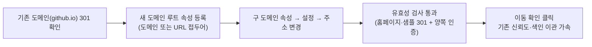

> <strong>이 글의 위치</strong>: 앞서 [GitHub Pages 블로그 URL 슬러그 개편과 SEO 리디렉션](/posts/20260822-1-github-pages-url-slug-seo-redirection/)과 [Cloudflare 웹 성능 설정](/posts/20261111-1-cloudflare-web-performance-cache-ssl-guide/)에 이어, 실제 이 블로그를 `seodaeya.github.io`에서 `nardlog.com`으로 이전한 직후 겪은 <strong>Google Search Console 색인 보류(44개)·탐색경로 급락(36 → 6) 현상의 원인 진단과 해결 과정</strong>을 정리합니다.

> <strong>3줄 요약</strong>
>
> 1. <strong>증상과 착각</strong>: 도메인 이전 직후 탐색경로 유효 항목이 36에서 6으로 급락하고 새 도메인에 `크롤링됨 - 현재 색인이 생성되지 않음`이 쌓여도, 대부분 <strong>JSON-LD 스키마 오류나 봇 차단 때문이 아닙니다.</strong>
> 2. <strong>진짜 원인</strong>: 기존 도메인(`github.io`)의 색인이 아직 검색엔진에 남아 있는 상태에서 새 도메인이 동시에 평가되면서 발생하는 <strong>도메인 이전 과도기 중복/재평가 대기</strong> 현상입니다.
> 3. <strong>핵심 해결책</strong>: `curl`로 기존 도메인 `HTTP 301`과 `Googlebot 200 OK`를 확인한 뒤, Google Search Console의 <strong>루트 속성(도메인 또는 URL 접두어) 간 [주소 변경] 도구</strong>를 제출하면 기존 신뢰도와 색인 이관이 훨씬 빨라집니다.

---

## 📉 1. 도메인 변경 직후 겪는 대표 증상 3가지

커스텀 도메인을 연결하고 며칠이 지나면 Google Search Console(GSC)에서 당황스러운 그래프가 보이기 시작합니다. 실제로 이 블로그에서 관측한 수치는 다음과 같았습니다.

| GSC 보고서 항목 | 관측된 수치 | 흔한 오해 | 실제 상태 |
| :--- | :--- | :--- | :--- |
| <strong>탐색경로 > 유효한 항목</strong> | `36 → 22 → 14 → 8 → 6` 하락 (감지일 멈춤) | "구조화 데이터(`BreadcrumbList`)가 깨졌다" | <strong>색인된 페이지만 집계</strong>하므로 미색인 증가에 따른 동반 하락 |
| <strong>크롤링됨 - 현재 색인이 생성되지 않음</strong> | 44개 누적 (전체 72개 중 미색인 59개) | "품질 탈락 또는 서버 오류" | 구 도메인 색인(9개)과 겹치는 <strong>도메인 이전 재평가 대기</strong> |
| <strong>NOINDEX(2개) · 리디렉션(10개)</strong> | 제외/리디렉션에 표시 | "빌드 설정이 잘못됐다" | 유틸리티/의도적 `noindex` + `trailingSlash` 301 <strong>정상 집계</strong> |

---

## 🔍 2. 코드나 봇 차단부터 의심하기 전에 확인할 3가지 (`curl` 진단)

원인을 좁히려면 추측 대신 터미널에서 3가지만 먼저 확인하면 됩니다.

### ① 기존 도메인 → 새 도메인 `301` 리디렉션 확인
```bash
curl -sI https://seodaeya.github.io/ | grep -iE '^(http|location):'
# HTTP/2 301
# location: https://nardlog.com/
```
`302`가 아니라 영구 이동을 뜻하는 <strong>`301`</strong>이 떨어져야 검색엔진이 기존 페이지의 평가 점수를 새 도메인으로 넘깁니다.

### ② `Googlebot` 접근 및 `robots.txt` 확인
Cloudflare 프록시를 함께 켠 경우 봇 차단을 의심하기 쉽습니다. 실제 Googlebot User-Agent로 응답을 확인합니다.
```bash
curl -sI -A "Mozilla/5.0 (compatible; Googlebot/2.1; +http://www.google.com/bot.html)" https://nardlog.com/
# HTTP/2 200 확인

curl -s https://nardlog.com/robots.txt
# User-agent: * / Allow: / 확인
```
> <strong>주의</strong>: User-Agent만 바꾼 `curl`은 Cloudflare가 실제 Googlebot IP인지 검증하지 않습니다. 따라서 `403`이 나와도 실제 구글봇이 차단됐다고 단정할 수 없고, 반대로 `200`이 나와도 구글봇 수집이 보장되지는 않습니다. 최종 판단은 GSC <strong>URL 검사 → 실시간 URL 테스트</strong>의 크롤링 결과로 하세요.

Cloudflare의 <strong>`Bot Fight Mode`</strong>는 WAF 사용자 규칙으로 예외를 만들 수 없고 API·앱 트래픽에도 챌린지를 보낼 수 있습니다. 색인 정체가 이어질 때만 잠시 끄고 `Googlebot` 응답과 일반 브라우저 응답을 비교해 보세요. 문제가 없으면 다시 켜도 됩니다.

### ③ JSON-LD (`BreadcrumbList`) 출력 확인
```bash
curl -s https://nardlog.com/posts/20260822-1-github-pages-url-slug-seo-redirection/ \
  | grep -o 'BreadcrumbList[^<]*'
```
정상적으로 출력된다면 스키마 오류가 아닙니다. *(참고: GSC 탐색경로 표에서 '항목 이름'이 `해당사항 없음`으로 보이는 것은 `BreadcrumbList`의 마지막 `ListItem`(현재 페이지)에 `item` 속성을 생략했을 때 나타나는 정상 표시입니다.)*

---

## 🛠️ 3. 핵심 해결법: GSC '주소 변경(Change of Address)' 제출

301 리디렉션만 걸어두어도 구글이 언젠가는 알아차리지만, 기존 도메인(`github.io`) 속성에 여전히 핵심 글들이 색인된 채 클릭을 가져가고 있다면 <strong>GSC 주소 변경 도구</strong>로 공식 이전을 선언해야 합니다.



### 단계별 진행 방법 (가장 많이 막히는 함정 포함)

1. <strong>경로 없는 '루트 속성' 2개 준비</strong>:
   - 주소 변경 도구는 <strong>경로가 붙은 속성(`https://nardlog.com/blog/`)에서는 동작하지 않습니다</strong>. `도메인 속성(nardlog.com)`이든 `URL 접두어(https://nardlog.com/)`든, <strong>경로 세그먼트가 없는 루트 속성이면 둘 다 사용할 수 있습니다.</strong>
   - 구·신 사이트 모두 <strong>같은 Google 계정으로 소유자 인증</strong>이 끝나 있어야 상대 사이트가 목록에 뜹니다. 새 도메인을 도메인 속성으로만 등록했더라도 인증만 되어 있으면 문제없고, 아직 없다면 `+ 속성 추가`로 등록·인증하세요.
   - `www`·`m` 등 여러 하위 도메인을 함께 쓰던 사이트는 변형별로 각각 이전해야 하며, `seodaeya.github.io`처럼 단일 호스트만 쓴다면 해당 속성 1건만 이전하면 됩니다. 도구 하나로 상위·하위 도메인을 한꺼번에 옮길 수는 없습니다.
2. <strong>구 도메인 속성에서 주소 변경 실행</strong>:
   - 상단 속성 선택기에서 <strong>구 도메인(`https://seodaeya.github.io/`)</strong> 선택 → 좌측 하단 <strong>[설정]</strong> → <strong>[주소 변경]</strong> 클릭
   - 새 사이트에서 `https://nardlog.com/` 선택 → <strong>[유효성 검사] 실행</strong>
3. <strong>유효성 검사 항목 확인 및 [이동 확인]</strong>:
   - 필수 점검(`홈페이지의 301 리디렉션`, `두 사이트 모두 인증`)을 통과해야 계속 진행할 수 있습니다. 권장 점검(`샘플 페이지의 301 리디렉션`)은 경고만 표시되므로, 가능하면 샘플 URL까지 301이 걸린 상태에서 <strong>[이동 확인]</strong>을 눌러 제출하세요.

> <strong>제출 후 유지 기간</strong>: 이전 사이트에는 이동 진행 알림이 <strong>180일</strong>간 표시됩니다. 301 리디렉션은 Google 검색 유입이 계속되는 동안, <strong>최소 1년</strong>은 유지하세요. 180일이 지나면 Google은 두 사이트의 관계를 인식하지 못하고, 구 도메인을 별개 사이트로 다시 취급할 수 있습니다.

---

## ⚡ 4. 주소 변경 후 병행할 3가지 후속 작업

1. <strong>새 도메인 Sitemap 제출 확인</strong>: GSC 새 도메인 속성 → <strong>[Sitemaps]</strong>에서 `sitemap.xml` 상태가 <strong>`성공`</strong>인지 확인합니다.
2. <strong>핵심 URL 우선 `색인 생성 요청`</strong>: `크롤링됨 - 현재 색인이 생성되지 않음`에 묶여 있는 글 중 트래픽이 가장 큰 5\~10개 URL을 <strong>URL 검사 → 색인 생성 요청</strong>으로 먼저 밀어 넣습니다(일일 할당량 내에서 순차 진행).
3. <strong>내부 링크 강화 & IndexNow 제출</strong>: 이미 색인된 글에서 미색인 글로 내부 링크를 연결하고, Bing·Naver용 `IndexNow`를 함께 제출하면 타 검색엔진 이관도 빨라집니다. 이 블로그는 `npm run indexnow` 스크립트로 제출합니다.

---

## ❓ 5. 자주 묻는 질문(FAQ)

### 도메인 속성으로 등록했는데 주소 변경 대상이 보이지 않습니다.
경로가 없는 루트 속성이라면 `도메인 속성`도 사용할 수 있습니다. 보이지 않는다면 ① 두 속성이 <strong>같은 Google 계정의 소유자</strong>로 인증됐는지, ② 새 속성 주소에 `https://nardlog.com/blog/`처럼 <strong>경로가 들어가 있지 않은지</strong> 확인하세요.

### 301만 걸면 주소 변경 도구 없이도 되나요?
됩니다. 다만 Google이 이전을 알아채는 속도가 느리고 구 도메인의 신호 이관도 늦어질 수 있습니다. 주소 변경 도구는 필수 절차가 아니라 <strong>이관을 앞당기는 가속 장치</strong>로 이해하면 됩니다.

### 주소 변경 후 얼마나 걸리나요?
사이트 규모와 크롤링 속도에 따라 다릅니다. 소규모 사이트는 보통 <strong>2\~4주</strong>에 걸쳐 점진적으로 회복되는 편이며(이 블로그도 2026년 11월 19일 주소 변경을 제출해 추이를 추적 중입니다), 페이지가 많은 사이트는 수개월 걸릴 수 있습니다. 그동안 301을 유지하고 핵심 URL 색인 요청을 병행하세요.

### 탐색경로 유효 항목 급락은 구조화 데이터 오류인가요?
대부분 아닙니다. 탐색경로 리포트는 <strong>색인된 페이지</strong>를 기준으로 집계되므로, 도메인 이전으로 색인이 재평가되는 동안 유효 항목도 함께 줄어듭니다. 먼저 `BreadcrumbList` JSON-LD가 정상 출력되는지 확인하고, 이상이 없으면 색인 회복을 기다리는 편이 맞습니다.

---

## 🧭 6. 정리

도메인 변경 직후 GSC에서 <strong>탐색경로 유효 항목이 줄어들고 `크롤링됨 - 현재 색인이 생성되지 않음`이 늘어나는 현상</strong>은 대부분 오류가 아니라 <strong>구 도메인 색인이 새 도메인으로 넘어가는 과도기</strong> 신호입니다.

- ① `301 리디렉션`과 `Googlebot 200 OK`를 `curl`로 확인하고,
- ② <strong>루트 속성(도메인 또는 URL 접두어)</strong>을 맞춰 GSC <strong>주소 변경</strong>을 공식 제출한 뒤,
- ③ 핵심 URL 수동 색인 요청과 Sitemap 점검을 해두면 소규모 블로그 기준 보통 <strong>2\~4주</strong>에 걸쳐 색인과 탐색경로 수치가 점진적으로 회복됩니다. 사이트 규모가 크면 수개월 걸릴 수 있으니 301 유지와 색인 요청을 계속 병행하세요.

---

> <strong>기준일</strong>: 2026년 11월 20일 (2026년 11월 19일 `seodaeya.github.io` → `nardlog.com` GSC 주소 변경 제출 기준). Google Search Central 공식 문서와 이 블로그의 실제 GSC·`curl` 진단 기록을 바탕으로 작성했습니다.
>
> <strong>참고 자료</strong>
>
> - [Google Search Central — Change of Address Tool (주소 변경 도구)](https://support.google.com/webmasters/answer/9370220)
> - [Google Search Central — 사이트 이전 가이드(URL 변경)](https://developers.google.com/search/docs/crawling-indexing/site-move-with-url-changes)
> - [Google Search Central — 301·영구 리디렉션](https://developers.google.com/search/docs/crawling-indexing/301-redirects)
> - [Cloudflare — Bot Fight Mode](https://developers.cloudflare.com/bots/get-started/bot-fight-mode/)
> - [관련 글: GitHub Pages 블로그 URL 슬러그 개편과 SEO 리디렉션](/posts/20260822-1-github-pages-url-slug-seo-redirection/)
> - [관련 글: Cloudflare 웹 성능 설정: 캐시·SSL·압축 실전 가이드](/posts/20261111-1-cloudflare-web-performance-cache-ssl-guide/)
