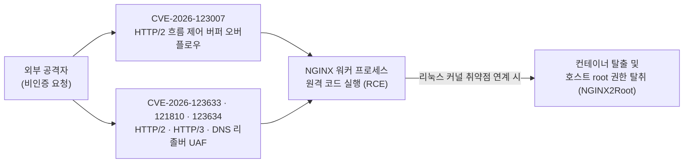

> <strong>이 글의 위치</strong>: 2026년 11월 18일(현지 시간) F5/NGINX가 보안 패치를 배포했고, 국내 보안 기업 티오리(Theori)의 AI 기반 취약점 탐지 플랫폼 '진트(Xint)'가 NGINX RCE 취약점 5종과 이를 호스트 `root`로 연결하는 리눅스 커널 LPE를 묶어 <strong>NGINX2Root</strong>로 공개했습니다. 한국인터넷진흥원(KISA) 보호나라도 11월 19일 긴급 보안 업데이트를 권고했습니다. 이 글은 <strong>RCE 5종과 같은 날 함께 패치된 TLS 1.3 DoS 1종, 영향 버전, 실전 점검 명령어, 패치 및 임시 완화책</strong>을 한 번에 정리합니다.

> <strong>3줄 요약</strong>
>
> 1. <strong>핵심 위협</strong>: 2015년 HTTP/2 도입 이후 약 11년간 잠복해 있던 `CVE-2026-123007`(CVSS 4.0 9.2)을 포함해 인증 없이 원격 코드 실행(Pre-auth RCE)이 가능한 결함 5종이 공개됐고, Rapid7이 공개한 PoC(개념증명)도 이미 나와 있습니다.
> 2. <strong>권고 패치 버전</strong>: NGINX 오픈소스 기준 <strong>안정판(Stable) `1.30.7` 이상</strong>, <strong>메인라인(Mainline) `1.31.9` 이상</strong>(NGINX Plus는 `37.0.8.1`, `37.3.0.1` 등 각 계열 패치 빌드)으로 즉시 업데이트 후 프로세스를 재시작해야 합니다.
> 3. <strong>임시 대응과 한계</strong>: 즉시 패치가 어렵다면 `http2`를 비활성화해 가장 치명적인 공격 경로를 줄일 수 있으나, HTTP/3·DNS 리졸버·TLS 1.3 DoS 취약점은 남으므로 조속한 버전 업그레이드가 필수입니다.

> <strong>공식 원문 바로가기</strong>: [NGINX Security Advisories](https://nginx.org/en/security_advisories.html) · [KISA 보호나라 보안 공지](https://www.boho.or.kr/kr/bbs/view.do?searchCnd=&bbsId=B0000133&searchWrd=&menuNo=205020&pageIndex=1&categoryCode=&nttId=72314) · [Xint NGINX2Root 분석](https://xint.io/blog/nginx2root-remote-code-execution)

---

## 🚨 1. 왜 'NGINX2Root'가 긴급 이슈인가?

이번 권고는 단순 서비스 지연(DoS) 수준을 넘어, <strong>외부 공격자가 로그인·인증 없이 웹 서버 워커 프로세스 권한으로 임의 코드를 실행(Pre-auth RCE)</strong> 할 수 있는 메모리 손상 취약점들이 묶여 공개되었다는 점에서 파급력이 큽니다.



- <strong>11년 만의 발견</strong>: 대표 취약점인 `CVE-2026-123007`은 2015년 NGINX `1.9.5`에 HTTP/2가 처음 도입된 시점부터 존재해 온 결함입니다.
- <strong>PoC 공개</strong>: Rapid7이 `CVE-2026-123007`에 대한 PoC(개념증명)를 공개했습니다. PoC는 `http2 on` 상태의 NGINX 1.31.8 Docker 이미지에서 비인증 RCE를 시연했으며, 공개 코드를 이용한 스캐닝·악용 시도가 늘어날 수 있습니다.
- <strong>root 권한 상승 연계</strong>: 연구진은 NGINX 워커 권한 탈취 이후 리눅스 커널 취약점(SCTP 관련 등)과 연계해 격리된 컨테이너 환경을 벗어나 호스트의 최상위(`root`) 권한까지 획득하는 시나리오(`NGINX2Root`)를 시연했습니다.

---

## 🧩 2. 공개된 핵심 CVE 6종 요약 (RCE 5 + DoS 1)

2026년 11월 18일 F5/NGINX는 NGINX 관련 보안 취약점 10건을 한꺼번에 패치했습니다. 그중 Xint가 <strong>NGINX2Root</strong>로 묶은 것은 <strong>RCE 5종</strong>이며, 여기에 같은 날 함께 패치된 <strong>TLS 1.3 DoS 1종</strong>을 더해 실무 영향이 큰 6종을 정리합니다. KISA 보호나라 공지(2026-11-19)는 RCE 5종만 다룹니다.

| CVE 번호 | 유형 및 영역 | CVSS (4.0 / 3.1) | 영향 버전 및 핵심 발생 조건 |
| :--- | :--- | :--- | :--- |
| <strong>`CVE-2026-123007`</strong> | <strong>HTTP/2 흐름 제어</strong><br/>정수 언더플로우 / 힙 버퍼 오버플로우 | `9.2` / `8.1` | <strong>`1.9.5 – 1.30.6`, `1.31.0 – 1.31.8`</strong>. `ngx_http_v2_module`에서 흐름 제어 윈도우 한도를 초과하는 조작 트래픽 처리 시 <strong>비인증 RCE</strong> 발생 (PoC 공개). |
| <strong>`CVE-2026-123633`</strong> | <strong>HTTP/2 연결 종료</strong><br/>Use-After-Free (UAF) | `9.2` / `8.1` | <strong>`1.19.7 – 1.30.6`, `1.31.0 – 1.31.8`</strong>. `worker_connections` 부족 등 연결 드레이닝 중 활성 HTTP/2 연결이 닫힐 때 업스트림 프록싱 과정에서 UAF 발생. |
| <strong>`CVE-2026-121810`</strong> | <strong>HTTP/3 (QUIC)</strong><br/>Use-After-Free (UAF) | `9.2` / `8.1` | <strong>`1.25.0 – 1.30.6`, `1.31.0 – 1.31.8`</strong>. 스트림 생성 및 업스트림 프록싱 도중 QUIC(HTTP/3) 연결이 드레이닝될 때 UAF 발생. |
| <strong>`CVE-2026-123634`</strong> | <strong>DNS 리졸버 · 미러링</strong><br/>Use-After-Free (UAF) | `9.2` / `8.1` | <strong>`0.6.18 – 1.30.6`, `1.31.0 – 1.31.8`</strong>. `resolver`와 변수를 조합한 `proxy_pass`, SSI 또는 `mirror` 서브요청 환경에서 DNS 대기열 처리 중 UAF 발생. |
| <strong>`CVE-2026-113425`</strong> | <strong>메일 프록시(Mail Proxy)</strong><br/>Use-After-Free (UAF) | `9.2` / `8.1` | <strong>`0.5.33 – 1.30.6`, `1.31.0 – 1.31.8`</strong>. 메일 프록시(`proxy on`, `auth_http`) 인증 조회 중 클라이언트가 연결을 급격히 끊을 때 UAF 발생. |
| <strong>`CVE-2026-118899`</strong> | <strong>TLS 1.3</strong><br/>무한 루프 (DoS) | `8.7` / `7.5` | <strong>`1.13.0 – 1.30.6`, `1.31.0 – 1.31.8`</strong>. `listen ... ssl` + TLS 1.3 환경에서 조작된 연결 요청 본문 파싱 시 워커 무한 루프 유발. |

> <strong>용어 정리</strong>: Xint는 NGINX RCE 5종과 리눅스 커널 SCTP LPE 1건을 함께 <strong>NGINX2Root</strong>로 설명합니다. 위 표의 6번째 `CVE-2026-118899`는 NGINX2Root에 포함되지 않는, 같은 날 함께 패치된 별도 DoS 취약점입니다.

---

## 📦 3. 영향 받는 버전과 안전한 패치 버전

사용 중인 NGINX 제품군에 따라 아래 기준 이상으로 업데이트해야 합니다.

| 제품군 | 영향 받는 버전 | 안전(패치 완료) 버전 |
| :--- | :--- | :--- |
| <strong>NGINX Open Source (Stable)</strong> | `1.30.6` 이하 (CVE별 하한 상이) | <strong>`1.30.7` 이상</strong> |
| <strong>NGINX Open Source (Mainline)</strong> | `1.31.0 – 1.31.8` | <strong>`1.31.9` 이상</strong> |
| <strong>NGINX Plus</strong> | `37.0.0 – 37.0.7.1`, `37.1.0 – 37.2.0.1` | <strong>`37.0.8.1` / `37.3.0.1`</strong> |
| <strong>NGINX Plus R34–R36</strong> | R34 – R36 | KISA 권고 표에 해결 버전이 `-`로 표시되어 있어, F5 지원 정책을 확인한 뒤 <strong>`37.0.8.1` / `37.3.0.1` 이상으로 이전 검토</strong> 필요 |

> <strong>⚠️ OS 배포판 패키지(Ubuntu · Debian · RHEL) 사용 시 주의점</strong>
> 리눅스 배포판 기본 저장소(`apt`, `dnf`, `yum`)에서 설치한 NGINX는 메이저·마이너 버전 숫자(예: `1.24.0`)를 유지한 채 <strong>보안 패치만 백포트(Backport)</strong> 해 배포하는 경우가 많습니다. 버전 숫자만 보지 말고 아래 명령어로 패키지 변경 이력에 CVE 패치가 반영되었는지 확인하세요. Docker 컨테이너 이미지, Kubernetes Ingress-NGINX, OpenResty 등 NGINX 코어를 내장한 솔루션도 벤더 공지를 함께 점검해야 합니다.
>
> ```bash
> # Ubuntu / Debian 백포트 패치 이력 확인
> apt changelog nginx | grep -E "CVE-2026-123007|CVE-2026-123633"
>
> # RHEL / Rocky / AlmaLinux 백포트 패치 이력 확인
> rpm -q --changelog nginx | grep -E "CVE-2026-123007|CVE-2026-123633"
> ```

---

## 🛠️ 4. 서버 점검 및 긴급 대응 절차

### 1단계: 현재 NGINX 버전 및 취약 설정 확인

서버 터미널에서 현재 실행 중인 버전과 HTTP/2·HTTP/3·리졸버 사용 여부를 먼저 파악합니다.

```bash
# 1. 현재 설치된 NGINX 버전 확인
nginx -v

# 2. HTTP/2, HTTP/3(QUIC), DNS resolver 설정 사용 여부 점검
grep -rnE "http2|http3|quic|resolver" /etc/nginx/
```

### 2단계: 최신 버전 업그레이드 및 프로세스 재시작 (가장 권장)

패키지 업그레이드만 하고 `systemctl reload`만 실행하면 설정만 다시 읽고 <strong>메모리에는 기존 취약 바이너리가 그대로 남습니다</strong>. 반드시 `restart`(또는 무중단 `USR2` 바이너리 교체)로 프로세스를 갱신하세요.

<strong>Ubuntu / Debian 계열</strong>
```bash
sudo apt update
sudo apt install --only-upgrade nginx
sudo nginx -t && sudo systemctl restart nginx
```

<strong>RHEL / Rocky Linux / AlmaLinux 계열</strong>
```bash
sudo dnf update nginx
sudo nginx -t && sudo systemctl restart nginx
```

<strong>구 바이너리 잔존 여부 확인</strong>
```bash
# 실행 중인 마스터/워커가 삭제된 구 바이너리(.deleted)를 물고 있지 않은지 확인
sudo lsof -p $(pgrep -o nginx) | grep -i deleted
```

<strong>컨테이너 / 소스 빌드 환경</strong>
- 공식 Docker 이미지를 사용하는 경우 `nginx:1.30.7`, `nginx:1.31.9` (또는 최신 패치가 반영된 `alpine` 태그)로 베이스 이미지를 교체해 재빌드·재배포합니다.

### 3단계: 즉시 패치가 어려울 때의 임시 완화책 (`http2` 비활성화)

운영 서비스 호환성 테스트 등으로 당장 업그레이드가 어렵다면, 가장 광범위하게 악용될 수 있는 <strong>HTTP/2 공격 표면(`CVE-2026-123007`, `CVE-2026-123633`)</strong> 부터 임시 차단할 수 있습니다.

- <strong>NGINX 1.25.1 이상</strong> (`http2 on;` 지시어를 쓰는 경우):
```nginx
server {
    listen 443 ssl;
    http2 off;
    ...
}
```
- <strong>NGINX 1.25.0 이하</strong> (`listen` 파라미터에 `http2`가 붙은 경우):
```nginx
# 변경 전
# listen 443 ssl http2;

# 변경 후 (http2 제거)
listen 443 ssl;
```

설정 수정 후에는 반드시 문법 검사와 리로드를 실행합니다.
```bash
sudo nginx -t && sudo systemctl reload nginx
```

> <strong>❗ 임시 조치의 한계</strong>
> HTTP/2를 끄더라도 <strong>HTTP/3(QUIC)을 사용 중이면 `CVE-2026-121810`</strong>, <strong>DNS 리졸버 + 동적 `proxy_pass`/미러링 설정이 있으면 `CVE-2026-123634`</strong>, <strong>TLS 1.3 환경이면 `CVE-2026-118899`</strong> 위협이 그대로 남습니다. `http2` 비활성화는 패치 일정을 벌기 위한 <strong>단기 방어선</strong>으로만 활용하고, 가능한 한 빠르게 `1.30.7` / `1.31.9` 또는 배포판 보안 패치를 적용하시기 바랍니다.

---

## ✅ 5. 운영자 체크리스트

1. <strong>공개 웹/프록시 서버 전수 조사</strong>: 외부에 노출된 리버스 프록시, 로드밸런서, Ingress Controller의 NGINX 버전 확인
2. <strong>패치 우선순위 적용</strong>: `http2`가 켜진 공인 IP 노출 서버를 최우선으로 `1.30.7` / `1.31.9` 이상(또는 OS 백포트 패치) 업데이트 후 `systemctl restart` 실행
3. <strong>설정 무결성 점검</strong>: 업그레이드 후 `nginx -t`, `lsof` 삭제 바이너리 확인 및 주요 업스트림 응답·HTTP/2 협상 정상 작동 확인
4. <strong>이상 징후 모니터링</strong>: 워커 프로세스 비정상 종료(`worker process exited on signal 11` 등)나 갑작스러운 CPU 100% 점유(TLS 1.3 무한 루프) 로그가 최근 발생했는지 `/var/log/nginx/error.log` 점검

---

## ❓ 6. 자주 묻는 질문(FAQ)

### NGINX2Root 취약점은 정확히 무엇을 뜻하나요?
2026년 11월 18일 공개된 NGINX의 원격 코드 실행(RCE) 취약점 5종(`CVE-2026-123007` 등)과 별도의 리눅스 커널 권한 상승(LPE) 취약점을 연계해, 비인증 외부 요청만으로 컨테이너를 탈출하고 호스트의 `root` 권한까지 탈취할 수 있는 공격 체인을 연구팀(Xint)이 명명한 이름입니다.

### OS 패키지 버전이 `1.24.0`처럼 낮게 나오는데도 안전한 경우가 있나요?
네. Ubuntu, Debian, RHEL 등 배포판 공식 저장소는 upstream 버전 숫자를 올리지 않고 보안 패치만 백포트(Backport)합니다. `apt changelog nginx`나 `rpm -q --changelog nginx`에 `CVE-2026-123007` 등 이번 CVE 수정 기록이 들어 있다면 패치된 상태입니다. 반대로 공식 저장소가 아닌 서드파티·소스 빌드·컨테이너 이미지라면 `1.30.7` 또는 `1.31.9` 이상으로 직접 올려야 합니다.

### `http2 off`만 설정해 두면 당분간 괜찮을까요?
가장 위험도가 높고 PoC가 공개된 `CVE-2026-123007`과 같은 HTTP/2 계열인 `CVE-2026-123633`의 공격 표면은 줄일 수 있습니다. 하지만 HTTP/3(`CVE-2026-121810`), DNS 리졸버(`CVE-2026-123634`), TLS 1.3 DoS(`CVE-2026-118899`)는 별개 경로로 남아 있으므로 임시 방어선으로만 쓰고 빠르게 정식 패치를 적용해야 합니다.

### 패치 후 `systemctl reload`와 `restart` 중 무엇을 써야 하나요?
패키지 업그레이드 직후에는 반드시 `systemctl restart nginx`(또는 무중단 `USR2` 바이너리 업그레이드)를 사용해야 메모리에 상주하던 기존 취약 바이너리가 교체됩니다. `reload`는 설정 파일(`http2 off` 등)만 바꿀 때 사용하세요.

---

> <strong>기준일</strong>: 2026년 11월 20일. F5/NGINX 공식 보안 권고(2026-11-18), KISA 보호나라 보안 업데이트 권고(2026-11-19), Xint(Theori) NGINX2Root 기술 공개 및 NVD/CVE 세부 정보를 바탕으로 작성했습니다.
>
> <strong>참고 자료</strong>
>
> - [NGINX — Security Advisories](https://nginx.org/en/security_advisories.html)
> - [NGINX — CHANGES 1.31.9 (2026-11-18)](https://nginx.org/en/CHANGES)
> - [KISA 보호나라 — NGINX 제품 보안 업데이트 권고 (2026-11-19)](https://www.boho.or.kr/kr/bbs/view.do?searchCnd=&bbsId=B0000133&searchWrd=&menuNo=205020&pageIndex=1&categoryCode=&nttId=72314)
> - [Xint (Theori) — NGINX2Root: New RCE Vulnerabilities in nginx](https://xint.io/blog/nginx2root-remote-code-execution)
> - [Rapid7 — CVE-2026-123007 분석 및 PoC](https://www.rapid7.com/blog/post/ve-cve-2026-123007-critical-nginx-http-2-integer-underflow-leads-to-rce-fixed/)
> - [NVD — CVE-2026-123007](https://nvd.nist.gov/vuln/detail/CVE-2026-123007)
> - [관련 글: 자바 취약점 Java4Shell, 영향 확인과 해결 방법](/posts/20261118-1-java4shell-cve-2026-114938-security-advisory-guide/)
> - [관련 글: 미국 사이버 공격 공포의 진실: 11월 연쇄 장애와 실제 보안 이슈 4가지](/posts/20261119-1-us-cybersecurity-anxiety-outages-breaches-2026/)
